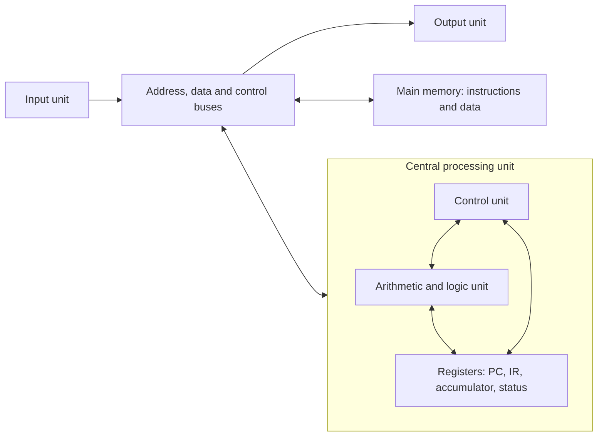
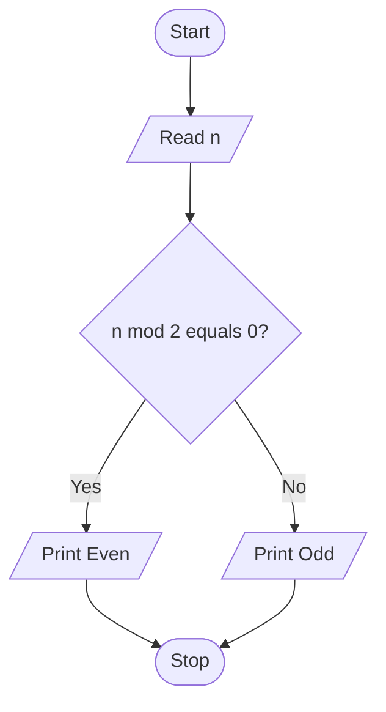

## Navigation

- [[#Exam blueprint and study order]]
- [[#Module 1 - Computer fundamentals and C foundations]]
- [[#Module 2 - Decisions branches and loops]]
- [[#Module 3 - Arrays searching sorting and strings]]
- [[#Module 4 - Functions recursion and pointers]]
- [[#Module 5 - Structures nested structures and unions]]
- [[#Supplement - Recursion practice beyond the core syllabus]]
- [[#Last revision - Questions traps and checklist]]
- [[#Complete lab index]]
- [[#Source map and corrections]]

## Exam blueprint and study order

| Module | Official contents, condensed | Stated marks |
|---|---|---:|
| 1 | Von Neumann, languages, number systems, integer/floating representation, C structure, preprocessing/macros, types/constants/variables/enums/storage classes, operators/conversions/precedence, format specifiers | 12–14 |
| 2 | `if`, `if-else`, nesting, ladders, `switch`, `break`, `continue`, `goto`, `while`, `do-while`, `for` | 16–20 |
| 3 | 1D/2D arrays, character strings, linear search, bubble sort | 6–10 |
| 4 | Functions, value/reference terminology, recursion, pointers, pointers and arrays | 24–28 |
| 5 | Structures, nesting, structure arrays, unions | 10–12 |

The ranges are copied from the blueprint. Their minima total 68 and maxima total 84; they are **ranges, not a fixed allocation to add to 80**. The supplied blueprint does not give section-wise question counts or guaranteed questions.

**Suggested learning order:** Module 1 essentials → Module 2 → Module 3 → Module 4 → Module 5. For revision after learning the basics, spend the most time on Module 4, then Module 2. Revise Modules 3 and 4 together because arrays, strings, functions and pointers overlap.

### Program conventions

- Complete programs have headers and `int main(void)`. Blocks explicitly called **core snippets** go inside a suitable `main`, with the listed variables/input already supplied. Blocks called **functions** are placed outside `main` and called as shown.
- Examples use C11-compatible syntax, fixed array capacities and ordinary exam-sized inputs. Where arithmetic may overflow, the intended domain is stated. `long long` does not make arbitrarily large answers safe.
- Read `scanf`'s return value in complete programs. A failed conversion must not leave an uninitialized variable in use.
- For math functions, include `<math.h>`; some GCC environments require linking with `-lm`.
- String examples use bounded input. `scanf(" %99[^\n]", s)` reads a nonempty line with spaces into `char s[100]`; its leading space skips blank lines/leading whitespace. Use `fgets` when those must be preserved.

---

## Module 1 - Computer fundamentals and C foundations

**Sources:** Lectures 1, 2, 3, 3.1, 3.2, 3 Questions, the three Lecture 4 decks, Lectures 7–10, storage-class slides, and both lecture notes.

### 1.1 Computer units and Von Neumann architecture

A **computer** accepts data, executes arithmetic/logical operations according to a program, stores information and produces results. **Hardware** is the physical equipment; **software** consists of programs and associated data. A **program** is a sequence of instructions for a task.

The **stored-program concept** stores instructions and data in memory. In the basic **Von Neumann model**, instructions and data share the same memory and communication path.



| Component | Exam explanation |
|---|---|
| Input unit | Accepts information, e.g. keyboard, mouse or scanner |
| Output unit | Presents results, e.g. monitor or printer |
| ALU | Arithmetic, comparisons, logical and bit operations |
| Control unit | Fetches/decodes instructions and coordinates execution and data movement |
| Registers | Very small, fast CPU storage for immediate work |
| Main memory | Stores active instructions and data at addressable locations |
| Data bus | Carries data/instruction values |
| Address bus | Identifies the memory or device location being accessed |
| Control bus | Carries control/status signals such as read and write |

**Registers to remember:** PC contains the address of the next instruction; IR holds the current instruction; accumulator holds intermediate results; status register contains flags such as zero/carry/overflow. MAR holds a memory address and MDR/MBR holds transferred data in a simple CPU model.

**Fetch–decode–execute cycle:**

1. **Fetch:** use PC to fetch an instruction into IR; update PC appropriately.
2. **Decode:** CU identifies the operation and operands.
3. **Execute:** CPU performs the operation, possibly fetching operands.
4. **Store/write back:** save the result if required. A branch may change PC.

**Advantages:** simple unified-memory design, flexible reprogramming, general-purpose use. **Limitation:** instruction fetches and data transfers compete for the shared path, the **Von Neumann bottleneck**. Do not equate Von Neumann architecture with ISA: an **instruction set architecture** specifies the instructions and programmer-visible machine interface.

#### Memory and organization recap

| Storage | Main role | Volatile? | Relative character |
|---|---|---|---|
| Registers | Current operands/results | Usually yes | Fastest, tiny |
| Cache | Copies of frequently/recently used memory | Usually yes | Fast, small |
| RAM | Active programs and data | Usually yes | Larger than cache |
| ROM/firmware storage | Persistent startup/control code | No | Some forms can be reprogrammed |
| HDD | Persistent storage using magnetic media | No | Mechanical access |
| SSD | Persistent storage, commonly NAND flash | No | No moving parts |

A bit is 0 or 1. On ordinary current systems a byte has 8 bits; C defines `sizeof(char) == 1` and `<limits.h>` gives `CHAR_BIT`. A machine word is architecture dependent, commonly 16/32/64 bits. Binary capacities: 1 KiB = 1024 bytes, 1 MiB = 1024 KiB; decimal 1 kB = 1000 bytes. Do not memorize the slides' device capacities, register counts or timing numbers as universal constants. Clock frequency counts cycles per second; instructions per second also depend on design and workload. A multicore CPU has multiple execution cores.

**Supplementary:** Harvard architecture separates instruction/data memory paths. Your class notes mark it outside the exam scope. System software includes operating systems and translators; application software solves user tasks. The OS manages processes, memory, files and devices.

**Lab connection:** these are theory topics. Labs 1–8 below demonstrate the input–process–output model; no architecture-specific C lab is in the supplied lab file.

### 1.2 Languages paradigms and translators

| Feature | Machine language | Assembly language | High-level language |
|---|---|---|---|
| Form | Encoded binary instructions | Mnemonics such as `MOV`, `ADD` | Statements such as `sum = a + b;` |
| Translator | CPU executes its instruction encoding | Assembler | Compiler/interpreter or a combination |
| Hardware dependence | High | High | Usually more portable with suitable implementation |
| Writing/debugging | Hard | Requires hardware knowledge | Easier abstraction and maintenance |
| Main advantage | Direct machine instructions | Detailed hardware control | Productivity and readability |

Assembly example: `MOV AX, 5`, `MOV BX, 3`, `ADD AX, BX` leaves AX as 8 in this illustrative register model. Assembly is useful for low-level control but is machine dependent and difficult to maintain. Compiled high-level code can also be very efficient; language level alone does not determine speed or memory use.

**Programming paradigms:** procedural/imperative programs describe steps and functions (C); object-oriented programs organize behavior around objects (e.g. C++/Java); functional programs emphasize function evaluation (e.g. Lisp/Haskell); logic programs use facts and rules (e.g. Prolog). Paradigm and translation method are different classifications.

| Translator | Input and work | Result/typical behavior |
|---|---|---|
| Compiler | Translates source ahead of execution | Object code, assembly or intermediate representation; e.g. GCC |
| Assembler | Translates assembly mnemonics | Relocatable machine-code object file; e.g. GNU `as`, NASM |
| Interpreter | Executes a source/intermediate representation | Often supports interactive execution; e.g. a Python interpreter |

“Interpreter executes line by line” is a classroom simplification: interpreters can use bytecode and JIT compilation. Both compilers and interpreters can report syntax errors before the program reaches a line.

### 1.3 Algorithms flowcharts and problem solving

An **algorithm** is a finite, unambiguous procedure for a problem. Characteristics: zero or more inputs, one or more outputs, definiteness, finiteness, and effective executable steps. A flowchart depicts the sequence visually.

| Symbol | Meaning |
|---|---|
| Oval/rounded terminal | Start or stop |
| Parallelogram | Input/output |
| Rectangle | Processing/assignment |
| Diamond | Decision with labelled branches |
| Arrow | Direction of control |
| Connector | Continuation elsewhere |

Additional slide symbols: a small circle is an on-page connector; a rectangle with double vertical edges is a predefined process/subroutine; a hexagon can represent preparation/loop control; a cylinder represents stored database data. Keep the drawing's convention clear.

Flowcharts help communication, logical checking, workflow design and documentation. For a simple exam flowchart, use one start and one stop, flow mainly downwards or left-to-right, label decision exits, and use connectors to avoid crossing arrows. Connector labels must match wherever the continuation appears. A counting-table chart initializes a counter, tests its bound, displays a product, increments and returns to the test. A login chart inputs credentials, checks them, then branches to success or an error/retry path.

**Algorithm: maximum of three:** read `a,b,c`; set `max=a`; if `b>max`, set `max=b`; if `c>max`, set `max=c`; print `max`; stop. **Sum of two:** read, add, print. **Factorial:** initialize product to 1; multiply by 2 through `n`; print. These cover the algorithm exercises in Lecture 3.2.



**Lab connection:** Lab 9 (p.18), even/odd. Translate the same decision into a diamond in a flowchart and `if-else` in C.

### 1.4 Number systems - every conversion

| System | Base | Allowed digits | Example |
|---|---:|---|---|
| Binary | 2 | 0,1 | $(11001)_2$ |
| Octal | 8 | 0–7 | $(175)_8$ |
| Decimal | 10 | 0–9 | $(125)_{10}$ |
| Hexadecimal | 16 | 0–9,A–F | $(FA)_{16}$ |

For base $b$, a positional number has value $\sum d_i b^i$. Positions left of the radix point use powers 0,1,2,… from right to left; fractional positions use −1,−2,… . A digit must be less than the base: `128` is not a valid octal representation.

#### Decimal to binary octal and hexadecimal

Repeatedly divide the integer by the target base. Record remainders and read **bottom to top**.

| Conversion | Successive quotient/remainder pairs | Answer |
|---|---|---|
| 25 to binary | 12 r1, 6 r0, 3 r0, 1 r1, 0 r1 | $11001_2$ |
| 125 to octal | 15 r5, 1 r7, 0 r1 | $175_8$ |
| 250 to hex | 15 r10(A), 0 r15(F) | $FA_{16}$ |

For fractions, repeatedly multiply the fractional part by the target base and take integer parts **in order**. Example: $0.625×2=1.25$, $0.25×2=0.5$, $0.5×2=1.0$, so $0.625_{10}=0.101_2$. Thus $10.625_{10}=1010.101_2$. Some fractions repeat indefinitely in another base.

#### Binary octal and hex to decimal

- $101101_2=32+8+4+1=45_{10}$.
- $345_8=3×64+4×8+5=229_{10}$.
- $2A_{16}=2×16+10=42_{10}$.
- $101.01_2=4+1+1/4=5.25_{10}$.

#### Grouping conversions

| From → to | Method | Worked example |
|---|---|---|
| Binary → octal | Groups of 3 bits | $1101011_2=001\ 101\ 011=153_8$ |
| Binary → hex | Groups of 4 bits | $11111010_2=1111\ 1010=FA_{16}$ |
| Octal → binary | Each digit becomes exactly 3 bits | $345_8=011\ 100\ 101_2$ |
| Hex → binary | Each digit becomes exactly 4 bits | $2A_{16}=0010\ 1010_2$ |
| Octal → hex | Via binary, regroup into 4 | $345_8=0000\ 1110\ 0101_2=E5_{16}$ |
| Hex → octal | Via binary, regroup into 3 | $2A_{16}=000\ 101\ 010_2=52_8$ |

Group away from the radix point: leftwards for the integer part and rightwards for the fractional part. Add leading/trailing zero padding only at the outer ends. Example $1010.11_2=001\ 010.110_2=12.6_8=A.C_{16}$.

Useful digit values: 0=0000, 1=0001, 2=0010, 3=0011, 4=0100, 5=0101, 6=0110, 7=0111, 8=1000, 9=1001, A=1010, B=1011, C=1100, D=1101, E=1110, F=1111.

**Practice answers:** $125_{10}=1111101_2=175_8=7D_{16}$; $FA8_{16}=4008_{10}=7640_8$; $175_8=7D_{16}$. The decimal slide's “no direct conversion” means binary regrouping is convenient; decimal arithmetic is another valid route.

**The exact practice values on the last conversion slide:**

| Given value | Binary | Octal | Decimal | Hex |
|---|---|---|---:|---|
| $125_{10}$ | 1111101 | 175 | 125 | 7D |
| $250_{10}$ | 11111010 | 372 | 250 | FA |
| $10110110_2$ | 10110110 | 266 | 182 | B6 |
| $11101101_2$ | 11101101 | 355 | 237 | ED |
| $345_8$ | 11100101 | 345 | 229 | E5 |
| $726_8$ | 111010110 | 726 | 470 | 1D6 |
| $7D_{16}$ | 1111101 | 175 | 125 | 7D |
| $3AF_{16}$ | 1110101111 | 1657 | 943 | 3AF |

**Lab connection:** Lab 28 (p.72), binary → decimal, and the added decimal → binary variant appear under [[#2.5 Lab programs - Number loops and series]].

### 1.5 Integer and floating-point representation

For an unsigned $n$-bit integer, range is $0$ to $2^n-1$. For two's-complement signed integers, range is $-2^{n-1}$ to $2^{n-1}-1$.

| Width | Unsigned range | Two's-complement signed range |
|---:|---:|---:|
| 8 | 0…255 | −128…127 |
| 16 | 0…65,535 | −32,768…32,767 |
| 32 | 0…4,294,967,295 | −2,147,483,648…2,147,483,647 |

**Signed representations:** sign-magnitude uses a sign and magnitude, with two zeros; one's complement inverts every bit for a negative value and also has two zeros; two's complement inverts and adds 1, giving a single zero and one additional negative value. In two's complement, the top bit has weight $-2^{n-1}$; the remaining bits are not simply the absolute magnitude of a negative number.

Example, 8-bit −5: `00000101` → invert `11111010` → add 1 `11111011`. Decode as $-128+64+32+16+8+2+1=-5$.

> [!warning] Overflow and character signedness
> Signed integer overflow is undefined behavior; do not promise it “wraps negative.” Unsigned arithmetic wraps modulo $2^n$. Plain `char` may be signed or unsigned. Storing 130 in a signed 8-bit character is not a portable way to obtain −126. `int` is not universally 16 bits: use `sizeof` and `<limits.h>`.

#### Floating point and IEEE 754

Floating point stores a sign, exponent and fraction/significand. A typical IEEE 754 normal binary32 value is

$$(-1)^s\times(1.f)_2\times2^{E-127}.$$

| Format | Sign | Exponent | Stored fraction | Bias | Approx. decimal precision |
|---|---:|---:|---:|---:|---:|
| binary32, typical `float` | 1 | 8 | 23 | 127 | 6–7 significant digits |
| binary64, typical `double` | 1 | 11 | 52 | 1023 | 15–16 significant digits |

**Lecture example: 19.125** = $10011.001_2=1.0011001_2×2^4$. Sign=0; exponent=4+127=131=`10000011`; fraction=`00110010000000000000000`. Combined: `0 10000011 00110010000000000000000`.

For normal values the leading 1 is implicit. Exponent fields of all zeros/all ones handle zeros/subnormals and infinities/NaNs in IEEE 754. C does not require every implementation to use these exact formats. Decimal fractions such as 0.1 often have no finite binary representation, so rounding occurs. Equality comparison is valid syntax, but computed approximations may require a chosen tolerance, e.g. `fabs(x-y) < 1e-9` for an appropriate problem scale. `%f` output rounds to the requested precision too.

### 1.6 C program structure compilation and preprocessing

```c
#include <stdio.h>
#define MESSAGE "Hello, World!"

int main(void)
{
    printf("%s\n", MESSAGE);
    return 0;
}
```

`#include` includes header contents; `stdio.h` provides standard I/O declarations. Braces form the function body. An expression statement usually ends in `;`. `return 0` reports success to the host environment. Standard hosted C uses an `int`-returning `main`; `void main()` is not the portable form. `main` is an identifier, not a keyword.

**Translation sequence:** `.c` source → **preprocessor** (header inclusion, macro expansion, conditional compilation) → **compiler** (analysis/translation, commonly to assembly) → **assembler** (object code) → **linker** (combines objects/libraries and resolves external references) → executable. The **loader** places the executable in memory for execution. Preprocessing does not “upload library functions into RAM.”

**Errors:** syntax error violates grammar; type/constraint error uses invalid types; linker error can be an undefined function reference; runtime error arises during execution; logical error gives a wrong result despite successful translation.

| Header | Examples |
|---|---|
| `<stdio.h>` | `printf`, `scanf`, `getchar`, `putchar`, `fgets`, `puts` |
| `<math.h>` | `sqrt`, `pow`, `sin`, `fabs` |
| `<string.h>` | `strlen`, `strcpy`, `strcat`, `strcmp`, `strstr` |
| `<ctype.h>` | `isalpha`, `isdigit`, `isspace`, `toupper` |
| `<stdlib.h>` | `malloc`, `free`, `abs`, `exit` |
| `<limits.h>`, `<float.h>` | Integer/floating implementation limits |

Headers normally supply declarations, macros and types, while separately linked libraries supply many function implementations. `double sqrt(double);` is a declaration; `sqrt(100.0)` is a call. `#include "myheader.h"` uses an implementation-defined quoted-file search, commonly beginning locally; `<...>` uses the implementation's system-header search. Prefer `.h` for a user header; including a `.c` implementation is not the usual separate-compilation pattern. `include` is a directive name, not a C language keyword. `<conio.h>`, `clrscr` and `getch` are nonstandard historical extensions.

#### Macros - object-like and function-like

```c
#define PI 3.14159
#define SQUARE(x) ((x) * (x))
#define MUL(a, b) ((a) * (b))
#define MAX(a, b) ((a) > (b) ? (a) : (b))
```

Macro expansion is **text substitution before compilation**. The expanded expression normally runs when execution reaches it. Parenthesize parameters and the whole expression. `#define BAD(x) x*x` makes `BAD(2+3)` become `2+3*2+3`, yielding 11. `SQUARE(2+3)` yields 25, `MUL(3+2,4)` gives 20, `MAX(8,5)` gives 8. No semicolon belongs at the end of an expression macro definition.

Macros have no ordinary function-call overhead but can increase code size, lack parameter type checking and evaluate an argument more than once. **Never use `SQUARE(i++)`**: the expansion modifies `i` twice without sequencing. Functions are safer for arguments with side effects; modern compilers may inline them.

`#undef NAME` removes a macro; `#if`, `#ifdef`, `#else`, `#endif` support conditional compilation. Comments (`//` and `/*...*/`) are not executed. `#` also has a stringification role inside function-like macro definitions, beyond the directive marker use required here.

**Lab connection:** Lab 6 (p.12), circle area using a symbolic constant; see the next lab group.

### 1.7 Tokens identifiers constants variables and data types

Tokens are the smallest lexical units: **keywords, identifiers, constants, string literals and punctuators** (including operators/separators). The slides also group preprocessing directives as a teaching category. In `int sum = a + 10;`, tokens are `int`, `sum`, `=`, `a`, `+`, `10`, `;`.

**Identifier rules:** use letters/digits/underscore, begin with a letter or underscore, avoid keywords, spaces and punctuation. Names are case sensitive. Valid: `sum`, `totalMarks`, `count_123`. Invalid: `1sum`, `total-marks`, `@value`, `sum value`, `float`, `a+b`. Avoid leading-underscore names in your own code because some are reserved to implementations. Older teaching material lists **32 C90 keywords**; newer C versions add more.

```text
auto break case char const continue default do
double else enum extern float for goto if
int long register return short signed sizeof static
struct switch typedef union unsigned void volatile while
```

A variable is a named object with a type and storage. A **declaration** describes a name/type; a **definition** creates an object or supplies a function body; initialization gives an initial value. `int age = 20;` declares, defines and initializes. `extern int count;` can declare an object defined elsewhere. `age = 21;` assigns later.

| Type | Typical size, not universal | Example |
|---|---:|---|
| `char` | 1 C byte | `char grade = 'A';` |
| `short` | 2 bytes | `short s = 12;` |
| `int` | 4 bytes | `int n = 12;` |
| `long` | 4 or 8 bytes | `long x = 12L;` |
| `long long` | 8 bytes | `long long x = 12LL;` |
| `float` | 4 bytes | `float f = 12.5f;` |
| `double` | 8 bytes | `double d = 12.5;` |
| `long double` | Implementation dependent | `long double d = 12.5L;` |
| `void` | No object value/type size | `void display(void);` |

Modifiers: `signed`, `unsigned`, `short`, `long`. Arrays, pointers and function types are derived types; structures, unions and enums provide additional type organization. `typedef unsigned long ulong;` creates an alias, not a distinct numeric type. `sizeof(type)` or `sizeof object` returns a `size_t` byte count; print it with `%zu`.

#### Constants and literals

- Integer: decimal `123`, octal `0123` (=83 decimal), hexadecimal `0x123` (=291 decimal). `017 + 2` = 15+2 = **17 decimal**. `08` is invalid octal syntax.
- Integer suffixes: `12U`, `12L`, `12LL`, `12UL`, `12ULL` request unsigned/long variants, subject to literal typing rules.
- `0b1010` appears in the slides; it is a compiler extension in older C and standardized in C23. Use ordinary conversion algorithms for C11 portability.
- Floating: `3.14`, `-0.001`, `6.022e23`; an unsuffixed floating literal is `double`, `f/F` means `float`, `L` means `long double`.
- Character: `'A'`, `'5'`, `'\n'`. An ordinary character constant has type `int` in C. In ASCII, `'A'=65`, `'a'=97`, `'0'=48`; a character code is different from a digit's numeric value.
- String: `"Hello"`; contains an ending zero byte `\0`. `"5"` stores `'5'` and `\0`; integer `5`, character `'5'` and string `"5"` are different.
- Escapes: `\n` newline, `\t` tab, `\r` carriage return, `\b` backspace, `\a` alert, `\\` backslash, `\'` quote, `\"` double quote, `\0` null.

```c
const double gravity = 9.8;
enum Day { SUN, MON, TUE, WED, THU, FRI, SAT };
enum Number { A = 5, B, C = 10, D, E };
/* WED=3; A=5, B=6, C=10, D=11, E=12 */
```

`const` prevents modification through that object expression and supplies a type. A macro supplies replacement tokens. An enum gives named integer constants; omitted values start at zero or one more than the previous enumerator. A `const int` object is not generally an integer constant expression in C11, so it cannot always replace an enum/macro in `case` labels.

### 1.8 Scope lifetime linkage and storage classes

**Scope** is where a name is visible. **Lifetime/storage duration** is how long its object exists. **Linkage** determines whether declarations refer to the same entity across scopes/files. Block, file, function-label and function-prototype scopes appear in the slides. A local name can hide an outer name; C has no C++ `::` scope-resolution operator.

| Class/context | Scope | Duration | Default initialization | Key use |
|---|---|---|---|---|
| Ordinary local / `auto` | Block | Automatic | Indeterminate | Local temporary |
| `register` local | Block | Automatic | Indeterminate | Optimization hint; address cannot be taken in C11 |
| `static` local | Block | Entire execution | Zero | Retains value across calls |
| `static` at file scope | File | Entire execution | Zero | Internal linkage, private to translation unit |
| File-scope object, normally external linkage | File from declaration onward | Entire execution | Zero | Shared object if declared appropriately |
| `extern int x;` | Its declaration scope | Refers to existing object's duration | Declaration itself does not initialize | Refer to an externally defined object |

`register` does not guarantee register allocation or speed. “Garbage” in class notes means **indeterminate**: do not read an uninitialized automatic variable. A global variable is not automatically visible everywhere; declaration visibility and linkage still matter. An `extern` definition with an initializer is possible; the ordinary declaration-only example has none.

#### Important example - static vs automatic

```c
#include <stdio.h>
void counter(void)
{
    int a = 0;
    static int b = 0;
    printf("%d %d\n", ++a, ++b);
}
int main(void)
{
    counter(); counter(); counter();
    return 0;
}
```

Output: `1 1`, then `1 2`, then `1 3`. The automatic `a` is initialized again at each call; `b` is initialized once and remains alive. The text-only slide accidentally omits `static` from `b` in one example; its image shows the intended declaration.

**Lab connection:** no dedicated storage-class lab appears among the 72. This tracing example is added because the blueprint and class notes explicitly emphasize the topic.

### 1.9 Operators expressions conversion and precedence

| Family | Operators | Meaning |
|---|---|---|
| Arithmetic | `+ - * / %` | Addition through integer remainder |
| Unary | `+ - ++ -- ! ~ & * sizeof` | Sign, change, logical/bitwise inversion, address/dereference, size |
| Relational/equality | `< <= > >= == !=` | Result is integer 0 or 1 |
| Logical | `&&` `\|\|` `!` | Truth tests; nonzero means true |
| Bitwise | `&` `\|` `^` `~` `<<` `>>` | Operate on integer bits |
| Assignment | `= += -= *= /= %= &= ^= \|= <<= >>=` | Store/update |
| Conditional | `condition ? x : y` | Evaluate only the selected branch |
| Comma | `,` | Evaluate left, then right; result is right operand |
| Access | `[]`, `.`, `->` | Array/structure access |

**Integer arithmetic:** `5/2` is 2; `5.0/2` is 2.5; `-5/2` is −2 (truncate toward zero); `-5%2` is −1. `%` requires integer operands. Division/remainder by zero is invalid. In `a += expression`, `a` is evaluated only once; it is broadly equivalent to `a=a+expression` for simple variables.

**Prefix/postfix:** `x=5; y=++x;` gives x=6,y=6. `x=5; y=x++;` gives x=6,y=5. The operand must be modifiable: `++5` and `++(x+1)` are invalid. `i++ + i++` and `printf("%d %d", i++, i++)` do not have a reliable portable answer. Associativity is a parsing rule; it does not establish general operand evaluation order.

**Logical truth table:**

| A | B | A && B | A or B | !A |
|---:|---:|---:|---:|---:|
| 0 | 0 | 0 | 0 | 1 |
| 0 | 1 | 0 | 1 | 1 |
| 1 | 0 | 0 | 1 | 0 |
| 1 | 1 | 1 | 1 | 0 |

`&&` skips its right operand when the left is false; `||` skips it when the left is true. Use `(b != 0 && a % b == 0)` to guard remainder by zero. Bitwise `&`/`|` do not short-circuit. `5 && 2` =1; `5 & 2` =0.

#### Bitwise worked example

For 12=`00001100` and 25=`00011001`: AND=8, OR=29, XOR=21. XOR is 1 where bits differ. For unsigned values, shifts move bits; `12U<<1`=24 and `12U>>1`=6. Use valid shift counts smaller than the type width. Avoid shifting negative signed values.

The 8-bit complement of `00100011` is `11011100` (=220 unsigned). The C expression `~35` has the promoted integer type and, on typical two's-complement machines, gives −36; it is not automatically an 8-bit result. For an explicit low-byte view, `(~35U) & 255U` =220.

**Useful masks:** test bit k with `(x & (1U<<k)) != 0`; set with `x |= 1U<<k`; clear with `x &= ~(1U<<k)`; toggle with `x ^= 1U<<k`. Take k within the unsigned type's bit range.

#### Precedence - high to low

| Level | Operators | Associativity |
|---:|---|---|
| 1 | postfix `() [] . -> x++ x--` | Left to right |
| 2 | unary `++ -- + - ! ~ * & sizeof`, cast `(type)` | Right to left |
| 3 | `* / %` | Left to right |
| 4 | `+ -` | Left to right |
| 5 | `<< >>` | Left to right |
| 6 | `< <= > >=` | Left to right |
| 7 | `== !=` | Left to right |
| 8 | bitwise `&` | Left to right |
| 9 | bitwise `^` | Left to right |
| 10 | bitwise `\|` | Left to right |
| 11 | logical `&&` | Left to right |
| 12 | logical `\|\|` | Left to right |
| 13 | `?:` | Right to left |
| 14 | assignments | Right to left |
| 15 | comma | Left to right |

Examples: `2+3*4=14`; `(2+3)*4=20`; `20/5*2=8`; `a=b=c=10` groups `a=(b=(c=10))`. In the operator slide, `a=100,b=2,c=25,d=4`: `a*b+c*d=300`; then `result=a=(b+c*d)` assigns 102 to both result and a.

#### Type conversion and casting

**Implicit conversion** occurs automatically, e.g. `double d=5;`. Small integer types undergo integer promotions in many expressions; mixed arithmetic then applies usual arithmetic conversions. **Explicit cast** requests a conversion: `(double)a/b`.

`double x=5/2;` gives 2.0 because integer division happens first. `(double)(5/2)` is also 2.0; `(double)5/2` gives 2.5. Converting a representable floating value to integer discards the fractional part toward zero: `(int)3.9`=3, `(int)-3.9`=−3. Out-of-range conversion is not a safe wraparound method. Watch mixed signed/unsigned comparisons: negative signed values can convert to very large unsigned values.

**Lab connection:** Labs 1–8 practice arithmetic, division, remainders, floating arithmetic and swapping.

### 1.10 Formatted and unformatted input output

Standard streams are `stdin`, `stdout`, `stderr`; they may be redirected. `printf` writes formatted output and `scanf` converts input into objects via pointers. `getchar`/`putchar` process a character, `fgets` reads a bounded line, and `puts` prints a string followed by newline. `getchar` returns `int` to distinguish all character values from `EOF`.

| Value | `printf` | `scanf` destination |
|---|---|---|
| `int` | `%d` / `%i` | `%d` with `int *`; `%i` recognizes input base |
| `unsigned int` | `%u`, `%o`, `%x` / `%X` | Matching unsigned pointer |
| `short`, `long`, `long long` | `%hd`, `%ld`, `%lld` | Matching pointer types |
| `float` | `%f` (promoted to `double`) | `%f` with `float *` |
| `double` | `%f`, `%e`, `%g` | `%lf` with `double *` |
| `long double` | `%Lf` | `%Lf` with `long double *` |
| Character | `%c` | `%c` with `char *` |
| String | `%s` | Bounded `%99s` for `char s[100]` |
| Object pointer | `%p` with `(void *)p` | Not needed for ordinary exam input |
| `size_t` | `%zu` | `%zu` with `size_t *` |

**Formatting:** `%6d` gives a minimum width, right aligned; `%-6d` left aligns; `%06d` zero pads; `%.4d` prints at least four digits. `%9.3f` prints three fractional digits within a minimum width of nine. `%.3s` prints up to three string characters. `%e` uses scientific notation; `%g` uses fixed/scientific notation as appropriate and usually removes trailing zeros. `%%` prints a percent sign. `%+d` includes a sign, `% d` a leading space for nonnegative values, `%#x` a hexadecimal prefix for nonzero values. A field that is too small expands; it does not truncate an integer.

`printf("%*.*f",7,2,98.736)` prints `  98.74`. Under the usual rounding, `printf("%9.3f",123.456789)` prints `  123.457`. `%g` examples from the slides: 0.0000875 → `8.75e-05`, 8750000 → `8.75e+06`, 87.50 → `87.5` (exponent formatting can vary).

**Input details:**

- `scanf("%d %lf", &age, &marks)` needs addresses, not values.
- `scanf("%d:%d", &h, &m)` requires a colon; ordinary whitespace already separates most numeric conversions.
- `%2d` consumes at most two input characters for the integer; `%*d` reads and discards an integer with no corresponding pointer argument.
- `scanf("%d%*c%d%*c%d", &d,&m,&y)` discards one separator character each time; it does not validate which separator was used.
- `%c` and `%[` do not automatically skip leading whitespace. `scanf(" %c", &ch)` skips whitespace first.
- A scanset `%99[^\n]` reads until newline; `%99[abc]` accepts only the listed characters. If the first character fails to match, conversion fails and the array is **not guaranteed to receive even a null character**.
- `%s` stops at whitespace and appends `\0`. Do not use `&name` for `%s`; use `name` or `&name[0]`.
- Do not end an interactive `scanf` format with whitespace such as `"%d\n"`; it may wait for a later non-whitespace character.
- `scanf` returns successful assignments; suppressed fields do not count. `printf` returns characters written, or a negative value for an output error.

**Safe line input pattern:**

```c
#include <stdio.h>
#include <string.h>
int main(void)
{
    char line[100];
    if (fgets(line, sizeof line, stdin) == NULL) return 1;
    line[strcspn(line, "\n")] = '\0';
    puts(line);
    return 0;
}
```

`fgets` can retain newline and can return a partial long line. After numeric `scanf`, consume the rest of that input line before switching to line input. Never use `gets`: it cannot enforce capacity and was removed from standard C. `fflush(stdin)` is not a portable way to clear pending input.

### 1.11 Lab programs - Basic arithmetic and swapping

#### Labs 1 and 2 - Time conversion and four-digit sum

**Lab 1, p.1:** hours=`seconds/3600`; minutes=`(seconds%3600)/60`; seconds=`seconds%60`. Input 3671 → 1 hour, 1 minute, 11 seconds.

```c
#include <stdio.h>
int main(void)
{
    int total;
    if (scanf("%d", &total) != 1 || total < 0) return 1;
    printf("%d Hours %d Minutes %d Seconds\n",
           total / 3600, total % 3600 / 60, total % 60);
    return 0;
}
```

**Lab 2, p.3, without a loop:** take the four digits with division and remainder. Input 1234 → 10.

```c
#include <stdio.h>
int main(void)
{
    int n;
    if (scanf("%d", &n) != 1 || n < 1000 || n > 9999) return 1;
    int sum = n / 1000 + n / 100 % 10 + n / 10 % 10 + n % 10;
    printf("Sum of Digits = %d\n", sum);
    return 0;
}
```

#### Labs 3–6 - Conversion distance and circle area

These **independent core snippets** require `<stdio.h>` and `<math.h>` for `sqrt`. Read the named `double` variables using `%lf` before each snippet.

```c
/* Lab 3, p.5: Fahrenheit F to Celsius C, and Celsius C to F. */
double C = (F - 32.0) * 5.0 / 9.0;
double backToF = C * 9.0 / 5.0 + 32.0;
printf("Celsius = %.2f; Fahrenheit = %.2f\n", C, backToF);
/* For a separate Celsius input cInput, use cInput*9.0/5.0+32.0. */
```

```c
/* Lab 4, p.7: input double mm. */
double cm = mm / 10.0;
double inch = cm / 2.54;
double feet = inch / 12.0;
printf("cm=%.2f inches=%.2f feet=%.2f\n", cm, inch, feet);
```

```c
/* Lab 5, p.9: input double x1,y1,x2,y2. */
double dx = x2 - x1, dy = y2 - y1;
printf("Distance = %.2f\n", sqrt(dx * dx + dy * dy));
```

```c
/* Lab 6, p.12: input nonnegative double r. */
#define PI 3.142
printf("Area = %.3f\n", PI * r * r);
```

Checks: 32°F=0°C, 100°C=212°F; 254 mm=25.4 cm=10 inches; (0,0) to (3,4)=5. Use `5.0/9.0`, since `5/9` alone evaluates to zero.

#### Labs 7 and 8 - Swap two numbers

**Core snippets**, assuming distinct integer objects `a,b` with input values.

```c
/* Lab 7, p.14: using a temporary. */
int temp = a; a = b; b = temp;
```

```c
/* Lab 8, p.16: no temporary, arithmetic version in the lab.
   Requires every intermediate signed result to be representable. */
a = a + b;
b = a - b;
a = a - b;
```

```c
/* Added bitwise variant emphasized in lecture notes.
   a and b must be distinct integer objects. */
a ^= b; b ^= a; a ^= b;
```

Input 5,7 → 7,5. A temporary-variable swap is usually clearest and avoids arithmetic overflow. Pointer-based swapping is covered in Module 4.

---

## Module 2 - Decisions branches and loops

**Sources:** Lectures 11, 12, 13, 14 loops, both lecture notes, Labs 9–34. **Marks: 16–20.**

### 2.1 Selection - if else nesting and ladders

C conditions use zero as false and nonzero as true. An `if` optionally executes a statement; `if-else` chooses one of two paths. Braces allow a compound statement.

```c
/* Core syntax examples; x, marks, a, b, c are existing variables. */
if (x < 0) x = -x;  /* x must not be the minimum signed value */

if (x % 2 == 0) puts("Even");
else puts("Odd");

if (marks >= 80) puts("A");
else if (marks >= 60) puts("B");
else if (marks >= 50) puts("C");
else if (marks >= 40) puts("D");
else puts("F");

if (a > b) {
    if (a > c) puts("a is largest");
    else puts("c is largest or tied");
} else {
    if (b > c) puts("b is largest or tied");
    else puts("c is largest or tied");
}
```

**Independent `if` statements vs ladder:** all independent conditions are tested; a ladder stops after the first true branch. For classifying a character as exactly one category, use a ladder. In the lecture's independent-if example, a letter can print both its case category and “special” because the final `else` belongs only to the digit test.

**Dangling else:** an `else` binds to the nearest unmatched `if`, unless braces change the grouping. `if(condition);` contains an empty statement and usually indicates an accidental semicolon. `if(x=5)` assigns 5 and is true; `if(x==5)` compares. Write `x>=0 && x<=100`, not `0<=x<=100`.

#### Lab 9 - Even or odd; Lab 10 - Leap year

**Core snippets:** read an integer `n` or positive `year`. Lab 9 p.18; Lab 10 p.20.

```c
puts(n % 2 == 0 ? "Even" : "Odd");
/* Works for negative odd numbers too; n%2==1 would miss them. */
```

```c
int leap = year % 400 == 0 || (year % 4 == 0 && year % 100 != 0);
puts(leap ? "Leap year" : "Not a leap year");
```

2000 and 2024 are leap years; 1900 and 2025 are not. A nested-if version first tests divisibility by 4, then 100, then 400, as in the slides.

#### Lab 11 - Roots of a quadratic equation

**p.22; important branching and math program.** For $ax^2+bx+c=0$, $D=b^2-4ac$. If D>0: two real roots; D=0: equal roots; D<0: complex conjugates. Handle a=0 first.

```c
#include <stdio.h>
#include <math.h>
int main(void)
{
    double a, b, c;
    if (scanf("%lf%lf%lf", &a, &b, &c) != 3) return 1;
    if (a == 0.0) {
        if (b != 0.0) printf("Linear root = %.4f\n", -c / b);
        else puts(c == 0.0 ? "Infinitely many solutions" : "No solution");
        return 0;
    }
    double d = b * b - 4.0 * a * c;
    if (d > 0.0) {
        printf("%.4f %.4f\n", (-b + sqrt(d)) / (2.0 * a),
               (-b - sqrt(d)) / (2.0 * a));
    } else if (d == 0.0) {
        printf("Equal roots = %.4f\n", -b / (2.0 * a));
    } else {
        double re = -b / (2.0 * a);
        double im = sqrt(-d) / (2.0 * fabs(a));
        printf("%.4f + %.4fi, %.4f - %.4fi\n", re, im, re, im);
    }
    return 0;
}
```

Checks: (1,−3,2) → 2,1; (1,2,1) → −1 repeated; (1,0,1) → ±i. Exact zero comparisons are used for this classroom model; numerical software needs a scale-aware treatment of nearly zero coefficients/discriminants.

#### Labs 12–16 - Decisions practice

**Lab 12, p.25: total days in first m months.** This version is a **function**, accepting m=1…12 and a positive Gregorian year. February changes with leap status. `daysFirstMonths(3,2024)` returns 91; for 2025 it returns 90.

```c
int daysFirstMonths(int m, int year)
{
    const int days[12] = {31,28,31,30,31,30,31,31,30,31,30,31};
    if (m < 1 || m > 12 || year < 1) return -1;
    int total = 0;
    for (int i = 0; i < m; ++i) total += days[i];
    if (m >= 2 && (year % 400 == 0 ||
                  (year % 4 == 0 && year % 100 != 0))) ++total;
    return total;
}
```

**Lab 13, p.28: one number a multiple of the other. Core snippet**, integers a,b. Guard zero divisors; for ordinary exam integers exclude the signed minimum divided by −1 too.

```c
int multiple = (b != 0 && a % b == 0) || (a != 0 && b % a == 0);
puts(multiple ? "One is a multiple of the other" : "No nonzero-divisor match");
```

Mathematically 0 is a multiple of any nonzero integer. The both-zero case needs a stated convention; this implementation reports no nonzero-divisor match.

**Lab 14, p.30: quiz grade. Core snippet**, score=0…10. The full lab code assigns A:9–10, B:7–8, C:5–6, D:3–4, F:0–2. These are different thresholds from the lecture's marks-out-of-100 example.

```c
char grade;
if (score < 0 || score > 10) puts("Invalid score");
else {
    if (score >= 9) grade = 'A';
    else if (score >= 7) grade = 'B';
    else if (score >= 5) grade = 'C';
    else if (score >= 3) grade = 'D';
    else grade = 'F';
    printf("%c\n", grade);
}
```

**Lab 15, p.33: triangle validity and Heron's area. Core snippet**, double a,b,c, `<math.h>`.

```c
if (a > 0 && b > 0 && c > 0 && a+b > c && b+c > a && a+c > b) {
    double s = (a+b+c) / 2.0;
    printf("Area = %.2f\n", sqrt(s*(s-a)*(s-b)*(s-c)));
} else puts("Invalid triangle");
```

3,4,5 → area 6; 1,2,3 is degenerate and rejected.

**Other personal-note exercises:** a PCM-marks problem is another range/eligibility decision, but the supplied note does not specify its pass/admission thresholds. The weight-to-price example lists 0–100g:50,100–150g:50+2,150–200g:100+5,200+g:350+10 without defining whether additions are fixed or per extra gram. Use the same ladder technique once the actual question supplies those rules; do not invent rates or overlapping boundary behavior.

**Lab 16, p.36: vowel, consonant, digit or other. Function**, include `<ctype.h>`. C character functions accept EOF or an unsigned-char value; the cast makes arbitrary stored characters safe.

```c
#include <ctype.h>
const char *classify(char ch)
{
    unsigned char u = (unsigned char)ch;
    int c = tolower(u);
    if (c=='a' || c=='e' || c=='i' || c=='o' || c=='u') return "Vowel";
    if (isalpha(u)) return "Consonant";
    if (isdigit(u)) return "Digit";
    return "Other";
}
```

### 2.2 Switch and branch statements

`switch(expression)` chooses an entry label using an integer/enum/character value. Each `case` is a unique integer constant expression. `default` is optional and may be placed anywhere. A `break` exits the nearest enclosing loop or switch; without it, execution continues into following statements and cases.

```c
/* Core trace. */
int code = 115;
switch (code) {
case 110: printf("HRD ");
case 115: printf("IVS ");
case 125: printf("E&R ");
case 135: printf("CCD ");
}
/* Output: IVS E&R CCD */
```

There is no implicit “stop at the next case.” Labels choose where execution enters; after entry, ordinary sequential execution applies. Statements before the first label are skipped by the initial switch dispatch. Duplicate values `case 2:` and `case 1+1:` cause a diagnostic. `case 1.5:` is invalid. In C11, a `const int` variable is generally not valid as a case constant. GNU `case 80 ... 89:` is an extension; a portable solution can switch on a category or on `marks/10`.

| Statement | Effect |
|---|---|
| `break` | Exits nearest loop or switch |
| `continue` | Skips remainder of nearest loop iteration |
| `return` | Exits the current function, optionally with a value |
| `goto label;` | Jumps to a label within the same function |

`continue` in a `for` proceeds to its update expression, then condition; in `while` it proceeds to the condition; in `do-while` it proceeds to the bottom condition. `break` inside a switch nested in a loop exits the switch only. A `continue` in that switch continues the surrounding loop.

**Added goto demonstration:**

```c
#include <stdio.h>
int main(void)
{
    int n;
again:
    if (scanf("%d", &n) != 1) return 1;
    if (n < 0) goto again;
    printf("Accepted %d\n", n);
    return 0;
}
```

Prefer structured loops for ordinary repetition. `goto` cannot jump to a label in another function.

### 2.3 Lab programs - Switch menus and progressive bills

#### Labs 17 and 18 - Area menu and fall-through

**Lab 17, p.38.** Read choice 1=circle, 2=rectangle, 3=triangle. Input after choice supplies the dimensions needed by that shape. Triangle uses base and height here.

```c
#include <stdio.h>
int main(void)
{
    int choice;
    double a, b;
    if (scanf("%d", &choice) != 1) return 1;
    switch (choice) {
    case 1:
        if (scanf("%lf", &a) != 1 || a < 0) return 1;
        printf("Circle = %.2f\n", 3.14159*a*a);
        break;
    case 2:
        if (scanf("%lf%lf", &a,&b) != 2 || a < 0 || b < 0) return 1;
        printf("Rectangle = %.2f\n", a*b);
        break;
    case 3:
        if (scanf("%lf%lf", &a,&b) != 2 || a < 0 || b < 0) return 1;
        printf("Triangle = %.2f\n", 0.5*a*b);
        break;
    default: puts("Invalid choice");
    }
    return 0;
}
```

**Lab 18, p.42:** remove the three `break` statements and observe. Choice 1 now runs circle, rectangle, triangle, and then `default`, requesting each set of dimensions. Choice 2 runs rectangle, triangle and default. Choice 3 runs triangle and default. This deliberate experiment demonstrates fall-through; it is not correct menu behavior. If a default is absent in a particular version, only the following existing cases execute.

#### Lab 19 - Day number to name

**p.45. Core snippet**, read `int day`. The lab's mapping starts with Sunday=1, not Monday=1.

```c
switch (day) {
case 1: puts("Sunday"); break;
case 2: puts("Monday"); break;
case 3: puts("Tuesday"); break;
case 4: puts("Wednesday"); break;
case 5: puts("Thursday"); break;
case 6: puts("Friday"); break;
case 7: puts("Saturday"); break;
default: puts("Invalid day number");
}
```

#### Lab 20 - Simple calculator

**p.48.** Input form: `number operator number`, e.g. `12 / 4`.

```c
#include <stdio.h>
int main(void)
{
    double a, b;
    char op;
    if (scanf("%lf %c %lf", &a,&op,&b) != 3) return 1;
    switch (op) {
    case '+': printf("%.2f\n", a+b); break;
    case '-': printf("%.2f\n", a-b); break;
    case '*': printf("%.2f\n", a*b); break;
    case '/':
        if (b == 0.0) puts("Division by zero");
        else printf("%.2f\n", a/b);
        break;
    default: puts("Unknown operator");
    }
    return 0;
}
```

#### Labs 21–24 - Billing and discount with portable switch

**Important pattern:** convert a range to an integer **category**, then `switch` on it. The following **functions** use no loops and avoid GNU range-case syntax. Amounts are progressive: charge only the part in each slab, then add completed lower slabs.

| Lab | Page | Slabs |
|---|---:|---|
| 21 Internet | 52 | Up to 100 calls: ₹200; next 50: ₹0.60; next 50: ₹0.50; beyond 200: ₹0.40 |
| 22 Telephone | 55 | First 150 free; 151–250: ₹0.90; 251–400: ₹1.20; above 400: ₹1.50 |
| 23 Electricity | 58 | First 100 free; 101–200: ₹1.50; 201–400: ₹2.50; above 400: ₹3.50 |
| 24 Discount | 61 | Price ≥800: 25%; 500≤price<800: 20%; price<500: 0% |

The discount table overlaps at 800 in its printed “500–800” row. Its first condition is `>=800`; give that condition priority, so 800 receives 25%. The telephone table's first rate is visually faint, but its explanation and code explicitly make the first 150 calls free.

```c
double internetBill(int calls)
{
    if (calls < 0) return -1.0;
    int slab = calls<=100 ? 0 : calls<=150 ? 1 : calls<=200 ? 2 : 3;
    switch (slab) {
    case 0: return 200.0;
    case 1: return 200.0 + (calls-100)*0.60;
    case 2: return 230.0 + (calls-150)*0.50;
    default: return 255.0 + (calls-200)*0.40;
    }
}

double telephoneBill(int calls)
{
    if (calls < 0) return -1.0;
    int slab = calls<=150 ? 0 : calls<=250 ? 1 : calls<=400 ? 2 : 3;
    switch (slab) {
    case 0: return 0.0;
    case 1: return (calls-150)*0.90;
    case 2: return 90.0 + (calls-250)*1.20;
    default: return 270.0 + (calls-400)*1.50;
    }
}

double electricityBill(int units)
{
    if (units < 0) return -1.0;
    int slab = units<=100 ? 0 : units<=200 ? 1 : units<=400 ? 2 : 3;
    switch (slab) {
    case 0: return 0.0;
    case 1: return (units-100)*1.50;
    case 2: return 150.0 + (units-200)*2.50;
    default: return 650.0 + (units-400)*3.50;
    }
}

double discountAmount(double price)
{
    if (price < 0) return -1.0;
    int category = price>=800 ? 1 : price>=500 ? 2 : 3;
    switch (category) {
    case 1: return price*0.25;
    case 2: return price*0.20;
    default: return 0.0;
    }
}
```

Call pattern: read input, call the required function, print using `%.2f`. For Lab 24, **discount amount** is not final price; final price is `price-discountAmount(price)` if asked.

Checks: internet(100)=200, (150)=230, (200)=255, (250)=275; telephone(300)=150; electricity(300)=400; discount(600)=120, (800)=200. For each program test both sides of every slab boundary.

### 2.4 Iteration - for while and do-while

| Loop | Test position | Minimum executions | Typical use |
|---|---|---:|---|
| `for` | Before body | 0 | Counter-controlled repetition |
| `while` | Before body | 0 | Repeat while a condition holds |
| `do-while` | After body | 1 | A menu or operation that must run once |

```c
/* Core loop forms; n is an existing nonnegative count. */
for (int i=1; i<=n; ++i) printf("%d ", i);

int i=1;
while (i<=n) { printf("%d ", i); ++i; }

int j=1;
do { printf("%d ", j); ++j; } while (j<=n);
```

For n=0 the first two print nothing; the last prints 1. The semicolon after `do-while` is required.

**For order:** initialization once → condition → body → update → condition. All three expressions can be omitted: `for(;;)` repeats until an explicit exit. Commas can combine initialization/update expressions. An omitted condition acts as true. The condition may be any scalar expression, not only an `int` expression.

**Loop patterns:** sum starts at 0, product starts at 1, count starts at 0, min/max starts at an actual element. `i<n` executes n times for i=0…n−1; `i<=n` executes n+1 times from zero. `while(n>0)` processes digits by `n%10`, then `n/=10`; preserve a copy if original n is needed. Use `do-while` if zero itself must be processed as a one-digit number.

The lecture's “sum up to 100” example uses `n<100`, so it actually sums 1…99=4950. Use `n<=100` to obtain 5050. For simple series, avoid repeatedly calculating full powers/factorials when a recurrence can generate the next term.

**Continue example:** to divide 100 by input integers while skipping zero, check zero and continue before division. In `while`, remember to advance a manually maintained loop variable even when `continue` is taken.

### 2.5 Lab programs - Number loops and series

#### Lab 25 - Armstrong number

**p.64.** A nonnegative d-digit number is Armstrong if it equals the sum of each digit to the dth power: 153=1³+5³+3³; 9474=9⁴+4⁴+7⁴+4⁴. Using cubes alone only handles the three-digit version.

These **functions** also support Lab 30. Here inputs are limited to 0…1,000,000,000, so sums fit a typical 64-bit unsigned integer.

```c
unsigned long long digitPower(unsigned digit, unsigned exponent)
{
    unsigned long long result=1;
    for (unsigned i=0; i<exponent; ++i) result*=digit;
    return result;
}
int isArmstrong(unsigned n)
{
    unsigned copy=n, digits=0;
    do { ++digits; copy/=10; } while (copy);
    unsigned long long sum=0;
    copy=n;
    do {
        sum+=digitPower(copy%10, digits);
        copy/=10;
    } while (copy);
    return sum==n;
}
```

Driver: read nonnegative bounded n, then `puts(isArmstrong(n) ? "Armstrong" : "Not Armstrong");`. 0,153,9474 pass; 154 fails. Integer exponentiation avoids floating `pow` rounding in digit calculations.

#### Lab 26 - Sine series

**p.67.** $\sin x=x-x^3/3!+x^5/5!-\cdots$. Use **radians**. Term $t_0=x$, and $t_k=-t_{k-1}x^2/((2k)(2k+1))$.

```c
#include <stdio.h>
int main(void)
{
    double x;
    int n;
    if (scanf("%lf%d", &x,&n) != 2 || n<1 || n>100) return 1;
    double term=x, sum=x;
    for (int k=1; k<n; ++k) {
        term *= -x*x / ((2.0*k)*(2.0*k+1.0));
        sum += term;
    }
    printf("%.6f\n", sum);
    return 0;
}
```

For x≈0.5235987756 (π/6), n=5 → ≈0.500000. If the question supplies degrees, first use `x = degrees * 3.141592653589793 / 180.0`. For large |x|, more terms or angle reduction are needed. The printed prompt/units should always make your assumption explicit.

#### Lab 27 - Reverse a number

**p.70. Complete program**, nonnegative input ≤1,000,000,000 to keep the reverse within `long long`.

```c
#include <stdio.h>
int main(void)
{
    long long n, reverse=0;
    if (scanf("%lld", &n) != 1 || n<0 || n>1000000000LL) return 1;
    do { reverse=reverse*10+n%10; n/=10; } while(n);
    printf("%lld\n", reverse);
    return 0;
}
```

1234 → 4321; 1200 → 21; 0 → 0. To check a number palindrome, preserve the original and compare it with reverse.

#### Lab 28 - Binary to decimal; added decimal to binary

**p.72.** The lab wording is awkward, but its worked example/code convert binary digits to decimal. Use this complete program with a bounded string of at most 31 bits.

```c
#include <stdio.h>
int main(void)
{
    char bits[32];
    unsigned long long value=0;
    if (scanf("%31s", bits) != 1) return 1;
    for (int i=0; bits[i]!='\0'; ++i) {
        if (bits[i]!='0' && bits[i]!='1') { puts("Invalid binary"); return 1; }
        value=value*2+(unsigned)(bits[i]-'0');
    }
    printf("%llu\n", value);
    return 0;
}
```

1101 →13. In the alternative numeric-digit method, accumulate `(n%10)*place`, double `place`, and divide n by 10; validate each digit is 0 or 1.

**Added function, decimal → binary:** recursively print the quotient first, then remainder. `printBinary(13)` prints `1101`; `printBinary(0)` prints `0`.

```c
#include <stdio.h>
void printBinary(unsigned n)
{
    if (n>=2) printBinary(n/2);
    putchar('0'+(int)(n%2));
}
```

#### Labs 29 and 31 - Prime test and primes up to N

**Lab 29 p.74, Lab 31 p.79.** Prime means an integer greater than 1 with exactly two positive divisors. This **function** tests divisors up to √n; `d<=n/d` avoids overflowing `d*d`.

```c
int isPrime(int n)
{
    if (n<2) return 0;
    for (int d=2; d<=n/d; ++d)
        if (n%d==0) return 0;
    return 1;
}
```

**Core driver for Lab 31**, after reading int limit, 0…1,000,000:

```c
int count=0;
for (int n=2; n<=limit; ++n) {
    if (isPrime(n)) { printf("%d ", n); ++count; }
}
printf("\nCount = %d\n", count);
```

limit=10 →2,3,5,7; count=4. Do not confuse **primes up to N** with **first N primes** (Lab 60).

#### Lab 30 - Nth Armstrong number

**p.76. Core driver**, use `isArmstrong` above and read positive `rank`. The supplied lab starts candidates at **1**, so its sequence is 1,2,3,4,5,6,7,8,9,153,370,371,407,… . It excludes zero from enumeration even though zero satisfies the mathematical Armstrong test.

```c
unsigned answer=0;
int found=0;
for (unsigned candidate=1; candidate<=1000000U; ++candidate) {
    if (isArmstrong(candidate) && ++found==rank) {
        answer=candidate;
        break;
    }
}
if (answer) printf("%u\n", answer);
else puts("No such rank within the search limit");
```

rank=10 →153. State a finite search bound; not every arbitrarily large rank has an Armstrong number in the chosen integer domain.

#### Lab 32 - Fibonacci values within a range

**p.82.** Sequence begins 0,1,1,2,3,5,8,… . This complete iterative version prints values between inclusive low/high, preserving the repeated 1 as two sequence terms. Keep high≤1,000,000,000 here.

```c
#include <stdio.h>
int main(void)
{
    long long low, high;
    if (scanf("%lld%lld", &low,&high)!=2 || low<0 || low>high ||
        high>1000000000LL) return 1;
    long long a=0, b=1;
    while (a<=high) {
        if (a>=low) printf("%lld ", a);
        long long next=a+b; a=b; b=next;
    }
    putchar('\n');
    return 0;
}
```

Range 3…20 →3,5,8,13. A recursive nth-term version is Lab 61 in Module 4.

### 2.6 Lab programs - Nested loops tables and patterns

#### Lab 33 - Multiplication tables

**p.84. Core snippet**, positive int n,k. Outer loop chooses the table, inner loop chooses the multiplier. This uses tables 1…n with k terms each; change the start value if the question supplies another range.

```c
for (int table=1; table<=n; ++table) {
    for (int term=1; term<=k; ++term)
        printf("%d x %d = %d\n", table,term,table*term);
    putchar('\n');
}
```

To reproduce the lecture's tables 10…20, start `table=10` and stop at 20. A single table of 19 is obtained with one loop over the multiplier.

#### Lab 34 - All three patterns from the lab

**p.87. Important nested-loop question.** The second pattern repeats the largest row twice, exactly as printed in the lab. Number of rows n is dynamic.

```c
#include <stdio.h>
int main(void)
{
    int n;
    if (scanf("%d", &n)!=1 || n<1 || n>50) return 1;
    puts("Pattern 1");
    int value=1;
    for (int row=1; row<=n; ++row) {
        for (int col=1; col<=row; ++col) printf("%d ", value++);
        putchar('\n');
    }
    puts("Pattern 2");
    for (int row=1; row<=n; ++row) {
        for (int col=1; col<=row; ++col) printf("%d ", row);
        putchar('\n');
    }
    for (int row=n; row>=1; --row) {
        for (int col=1; col<=row; ++col) printf("%d ", row);
        putchar('\n');
    }
    puts("Pattern 3");
    for (int row=1; row<=n; ++row) {
        for (int col=0; col<row; ++col) printf("%d ", row+2*col);
        putchar('\n');
    }
    return 0;
}
```

For n=3:

```text
Pattern 1       Pattern 2       Pattern 3
1               1               1
2 3             2 2             2 4
4 5 6           3 3 3           3 5 7
                3 3 3
                2 2
                1
```

**Added centered pyramid**, emphasized in your personal notes. Core snippet with n input: spaces=n−row; stars=2×row−1.

```c
for (int row=1; row<=n; ++row) {
    for (int space=0; space<n-row; ++space) putchar(' ');
    for (int star=0; star<2*row-1; ++star) putchar('*');
    putchar('\n');
}
```

For n=3: `  *`, ` ***`, `*****`. For any pattern, first derive how many spaces/items a row has, then derive the item value using row/column. Do not hard-code five rows.

---

## Module 3 - Arrays searching sorting and strings

**Sources:** Lecture 16, lecture notes, Labs 35–56. **Marks: 6–10** in the module table; array/string questions can also exercise Module 4 functions and pointers.

### 3.1 One-dimensional arrays

An array stores a fixed number of **same-type elements in contiguous memory**. `int a[5];` has valid indices 0…4. Access to `a[5]` is outside its bounds and gives undefined behavior; C does not automatically check bounds.

```c
/* Independent declaration examples. */
int a[5] = {3,58,89,42,1};
int b[] = {282,392,34};          /* length inferred as 3 */
int c[5] = {90,85};             /* remaining elements are zero */
int d[5] = {0};                 /* all zero */
int e[10] = {[2]=19, [9]=2};   /* C99 designated initialization */
```

An uninitialized automatic array has indeterminate elements; a static-duration array defaults to zero. Assign individual elements with `a[3]=10;`; whole-array assignment `a=b` is invalid. For an actual array in its declaration context, `sizeof a / sizeof a[0]` gives its element count. This does not work after a function parameter has adjusted to a pointer.

**Input/output:** loop `i=0; i<n; ++i`, input `scanf("%d", &a[i])`, output `printf("%d ", a[i])`. If base address is B and element size is s, address of element i is B+i×s. With B=1000 and s=4, a[3] is at 1012 (illustrative addresses).

#### Labs 35–40 - Reusable array functions

These are **functions** for an already read `int a[n]`, with **1≤n≤100**. Include `<stdio.h>` for printing. Each solves the indicated lab directly.

```c
#include <stdio.h>
/* Lab 35, p.92. Outputs via pointers; pointer syntax is explained in Module 4. */
void extremes(const int a[], int n, int *small, int *large)
{
    *small=*large=a[0];
    for (int i=1; i<n; ++i) {
        if (a[i]<*small) *small=a[i];
        if (a[i]>*large) *large=a[i];
    }
}

/* Lab 36, p.95: indices 1,3,5,..., not odd-valued elements. */
long long sumOddIndices(const int a[], int n)
{
    long long sum=0;
    for (int i=1; i<n; i+=2) sum+=a[i];
    return sum;
}

/* Lab 37, p.98: inclusive endpoints, zero-based indices. */
void printSubarray(const int a[], int n, int left, int right)
{
    if (left<0 || right>=n || left>right) { puts("Invalid indices"); return; }
    for (int i=left; i<=right; ++i) printf("%d ", a[i]);
    putchar('\n');
}

/* Lab 38, p.101: sign and parity categories overlap. Zero is even. */
void countCategories(const int a[], int n)
{
    int pos=0, neg=0, zero=0, odd=0, even=0;
    for (int i=0; i<n; ++i) {
        if (a[i]>0) ++pos;
        else if (a[i]<0) ++neg;
        else ++zero;
        if (a[i]%2==0) ++even;
        else ++odd;
    }
    printf("positive=%d negative=%d zero=%d odd=%d even=%d\n",
           pos,neg,zero,odd,even);
}

/* Lab 39, p.104: caller supplies an auxiliary array b of size n. */
void reverseInto(const int a[], int b[], int n)
{
    for (int i=0; i<n; ++i) b[i]=a[n-1-i];
}

/* Lab 40, p.107: checks ascending/nondecreasing order. */
int isSorted(const int a[], int n)
{
    for (int i=1; i<n; ++i)
        if (a[i-1]>a[i]) return 0;
    return 1;
}
```

**Driver pattern:** read n, validate 1…100, read n integers, call the desired function. Examples: `extremes(a,n,&small,&large)`; `sumOddIndices(a,n)`; `reverseInto(a,b,n)` then print b. If the question is only about arrays, you may place the corresponding loop directly in `main`.

Checks on `a={-3,0,4,7,-2}`: min=−3,max=7; odd-index sum=0+7=7; positive=2,negative=2,zero=1,odd=2,even=3; reversed={−2,7,4,0,−3}. Start min/max at a[0], never at zero: an all-negative array exposes that mistake.

**Additional lecture exercise - sum of all elements:** core snippet `long long sum=0; for(int i=0;i<n;++i) sum+=a[i];`. Pointer form is Lab 67.

#### Lab 42 - Split ten elements into two halves

**p.113. Complete program.** The first five stay in order in the first result; the last five stay in order in the second result. This is splitting, not sorting or alternating elements.

```c
#include <stdio.h>
int main(void)
{
    int a[10], first[5], second[5];
    for (int i=0; i<10; ++i) if (scanf("%d", &a[i])!=1) return 1;
    for (int i=0; i<5; ++i) { first[i]=a[i]; second[i]=a[i+5]; }
    for (int i=0; i<5; ++i) printf("%d ", first[i]);
    putchar('\n');
    for (int i=0; i<5; ++i) printf("%d ", second[i]);
    putchar('\n');
    return 0;
}
```

### 3.2 Linear search bubble sort and selection sort

#### Linear search - explicitly named in blueprint

Scan from the beginning until the key is found. It works on unsorted arrays. This **function** returns the first zero-based index, or −1 if absent.

```c
int linearSearch(const int a[], int n, int key)
{
    for (int i=0; i<n; ++i) if (a[i]==key) return i;
    return -1;
}
```

For `{10,7,10,3}`, key10 →index0; key9 →−1. Best time O(1), worst O(n), extra space O(1). If asked for human position, print index+1 only after checking index≥0. To count all occurrences, scan the whole array and increment a counter.

#### Lab 41 - Bubble sort

**p.110; explicitly named in blueprint.** Compare adjacent elements and swap if out of ascending order. At the end of each full pass, the largest element of the remaining region has moved to its right end.

```c
#include <stdio.h>
void bubbleSort(int a[], int n)
{
    for (int pass=0; pass<n-1; ++pass) {
        int swapped=0;
        for (int j=0; j<n-1-pass; ++j) {
            if (a[j]>a[j+1]) {
                int temp=a[j]; a[j]=a[j+1]; a[j+1]=temp;
                swapped=1;
            }
        }
        if (!swapped) break;
    }
}
int main(void)
{
    int a[100], n;
    if (scanf("%d", &n)!=1 || n<1 || n>100) return 1;
    for (int i=0; i<n; ++i) if (scanf("%d", &a[i])!=1) return 1;
    bubbleSort(a,n);
    for (int i=0; i<n; ++i) printf("%d ", a[i]);
    putchar('\n');
    return 0;
}
```

Trace `{5,1,4,2}`: pass1 → `{1,4,2,5}`, pass2 → `{1,2,4,5}`, pass3 no swap → stop. Worst/average O(n²), best O(n) with this flag, extra space O(1). Swapping only on `>` preserves the relative order of equal elements, so this bubble sort is stable.

#### Selection sort - present in Lecture 16 and allowed by Lab 41

Find the smallest element in the unsorted suffix and swap it into the next output position. **Function:**

```c
void selectionSort(int a[], int n)
{
    for (int i=0; i<n-1; ++i) {
        int minIndex=i;
        for (int j=i+1; j<n; ++j)
            if (a[j]<a[minIndex]) minIndex=j;
        int temp=a[i]; a[i]=a[minIndex]; a[minIndex]=temp;
    }
}
```

O(n²) comparisons even on already sorted input, O(1) extra space, usually unstable. Bubble sort compares neighbors repeatedly; selection sort chooses a suffix minimum. Do not substitute selection sort if an exam explicitly requests bubble sort.

### 3.3 Two-dimensional arrays and matrix processing

`int a[3][5];` stores 3 rows and 5 columns. Use `a[row][col]`, valid row0…2 and col0…4. C uses **row-major** storage: one entire row followed by the next. For C columns and element size s,

$$\operatorname{address}(a[i][j])=B+(iC+j)s.$$

With a[2][3], B=1000, s=4, a[1][2] is at 1000+(1×3+2)×4=1020. Input usually uses outer row loop and inner column loop. For column-wise processing, fix the column in the outer loop and vary row in the inner loop.

`int a[r][c];` with runtime dimensions is a **variable-length array**, not heap allocation; it is supported only where the C implementation offers VLAs. The following examples use fixed capacities to avoid that dependency.

#### Lab 43 - Student totals and subject averages

**p.116. Complete program:** exactly 3 students, 5 subjects. Student totals sum across columns; subject averages sum across rows and divide by **3.0**.

```c
#include <stdio.h>
int main(void)
{
    double marks[3][5];
    for (int i=0; i<3; ++i)
        for (int j=0; j<5; ++j)
            if (scanf("%lf", &marks[i][j])!=1) return 1;
    for (int i=0; i<3; ++i) {
        double total=0;
        for (int j=0; j<5; ++j) total+=marks[i][j];
        printf("Student %d total = %.2f\n", i+1,total);
    }
    for (int j=0; j<5; ++j) {
        double sum=0;
        for (int i=0; i<3; ++i) sum+=marks[i][j];
        printf("Subject %d average = %.2f\n", j+1,sum/3.0);
    }
    return 0;
}
```

#### Lab 44 - Search a matrix and count occurrences

**p.121. Function**, matrix declared `int a[10][10]`, dimensions1…10. For `{{1,2,3},{4,2,5}}`, key2 →2 occurrences.

```c
int matrixCount(int a[][10], int rows, int cols, int key)
{
    int count=0;
    for (int i=0; i<rows; ++i)
        for (int j=0; j<cols; ++j)
            if (a[i][j]==key) ++count;
    return count;
}
```

To display positions too, print `(i,j)` when a match occurs. A missing key gives zero, not an uninitialized count.

#### Lab 45 - Matrix multiplication

**p.124; important.** A(r1×c1) times B(r2×c2) is possible iff **c1=r2**; the result is r1×c2. $C_{ij}=\sum_{k=0}^{c1-1}A_{ik}B_{kj}$. This is not element-by-element multiplication.

```c
#include <stdio.h>
int main(void)
{
    int r1,c1,r2,c2;
    int a[10][10], b[10][10];
    long long c[10][10]={0};
    if (scanf("%d%d%d%d", &r1,&c1,&r2,&c2)!=4 ||
        r1<1 || r1>10 || c1<1 || c1>10 ||
        r2<1 || r2>10 || c2<1 || c2>10) return 1;
    if (c1!=r2) { puts("Incompatible dimensions"); return 1; }
    for (int i=0; i<r1; ++i)
        for (int j=0; j<c1; ++j)
            if (scanf("%d", &a[i][j])!=1) return 1;
    for (int i=0; i<r2; ++i)
        for (int j=0; j<c2; ++j)
            if (scanf("%d", &b[i][j])!=1) return 1;
    for (int i=0; i<r1; ++i)
        for (int j=0; j<c2; ++j)
            for (int k=0; k<c1; ++k)
                c[i][j]+=(long long)a[i][k]*b[k][j];
    for (int i=0; i<r1; ++i) {
        for (int j=0; j<c2; ++j) printf("%lld ", c[i][j]);
        putchar('\n');
    }
    return 0;
}
```

Use modest element values so sums fit `long long`. For A=`[[1,2],[3,4]]`, B=`[[5,6],[7,8]]`, result=`[[19,22],[43,50]]`. Forgetting to initialize c to zero gives incorrect accumulation.

#### Lab 46 - Magic square

**p.127. Function**, square matrix declared `int a[10][10]`, n = 1…10. Under the lab definition, all row sums, column sums and both diagonal sums must agree.

```c
int isMagic(int a[][10], int n)
{
    long long target=0, d1=0, d2=0;
    for (int j=0; j<n; ++j) target+=a[0][j];
    for (int i=0; i<n; ++i) {
        long long row=0, col=0;
        for (int j=0; j<n; ++j) { row+=a[i][j]; col+=a[j][i]; }
        if (row!=target || col!=target) return 0;
        d1+=a[i][i]; d2+=a[i][n-1-i];
    }
    return d1==target && d2==target;
}
```

Example `[[2,7,6],[9,5,1],[4,3,8]]`: every required sum is 15. A **normal** magic square additionally contains each integer1…n² exactly once; the lab's stated definition does not require that extra test. If asked for a normal magic square, validate distinct values/range too. A matrix with equal row sums alone is insufficient.

#### Lab 47 - Symmetric matrix

**p.130. Function**, square matrix `int a[10][10]`. A is symmetric iff A=Aᵀ, meaning `a[i][j]==a[j][i]` for every pair.

```c
int isSymmetric(int a[][10], int n)
{
    for (int i=0; i<n; ++i)
        for (int j=i+1; j<n; ++j)
            if (a[i][j]!=a[j][i]) return 0;
    return 1;
}
```

Only one triangle needs checking. `[[1,2],[2,3]]` is symmetric; `[[1,2],[3,4]]` is not. A rectangular matrix is not symmetric in this definition.

#### Lab 48 - Trace and norm

**p.133. Function**, include `<math.h>` and `<stdio.h>`, matrix `int a[10][10]`. Trace=sum of principal diagonal; the norm requested here is the **Frobenius norm**, sqrt(sum of squares of every element).

```c
#include <math.h>
#include <stdio.h>
void traceAndNorm(int a[][10], int n)
{
    long long trace=0;
    double squareSum=0;
    for (int i=0; i<n; ++i) {
        trace+=a[i][i];
        for (int j=0; j<n; ++j) squareSum+=(double)a[i][j]*a[i][j];
    }
    printf("Trace=%lld Norm=%.2f\n", trace,sqrt(squareSum));
}
```

For `[[1,2],[3,4]]`, trace5, norm√30≈5.48. For identity3×3, trace3, norm√3≈1.73. Do not square only the diagonal for the norm.

**Added matrix operations:** transpose uses `t[j][i]=a[i][j]` and swaps dimensions. Matrix addition requires matching dimensions and uses `c[i][j]=a[i][j]+b[i][j]`. These support the matrix concepts even though they are not separate numbered labs in this file.

### 3.4 Character arrays strings and library functions

A C string is a character sequence terminated by **`\0`**. `char s[]="MUJ";` has four elements: M,U,J,zero. `strlen(s)` is3; `sizeof s` is4 here. `char a[3]={'a','b','c'};` has no terminator and must not be passed to `%s` or `strlen` as a string.

`char name[20]="Arvind";` has capacity20 and current length6. `char *p="hello";` points at a string literal that must not be modified; `char s[]="hello";` creates a modifiable array. Arrays cannot be assigned with `s="new"` after declaration; copy characters with a suitable function and sufficient capacity.

| `<string.h>` function | Meaning | Exam caution |
|---|---|---|
| `strlen(s)` | Length before `\0`, `size_t` | Excludes terminator; use `%zu` |
| `strcpy(dest,src)` | Copies including terminator | Destination must fit; regions must not overlap |
| `strcat(dest,src)` | Appends src to terminated dest | Capacity≥old length+source length+1 |
| `strcmp(a,b)` | Lexicographic comparison | Negative/zero/positive; not guaranteed −1/1 |
| `strchr(s,c)` | First matching character pointer or NULL | Compare with NULL before dereference |
| `strrchr(s,c)` | Last matching character pointer or NULL | Useful for Lab 50 |
| `strstr(s,sub)` | First matching substring pointer or NULL | Empty substring matches at the beginning |
| `strcspn(s,"\n")` | Length before first newline | Convenient for removing `fgets` newline |

`strrev`, `strupr`, `strlwr` are not ISO C library functions. Use loops or `toupper`/`tolower`. `strcmp` is case sensitive; lexical order follows character values, not natural-language dictionary rules.

### 3.5 Lab programs - String processing

The following **functions** expect valid null-terminated strings. Supply a writable array for functions that modify it. Use bounded input or `fgets` as described in Module 1.

#### Labs 49 and 50 - Uppercase and last character occurrence

```c
#include <ctype.h>
/* Lab49, p.136. */
void makeUpper(char s[])
{
    for (int i=0; s[i]!='\0'; ++i)
        s[i]=(char)toupper((unsigned char)s[i]);
}
/* Lab50, p.138: index of last occurrence, -1 when absent. */
int lastIndex(const char s[], char target)
{
    int last=-1;
    for (int i=0; s[i]!='\0'; ++i) if (s[i]==target) last=i;
    return last;
}
```

Calls: `makeUpper(s); puts(s);`; `printf("%d",lastIndex("banana",'a'));` →5. The index is zero based; the sixth position is index5. This search is for ordinary non-null characters.

#### Lab 51 - Concatenate length and copy using library functions

**p.141. Complete program.** Reads two nonempty lines, each at most99 characters. Destination capacities200 allow their combined maximum198 characters plus terminator.

```c
#include <stdio.h>
#include <string.h>
int main(void)
{
    char first[100], second[100], joined[200], copied[200];
    if (scanf(" %99[^\n]", first)!=1) return 1;
    if (scanf(" %99[^\n]", second)!=1) return 1;
    strcpy(joined,first);
    strcat(joined,second);
    strcpy(copied,joined);
    printf("Concatenated: %s\nLength: %zu\nCopied: %s\n",
           joined,strlen(joined),copied);
    return 0;
}
```

Hello + World →HelloWorld, length10. Concatenation inserts no automatic space. Add a space explicitly if the question asks for one, with sufficient capacity.

#### Lab 52 - Count words robustly

**p.144. Function.** Count transitions from whitespace to non-whitespace. “Number of spaces +1” fails for leading/trailing or repeated spaces and empty strings.

```c
#include <ctype.h>
int countWords(const char s[])
{
    int count=0, inWord=0;
    for (int i=0; s[i]!='\0'; ++i) {
        if (isspace((unsigned char)s[i])) inWord=0;
        else if (!inWord) { ++count; inWord=1; }
    }
    return count;
}
```

`"  C   programming\trocks "` has3 words. This definition treats a word as a maximal run of non-whitespace; punctuation remains part of that run.

#### Labs 53 and 54 - Reverse and length without predefined functions

```c
#include <stddef.h>
/* Lab54, p.148: no strlen. */
size_t manualLength(const char s[])
{
    size_t n=0;
    while (s[n]!='\0') ++n;
    return n;
}
/* Lab53, p.146: reversal in place, including spaces as characters. */
void reverseString(char s[])
{
    size_t n=manualLength(s);
    for (size_t i=0; i<n/2; ++i) {
        char temp=s[i]; s[i]=s[n-1-i]; s[n-1-i]=temp;
    }
}
```

`"C programming"` reverses to `"gnimmargorp C"`; length13. The loop uses n/2 swaps; the terminator stays at s[n]. Empty strings are handled safely.

#### Lab 55 - Find a substring manually

**p.150. Function**, returns first zero-based index or−1. Test every possible starting position, then match consecutive characters. The lab is a substring **search**, not an instruction merely to extract an arbitrary range.

```c
int substringIndex(const char text[], const char sub[])
{
    if (sub[0]=='\0') return 0;
    for (int i=0; text[i]!='\0'; ++i) {
        int j=0;
        while (sub[j]!='\0' && text[i+j]!='\0' && text[i+j]==sub[j]) ++j;
        if (sub[j]=='\0') return i;
    }
    return -1;
}
```

`substringIndex("banana","ana")` →1; `("banana","xyz")` →−1. Worst time O(nm). `strstr` provides a library alternative and appears in the pointer-returning Lab 68.

#### Lab 56 - String palindrome

**p.153. Function**, compare symmetric positions. This version avoids string-library functions; Lab 62 revisits the task through a function using `strlen`.

```c
int palindromeManual(const char s[])
{
    int n=0;
    while (s[n]!='\0') ++n;
    for (int i=0; i<n/2; ++i) if (s[i]!=s[n-1-i]) return 0;
    return 1;
}
```

`racecar` passes, `hello` fails. This is an exact character comparison: case and spaces matter. Empty and single-character strings pass. A phrase palindrome that ignores punctuation/case requires additional normalization; do not silently change the requested definition.

---

## Module 4 - Functions recursion and pointers

**Sources:** lecture notes, Lecture 15 pointers, the six-page recursion PDF, Labs 57–68, and related array/string labs. **Marks: 24–28**, the largest range in the blueprint.

### 4.1 Functions declarations definitions and parameters

A function groups statements into a named operation. It enables reuse, modular design, readable code and separate testing. **Library functions** come from libraries; **user-defined functions** are written for the problem.

```c
#include <stdio.h>
int add(int a, int b);          /* prototype / declaration */
int main(void)
{
    int result=add(4,7);        /* call; 4 and 7 are actual arguments */
    printf("%d\n", result);
    return 0;
}
int add(int a, int b)           /* definition; a,b are formal parameters */
{
    return a+b;
}
```

The prototype tells the compiler the return and parameter types before a call. Formal parameters receive copied argument values. A non-void function should return a valid value on every path used by its caller. A `void` function can use `return;` with no value. A function may contain multiple return statements, but any executed return immediately exits that call. A return expression supplies one result; pointer parameters or a structure return can provide multiple related outputs.

| Category | Prototype example |
|---|---|
| No parameters, no return value | `void greet(void);` |
| Parameters, no return value | `void printSum(int,int);` |
| No parameters, returns value | `int readChoice(void);` |
| Parameters and return value | `int add(int,int);` |

In C11, `f(void)` explicitly means no parameters; a bare declaration `f()` does not provide a parameter-type prototype. Standard C does not allow a function definition nested inside another function. A local variable belongs to its scope; use parameters/return values rather than assuming every function can access another function's locals.

### 4.2 Call by value and call by address

> [!important] Correct exam terminology
> The blueprint says “call by reference.” In C this is implemented by **passing addresses through pointer arguments**. C always passes argument values; the copied value can itself be an address. You may write “call by reference/address using pointers” in an answer, then explain the mechanism accurately.

| Point | Value parameter | Address passed through pointer |
|---|---|---|
| Argument | `x` | `&x` |
| Parameter | `int x` | `int *p` |
| What is copied? | Object's value | Address value |
| Caller object changed by `parameter=...`? | No | Pointer variable changes only; `*p=...` changes pointee |
| Use | Read/compute from independent values | Modify caller objects or return multiple outputs |

#### Important lecture program - Swap by value vs address

```c
#include <stdio.h>
void swapValue(int a, int b)
{
    int temp=a; a=b; b=temp;
    /* Only these local copies change. */
}
void swapAddress(int *a, int *b)
{
    int temp=*a; *a=*b; *b=temp;
}
int main(void)
{
    int a=5,b=7;
    swapValue(a,b);
    printf("After value: %d %d\n", a,b);
    swapAddress(&a,&b);
    printf("After address: %d %d\n", a,b);
    return 0;
}
```

Output `After value: 5 7`, then `After address: 7 5`. The pointer parameters are local copies, but both copied addresses refer to the original caller objects. A global variable is one way to share state, but it is not the only alternative to pointer output: returning a result or a structure also works.

### 4.3 Passing arrays and strings to functions

In a parameter declaration, `int a[]` adjusts to `int *a`. The array's elements are not copied into a new array. A function can modify the caller's elements unless its interface uses `const` for read-only access.

```c
long long arraySum(const int a[], int n)
{
    long long sum=0;
    for (int i=0; i<n; ++i) sum+=a[i];
    return sum;
}
```

`arraySum(a,n)` receives a pointer and an element count. C does not require size to be passed syntactically, but the function needs some valid length convention. Passing n is the normal safe method; strings use `\0` as a sentinel. `sizeof a` inside this function is the pointer size, not the caller's array size.

**2D parameter:** `void process(int a[][10],int rows,int cols);` expects rows whose physical width is10 ints, matching `int a[10][10]`, even if only some columns are in use. A true `int a[3][5]` requires a compatible row width5; it cannot be passed to the width10 function. A multidimensional array is not an `int **`. Where VLAs are supported, `void process(int r,int c,int a[r][c]);` is an alternative.

### 4.4 Lab programs - Ordinary functions

#### Lab 57 - Factorial using a function

**p.156.** $0!=1$, $n!=1×2×…×n$. For a typical signed64-bit `long long`, limit n to20 (20! fits, 21! does not). The iterative function satisfies the lab; recursion appears next.

```c
#include <stdio.h>
long long Fact(int n)
{
    long long product=1;
    for (int i=2; i<=n; ++i) product*=i;
    return product;
}
int main(void)
{
    int n;
    if (scanf("%d", &n)!=1 || n<0 || n>20) return 1;
    printf("%lld\n", Fact(n));
    return 0;
}
```

#### Lab 58 - Maximum of an array using Max

**p.159. Function**, assumes n≥1. Call `Max(a,n)` after reading n elements; initialize from a real element to handle negative-only input.

```c
int Max(const int a[], int n)
{
    int largest=a[0];
    for (int i=1; i<n; ++i) if (a[i]>largest) largest=a[i];
    return largest;
}
```

`{-10,-25,-5,-30}` →−5. Main prints the returned result; the function need not print it itself.

#### Lab 60 - First N primes using a prime-check function

**p.164.** Place `isPrime` from Module 2 before this driver (or declare its prototype and define it later). The complete program is the driver plus that function.

```c
#include <stdio.h>
int isPrime(int n);  /* Use the definition in Module 2. */
int main(void)
{
    int n;
    if (scanf("%d", &n)!=1 || n<0 || n>1000) return 1;
    int count=0, candidate=2;
    while (count<n) {
        if (isPrime(candidate)) { printf("%d ", candidate); ++count; }
        ++candidate;
    }
    putchar('\n');
    return 0;
}
```

n=5 →2,3,5,7,11. Here n counts prime **terms**, while Lab 31's N is an upper bound on prime **values**.

#### Lab 62 - Palindrome using a string-handling function

**p.170. Function**, includes `strlen`, as the lab's code does. `strcmp` with a reversed copy is another valid approach, but `strrev` would be nonstandard.

```c
#include <string.h>
int isPalindrome(const char s[])
{
    size_t n=strlen(s);
    for (size_t i=0; i<n/2; ++i)
        if (s[i]!=s[n-1-i]) return 0;
    return 1;
}
```

Read a bounded string, call the function, print based on its 0/1 result. Keep the input-case/space convention identical to Lab 56.

#### Lab 63 - Sort names using Sort and compare functions

**p.173. Complete program.** Use string comparison, then swap entire names. A single character comparison or `name1 > name2` compares the wrong thing. This version reads n single-word names, each≤49 characters; use bounded line input if names may contain spaces.

```c
#include <stdio.h>
#include <string.h>
int compare(const char a[], const char b[])
{
    return strcmp(a,b);
}
void Sort(char names[][50], int n)
{
    for (int pass=0; pass<n-1; ++pass) {
        for (int j=0; j<n-1-pass; ++j) {
            if (compare(names[j],names[j+1])>0) {
                char temp[50];
                strcpy(temp,names[j]);
                strcpy(names[j],names[j+1]);
                strcpy(names[j+1],temp);
            }
        }
    }
}
int main(void)
{
    int n;
    char names[50][50];
    if (scanf("%d", &n)!=1 || n<1 || n>50) return 1;
    for (int i=0; i<n; ++i) if (scanf("%49s", names[i])!=1) return 1;
    Sort(names,n);
    for (int i=0; i<n; ++i) puts(names[i]);
    return 0;
}
```

Zara,Anita,David,Bobby →Anita,Bobby,David,Zara. `strcmp` ordering is case sensitive; state if the task requires ignoring case.

### 4.5 Recursion - Concept stack and tracing

**Recursion** occurs when a function calls itself directly or indirectly to solve a smaller instance of a problem. Every useful recursive design needs a **base case** and a **recursive step that progresses toward it**.

Each active call has its own parameters and automatic local variables. The call stack remembers where execution resumes. Once the base case returns, suspended calls finish in reverse order. Static locals are shared across calls rather than copied for each call.

**Factorial recurrence:** $F(0)=1$, $F(n)=nF(n-1)$ for n>0.

```text
factorial(4) waits for factorial(3)
factorial(3) waits for factorial(2)
factorial(2) waits for factorial(1)
factorial(1) returns 1
factorial(2) returns 2*1 = 2
factorial(3) returns 3*2 = 6
factorial(4) returns 4*6 = 24
```

**Printing before vs after recursion:** `printf(n); f(n-1);` prints during descent (n…1); `f(n-1); printf(n);` prints during return (1…n). Every statement after the recursive call waits for that call to finish.

| Recursion | Iteration |
|---|---|
| Repetition via calls | Repetition via loops |
| Uses stack frames for active calls | Simple loops often use constant extra space |
| Natural for trees/divide-and-conquer/backtracking | Natural for counting and straightforward repetition |
| Requires base case and progress | Requires loop condition and progress |
| Deep calls can exhaust the stack | Infinite loops may run forever without stack growth |

Recursion can be clearer but adds call/stack costs. Simple recursive Fibonacci repeats many subproblems; memoization or iteration avoids that repetition. Tail recursion puts the recursive call in final position, but C does not guarantee tail-call optimization.

### 4.6 Lab programs - GCD and recursive Fibonacci

#### Lab 59 - GCD recursively

**p.162.** Euclid's recurrence: gcd(a,0)=a; gcd(a,b)=gcd(b,a mod b). Accept nonnegative integers, excluding both zero for a defined mathematical answer here.

```c
#include <stdio.h>
int gcd(int a, int b)
{
    if (b==0) return a;
    return gcd(b,a%b);
}
int main(void)
{
    int a,b;
    if (scanf("%d%d", &a,&b)!=2 || a<0 || b<0 || (a==0 && b==0)) return 1;
    printf("%d\n", gcd(a,b));
    return 0;
}
```

gcd(18,12) →gcd(12,6) →gcd(6,0) →6. gcd(9,24)=3; gcd(0,15)=15. For nonzero positive inputs, LCM=`(a/gcd(a,b))*b`, with a sufficiently wide result type and overflow check if inputs are large.

#### Lab 61 - First N Fibonacci terms by recursion

**p.167; emphasized in your notes.** $F(0)=0$, $F(1)=1$, $F(n)=F(n-1)+F(n-2)$. N terms use indices0…N−1. Nth term conventions sometimes start at1, so explicitly state yours.

```c
#include <stdio.h>
long long fibonacci(int n)
{
    if (n<=1) return n;
    return fibonacci(n-1)+fibonacci(n-2);
}
int main(void)
{
    int n;
    if (scanf("%d", &n)!=1 || n<0 || n>30) return 1;
    for (int i=0; i<n; ++i) printf("%lld ", fibonacci(i));
    putchar('\n');
    return 0;
}
```

N=7 →0,1,1,2,3,5,8. `fibonacci(4)` expands to F3+F2=(F2+F1)+(F1+F0)=3. Both F2 subproblems repeat; time is exponential for this simple method and maximum active stack depth is O(n). The n≤30 limit keeps the demonstration practical. Your recursion PDF's nth-term program allows n≤40, which is correct in value range but can take much longer.

### 4.7 Other fully worked recursion topics from the PDF

These are **functions**. Include the listed headers and call from `main` with the stated domains. They cover all eight worked examples from the recursion PDF when combined with Fibonacci and GCD above.

```c
#include <stdio.h>
/* Factorial: domain 0..20 for a usual 64-bit long long. */
long long factorialRecursive(int n)
{
    if (n<=1) return 1;
    return n*factorialRecursive(n-1);
}
/* Sum 1..n: use small n (e.g. <=1000) to limit stack depth. */
long long sumNatural(int n)
{
    if (n<=0) return 0;
    return n+sumNatural(n-1);
}
/* Print ascending; move printf before the call for descending. */
void printNumbers(int n)
{
    if (n<=0) return;
    printNumbers(n-1);
    printf("%d ", n);
}
/* Nonnegative integer digits. */
unsigned sumDigits(unsigned n)
{
    if (n==0) return 0;
    return n%10+sumDigits(n/10);
}
/* n>=0; all products must fit long long. This defines a^0=1. */
long long power(int a, int n)
{
    if (n==0) return 1;
    return a*power(a,n-1);
}
```

Checks: factorialRecursive(5)=120, sumNatural(5)=15, printNumbers(5) prints1…5, sumDigits(472)=13, power(2,5)=32. Invalid negative exponents must be rejected by the driver; otherwise `power` never reaches zero. For 0⁰ this algorithm adopts the programming convention1.

#### Tower of Hanoi

Move n disks from source to destination, using auxiliary. Move one at a time; never put a larger disk on a smaller disk.

1. Move n−1 disks from source to auxiliary.
2. Move the largest disk from source to destination.
3. Move n−1 from auxiliary to destination.

```c
#include <stdio.h>
void hanoi(int n, char source, char auxiliary, char destination)
{
    if (n<=0) return;
    hanoi(n-1,source,destination,auxiliary);
    printf("Move disk %d from %c to %c\n", n,source,destination);
    hanoi(n-1,auxiliary,source,destination);
}
```

Call `hanoi(3,'A','B','C');`. Minimum moves $T(n)=2T(n-1)+1=2^n-1$: n=3→7, n=4→15. Time O(2ⁿ), active stack O(n). Use a small disk count (the PDF uses1…10). This is in the recursion handout, but not a separately numbered program in the lab file.

### 4.8 Pointers - Declaration address dereference and types

A pointer stores an address of an object/function or a null pointer value. `int *p` declares a pointer to int; `&x` obtains x's address; `*p` accesses the pointed-to object.

```c
#include <stdio.h>
int main(void)
{
    int x=10;
    int *p=&x;
    printf("x=%d, address=%p, pointed value=%d\n", x,(void *)p,*p);
    *p=25;
    printf("x=%d\n", x);
    return 0;
}
```

The final x is25. Exact addresses vary between runs. Print addresses with `%p` and cast an object pointer to `void *`; do not use `%d` as an address format. Input via a pointer works: `scanf("%d",p)` stores in x when p=&x; `scanf("%d",&p)` would have the wrong destination type.

**Declaration trap:** `int *p,q;` makes only p a pointer; q is an int. Use `int *p,*q;` for two pointers. A pointer's size is not the pointed object's size: `sizeof p` differs conceptually from `sizeof *p`. Not every pointer type/size should be assumed identical on every architecture.

| Pointer term | Meaning / correct handling |
|---|---|
| Null pointer | Points to no valid object, e.g. `int *p=NULL;`; never dereference |
| Uninitialized/wild pointer | Has no initialized valid address; initialize before use |
| Dangling pointer | Refers to an object after its lifetime ends; do not access |
| `void *` | Generic object pointer; convert to correct object type before dereference |
| Pointer to pointer | `int **pp=&p;`; `**pp` reaches the original int |
| Pointer to const | `const int *p`; cannot change the int through p |
| Const pointer | `int *const p=&x`; p cannot be reassigned |

```c
/* Core void-pointer example: correct type is required. */
int x=10;
double y=3.5;
void *vp=&x;
printf("%d\n", *(int *)vp);
vp=&y;
printf("%.1f\n", *(double *)vp);
```

`void *` arithmetic is not standard C. Converting it to an unrelated pointer type does not make accessing the stored object safe. Use `NULL`, not `'\0'`, to express null-pointer intent even though a zero integer constant can act as a null pointer constant.

### 4.9 Pointer arithmetic and arrays

For `int a[4]={10,20,30,40}; int *p=a;`, p points to a[0]. `p+1` advances by **one int element**, not one byte. If sizeof(int)=4, an illustrative address1000 becomes1004.

| Expression | Meaning |
|---|---|
| `a[i]` | Same element as `*(a+i)` |
| `&a[i]` | Same address as `a+i` |
| `*p` | Current element |
| `p++`, `p--` | Next/previous element pointer, within allowed bounds |
| `p+k`, `p-k` | Move k elements |
| `q-p` | Difference in elements when both refer into the same array or its one-past position |
| `p+q`, `p*q`, `p/q`, `-p` | Invalid pointer arithmetic |

Pointer difference has type **`ptrdiff_t`**, available through `<stddef.h>`, printed with `%td`. `q=a+3; p=a;` gives q−p=3. Do not convert a difference to a pointer to manufacture a valid address; the lecture's “nonportable conversion” example is not useful traversal code.

You may form a pointer one past the final element (`a+4` here), but **may not dereference it**. Pointer arithmetic outside the array/one-past range is invalid even if no dereference follows. Pointer subtraction and ordering comparisons need the appropriate same-array relationship; unrelated objects are not a portable address-ordering exercise.

**Precedence distinctions:**

- `*p++` means `*(p++)`: use current element, advance pointer.
- `(*p)++`: increment current element; pointer stays.
- `*++p`: advance pointer, then access next element.
- `++*p`: increment current element, then use its new value.

An array expression usually converts to a pointer to its first element, but an array is not a pointer variable. `a++` and `a=p` are invalid; `p++` can be valid. `&a` points to the whole array (different type from `&a[0]`); its arithmetic advances by a whole array.

For 2D arrays, `a+i` points to row i, and `*(*(a+i)+j)` is a[i][j]. `int (*row)[5]` is a pointer to a row of5 ints. Contrast `int *list[5]`, an array of5 int pointers.

**Supplementary allocation:** `<stdlib.h>` provides `malloc` and `free`. `int *p=malloc(n*sizeof *p);` needs a size-overflow check for large n, a NULL check, and eventually `free(p)`. After free, p no longer points to a live object. Allocation is supporting context from the storage-duration material, not a separate explicit blueprint topic.

### 4.10 Lab programs - Pointer applications

#### Lab 64 - Add integers through pointers

**p.177. Complete program.** This demonstrates both pointer-based input and dereferencing. The widened sum avoids int addition overflow for typical 32-bit int inputs.

```c
#include <stdio.h>
int main(void)
{
    int a,b;
    int *p=&a, *q=&b;
    if (scanf("%d%d",p,q)!=2) return 1;
    printf("%lld\n", (long long)*p+*q);
    return 0;
}
```

#### Lab 65 - Greatest and smallest of three using pointers

**p.179. Function**, all input/output pointers must refer to valid int objects. Keep output objects distinct from the inputs for this simple interface.

```c
void greatestSmallest(const int *a, const int *b, const int *c,
                     int *greatest, int *smallest)
{
    int hi=*a, lo=*a;
    if (*b>hi) hi=*b;
    if (*c>hi) hi=*c;
    if (*b<lo) lo=*b;
    if (*c<lo) lo=*c;
    *greatest=hi; *smallest=lo;
}
```

Call `greatestSmallest(&a,&b,&c,&hi,&lo);`, then print hi/lo. −10,−5,−20 →hi−5,lo−20; 8,8,8 →both8.

#### Lab 66 - String length using a pointer

**p.182. Function.** Walk until the terminator; the terminator is not counted.

```c
#include <stddef.h>
size_t pointerLength(const char *s)
{
    const char *p=s;
    while (*p!='\0') ++p;
    return (size_t)(p-s);
}
```

`pointerLength("C Programming")` →13. Call with a valid terminated string, not NULL.

#### Lab 67 - Sum an array using pointers

**p.184. Function.** n≥0; for n>0, a points to at least n int elements. Use exam-sized values so the sum fits the result type.

```c
long long pointerSum(const int *a, int n)
{
    long long sum=0;
    for (int i=0; i<n; ++i) sum+=*(a+i);
    return sum;
}
```

`{10,20,30}` →60. Equivalent traversal uses `for(const int *p=a; p<a+n; ++p) sum+=*p;` when a is a valid array pointer and n is in range.

#### Lab 68 - Return pointer to first substring occurrence

**p.187. Complete program.** `strstr` returns a pointer inside the main string; printing it as `%s` prints the matching suffix. Subtracting pointers gives the match index.

```c
#include <stdio.h>
#include <string.h>
#include <stddef.h>
const char *findFirst(const char *text, const char *sub)
{
    return strstr(text,sub);
}
int main(void)
{
    char text[200], sub[100];
    if (scanf(" %199[^\n]", text)!=1) return 1;
    if (scanf(" %99[^\n]", sub)!=1) return 1;
    const char *match=findFirst(text,sub);
    if (match==NULL) puts("Not found");
    else printf("Index=%td, first occurrence: %s\n", match-text,match);
    return 0;
}
```

`I love programming` + `love` →index2 and suffix `love programming`. The returned pointer remains valid while the caller's text array remains alive. Never return the address of a local automatic array created inside a search function. For an empty substring, the function would return text, though this nonempty-line input driver does not accept a blank substring.

---

## Module 5 - Structures nested structures and unions

**Sources:** blueprint, lecture-note emphasis, Labs 69–72. The supplied slide set has no dedicated structure/union deck, so the explanations and extra nested-structure/union examples here fill that gap. **Marks: 10–12.**

### 5.1 Structure definition initialization and member access

A **structure** groups named members, potentially of different types, into one record. Members have their own storage within the record. An array groups same-type elements; a structure groups related fields with meaningful names.

```c
struct Student {
    int roll;
    char name[50];
    double marks;
};  /* semicolon is mandatory */

/* Example declarations, inside a function. */
/* struct Student s = {101,"Asha",92.5}; */
/* struct Student t = {.roll=102,.name="Ravi",.marks=88.0}; */
/* struct Student *p=&s; */
/* s.marks = 95.0;  p->marks = 96.0; */
```

Use `.` with a structure object and `->` with a pointer: `p->marks` is `(*p).marks`. To input an integer member, `scanf("%d", &s.roll)`; to input a bounded word name, `scanf("%49s", s.name)`.

Structures of the same type can be assigned: `t=s;` copies their member values, including embedded arrays. An embedded pointer member copies only its pointer value, not a separately allocated pointee. C does not support whole-structure equality `s==t`; compare the required members. A function can receive/return a structure by value, or accept a pointer to modify an existing structure.

`typedef struct Student Student;` allows `Student s;`. `sizeof(struct Student)` includes any padding for alignment, so it can exceed the sum of member sizes. Do not assume a fixed result without a stated platform/layout.

### 5.2 Nested structures and arrays of structures

```c
struct Date { int day, month, year; };
struct EmployeeRecord {
    int id;
    char name[50];
    struct Date joining;
    double salary;
};
/* Inside a function:
struct EmployeeRecord e={101,"Asha",{14,11,2026},30000.0};
e.joining.day=15;
struct EmployeeRecord staff[20];
staff[0]=e;
*/
```

**Nested structure:** `e.joining.month` selects a member inside a member. **Array of structures:** `staff[i].salary` selects one record and field. **Array inside a structure:** `student.marks[j]` selects a subject mark within a record. Combining them, `students[i].marks[j]` selects student i's subject j.

When sorting records by one field, swap the **whole record**, so names, IDs and marks stay together. If you swap only totals, the displayed results no longer belong to the correct students.

### 5.3 Lab 69 - Personal information record

**p.190.** Define a structure with name, date of joining and salary, read one record and display it. This follows the lab's date-as-text representation; the nested-date example above shows the structured alternative.

```c
#include <stdio.h>
struct personal {
    char name[100];
    char joining[20];
    double salary;
};
int main(void)
{
    struct personal p;
    if (scanf(" %99[^\n]", p.name)!=1) return 1;
    if (scanf("%19s", p.joining)!=1) return 1; /* e.g. 15/10/2026 */
    if (scanf("%lf", &p.salary)!=1 || p.salary<0) return 1;
    printf("Name: %s\nJoining: %s\nSalary: %.2f\n",
           p.name,p.joining,p.salary);
    return 0;
}
```

Input lines `Asha Sharma`, `15/10/2026`, `30000` display the same record. The date string is stored, not semantically validated by this simple program.

### 5.4 Lab 70 - Sort students by total marks

**p.193; important array-of-structures program.** Store roll, name, marks in three subjects and computed total. Sort **decreasing** by total; print roll/name/total. The comparison must be `<` to move a lower total rightwards in a descending bubble sort.

```c
#include <stdio.h>
struct StudentRecord {
    int roll;
    char name[50];
    double marks[3];
    double total;
};
int main(void)
{
    struct StudentRecord students[100];
    int n;
    if (scanf("%d", &n)!=1 || n<1 || n>100) return 1;
    for (int i=0; i<n; ++i) {
        if (scanf("%d", &students[i].roll)!=1) return 1;
        if (scanf(" %49[^\n]", students[i].name)!=1) return 1;
        students[i].total=0;
        for (int j=0; j<3; ++j) {
            if (scanf("%lf", &students[i].marks[j])!=1) return 1;
            students[i].total+=students[i].marks[j];
        }
    }
    for (int pass=0; pass<n-1; ++pass) {
        for (int j=0; j<n-1-pass; ++j) {
            if (students[j].total<students[j+1].total) {
                struct StudentRecord temp=students[j];
                students[j]=students[j+1];
                students[j+1]=temp;
            }
        }
    }
    for (int i=0; i<n; ++i)
        printf("%d %s %.2f\n", students[i].roll,
               students[i].name,students[i].total);
    return 0;
}
```

Example: roll101 Asha with80,90,70 totals240; roll102 Ravi with90,95,85 totals270, so Ravi prints first. Equal totals retain input order in this version. If marks must lie in0…100, add that validation to match the question.

### 5.5 Lab 71 - Employees above average net salary

**p.197.** Net salary in this lab is **basic + HRA**, with HRA entered as an amount, not a percentage. Read n records, compute all net salaries and their mean, then select values **strictly greater** than the mean. Display all records and the selected subset, satisfying both parts of the lab's aim.

```c
#include <stdio.h>
struct Employee {
    int number;
    char name[50];
    double basic, hra, net;
};
void printEmployee(const struct Employee *e)
{
    printf("%d %s %.2f %.2f %.2f\n",
           e->number,e->name,e->basic,e->hra,e->net);
}
int main(void)
{
    struct Employee employees[100];
    int n;
    double total=0;
    if (scanf("%d", &n)!=1 || n<1 || n>100) return 1;
    for (int i=0; i<n; ++i) {
        if (scanf("%d", &employees[i].number)!=1) return 1;
        if (scanf(" %49[^\n]", employees[i].name)!=1) return 1;
        if (scanf("%lf%lf", &employees[i].basic,&employees[i].hra)!=2 ||
            employees[i].basic<0 || employees[i].hra<0) return 1;
        employees[i].net=employees[i].basic+employees[i].hra;
        total+=employees[i].net;
    }
    double average=total/n;
    puts("All employees: number name basic HRA net");
    for (int i=0; i<n; ++i) printEmployee(&employees[i]);
    printf("Average net salary: %.2f\n", average);
    puts("Employees above average:");
    for (int i=0; i<n; ++i)
        if (employees[i].net>average) printEmployee(&employees[i]);
    return 0;
}
```

Net salaries12000,18000,15000 →average15000; only18000 qualifies. For n=1, nobody is above their own mean. Equal-to-average employees do not qualify.

### 5.6 Lab 72 - Date after adding 45 days

**p.202.** Store a valid entered date in `struct Date`, add45, then normalize by the current month length, advancing month/year as necessary. Recompute February's length for the current year. Do not use a fixed30-day month or assume the year never changes.

```c
#include <stdio.h>
struct Date { int day, month, year; };
int leapYear(int year)
{
    return year%400==0 || (year%4==0 && year%100!=0);
}
int monthDays(int month, int year)
{
    const int days[12]={31,28,31,30,31,30,31,31,30,31,30,31};
    return days[month-1]+(month==2 && leapYear(year));
}
struct Date add45Days(struct Date d)
{
    d.day+=45;
    while (d.day>monthDays(d.month,d.year)) {
        d.day-=monthDays(d.month,d.year);
        ++d.month;
        if (d.month>12) { d.month=1; ++d.year; }
    }
    return d;
}
int main(void)
{
    struct Date d;
    if (scanf("%d%d%d", &d.day,&d.month,&d.year)!=3 ||
        d.year<1 || d.year>9998 || d.month<1 || d.month>12) return 1;
    if (d.day<1 || d.day>monthDays(d.month,d.year)) return 1;
    d=add45Days(d);
    printf("%02d/%02d/%04d\n", d.day,d.month,d.year);
    return 0;
}
```

Checks:20/02/2024 →05/04/2024;20/02/2025 →06/04/2025;20/12/2026 →03/02/2027. Adding45 means 45 days **after** the given date, not counting the starting date as day1. The driver reads the date rather than hard-coding today's date.

### 5.7 Union and structure comparison

A **union** provides different member views of shared storage. It is large enough and suitably aligned for its largest member, with possible padding. Its members do not each have independent simultaneous storage.

| Point | Structure | Union |
|---|---|---|
| Member storage | Separate regions | Shared region |
| Values represented | All members together | Usually one selected member at a time |
| Size | Includes members and padding | At least largest member size, with alignment padding |
| Updating a member | Other ordinary members retain values | Overwrites shared representation |
| Typical use | Student or employee record | Alternative payload types |
| Access syntax | `.` and `->` | `.` and `->` |

```c
#include <stdio.h>
union Value { int number; double real; char letter; };
int main(void)
{
    union Value value;
    value.number=42;
    printf("Integer: %d\n", value.number);
    value.real=3.5;
    printf("Real: %.1f\n", value.real);
    value.letter='A';
    printf("Character: %c\n", value.letter);
    printf("Union size: %zu\n", sizeof value);
    return 0;
}
```

Read the member most recently stored in these beginner examples. After `value.real=3.5`, do not expect the old integer42 to remain available. Reading another member interprets the shared representation and is not a portable way to preserve multiple independent values.

**Tagged union:** pair an enum indicating which type is present with a union holding that type. For example, a structure with `enum Kind kind; union Value data;` can represent an integer **or** real **or** character, with the tag telling code which member to use.

**Lab connection:** the supplied lab file has no separate union experiment. The complete union demonstration above is added to cover this explicit blueprint topic. Lab 69 is the basic structure example, Lab 70/71 are arrays of structures, and the nested-date example extends Lab 69's joining-date field.

---

## Supplement - Recursion practice beyond the core syllabus

The recursion PDF includes **24 practice titles**, some beyond this introductory exam. Its eight worked examples are all explained above. This table retains the whole practice list so none of that source's topic coverage disappears. The blueprint names recursion generally; it does not specifically require every advanced backtracking/sorting problem here.

| # in recursion PDF | Task | Recurrence or algorithm to know |
|---:|---|---|
| 1 | Print1…N / N…1 | Base n≤0; recurse before/after printing respectively |
| 2 | Sum first N | S(0)=0; S(n)=n+S(n−1) |
| 3 | Factorial | F(0)=1; F(n)=nF(n−1) |
| 4 | Fibonacci | F0=0,F1=1; Fn=F(n−1)+F(n−2) |
| 5 | Power | P(a,0)=1; P(a,n)=aP(a,n−1) |
| 6 | Digit sum | S(0)=0; S(n)=n%10+S(n/10) |
| 7 | Count digits | C(n)=1 for n<10; otherwise1+C(n/10); zero has one digit |
| 8 | Reverse number | Recurse on n/10 carrying accumulator `rev*10+n%10` |
| 9 | GCD/LCM | Euclid; LCM=(a/GCD)×b, with zero/overflow handling |
| 10 | Number palindrome | Reverse safely and compare with original |
| 11 | Prime recursively | Try d=2…√n; fail on divisibility; succeed beyond √n |
| 12 | Decimal to binary | Recurse on n/2 then print n%2 |
| 13 | Array sum / maximum | S(a,n)=a[n−1]+S(a,n−1); max compares last with max of prefix |
| 14 | Binary search | Sorted input; compare mid; recurse into left/right half; empty interval fails |
| 15 | Reverse string | Swap endpoint characters, recurse on inner interval |
| 16 | String palindrome | Endpoints equal and inner interval palindrome; crossed indices succeed |
| 17 | Recursive multiplication | M(a,0)=0; M(a,b)=a+M(a,b−1) for b≥0; check representability |
| 18 | Tower of Hanoi | Move n−1, largest, n−1; moves2ⁿ−1 |
| 19 | Merge sort | Split, recursively sort halves, merge with two cursors; O(n log n), auxiliary storage |
| 20 | Quick sort | Partition about pivot, recursively sort partitions; average O(n log n), worst O(n²) |
| 21 | String permutations | Fix one character, recurse over remaining choices, undo swaps; repeated letters may duplicate output |
| 22 | Subsets | For each element branch into exclude/include; n elements give2ⁿ subsets |
| 23 | N-Queens | Place one queen per row, reject occupied column/diagonals, recurse, backtrack |
| 24 | Rat in a maze | Explore allowed neighboring cells, track visits/path, undo choices, stop at destination |

### Useful additional recursive functions

These complement the worked examples without treating the advanced practice list as guaranteed exam questions. Domains: n≥0; arrays/indices valid; results fit; recursion depth kept modest.

```c
unsigned countDigits(unsigned n)
{
    return n<10 ? 1 : 1+countDigits(n/10);
}
unsigned long long reverseAcc(unsigned n, unsigned long long reversed)
{
    return n==0 ? reversed : reverseAcc(n/10,reversed*10+n%10);
}
int recursivePrime(int n, int divisor)
{
    if (n<2) return 0;
    if (divisor>n/divisor) return 1;
    if (n%divisor==0) return 0;
    return recursivePrime(n,divisor+1);
}
long long recursiveArraySum(const int a[], int n)
{
    return n==0 ? 0 : a[n-1]+recursiveArraySum(a,n-1);
}
int recursiveMax(const int a[], int n)
{
    if (n==1) return a[0];
    int prefixMax=recursiveMax(a,n-1);
    return a[n-1]>prefixMax ? a[n-1] : prefixMax;
}
int binarySearch(const int a[], int left, int right, int key)
{
    if (left>right) return -1;
    int mid=left+(right-left)/2;
    if (a[mid]==key) return mid;
    if (key<a[mid]) return binarySearch(a,left,mid-1,key);
    return binarySearch(a,mid+1,right,key);
}
int palindromeRecursive(const char s[], int left, int right)
{
    if (left>=right) return 1;
    return s[left]==s[right] && palindromeRecursive(s,left+1,right-1);
}
void reverseRecursive(char s[], int left, int right)
{
    if (left>=right) return;
    char temp=s[left]; s[left]=s[right]; s[right]=temp;
    reverseRecursive(s,left+1,right-1);
}
long long multiplyRecursive(long long a, unsigned b)
{
    return b==0 ? 0 : a+multiplyRecursive(a,b-1);
}
```

Call `recursivePrime(n,2)` (not divisor0/1); `recursiveMax(a,n)` requires n≥1. Binary search requires sorted input and returns some matching index, not necessarily the first duplicate. Reverse/palindrome string calls use endpoints0 and length−1; for length0 use right=−1 with a signed index type. `reverseAcc(1234,0)` →4321; `countDigits(0)` →1.

### Elementary data structures - Scope note

The blueprint's introductory syllabus paragraph mentions “Standard Library Functions, and Elementary Data Structures,” but its five-module table does not assign a separate data-structures unit. Standard library functions are covered throughout this note. Your personal notes explicitly label linked lists as later DSA material. Keep this brief orientation after the core modules:

- **Array:** contiguous indexed elements, fixed capacity in the examples.
- **Record/structure:** related named fields, possibly different types.
- **Stack:** last-in, first-out; push/pop; call stacks explain recursion.
- **Queue:** first-in, first-out; enqueue/dequeue.
- **Linked list:** nodes containing data and links, potentially noncontiguous. It is supplementary here, not an extra claim about the exam.

---

## Last revision - Questions traps and checklist

### Four-mark theory answer frames

These follow the supplied Lecture 3 Questions deck and the blueprint's concept topics. They are practice frames, not a prediction of section allocation.

1. **Explain Von Neumann with a diagram:** define stored-program/shared memory; draw CPU(CU,ALU,registers), memory,I/O and buses; describe fetch–decode–execute; state bottleneck.
2. **What is a program? Explain execution cycle:** define instruction sequence; PC/IR fetch; CU decode; CPU execute; write back; repeat.
3. **Compare machine/assembly/high-level languages:** give representation, translator, hardware dependence, ease and one example.
4. **Assembly advantages/disadvantages:** mnemonic low-level language; hardware control and possible efficient code; architecture dependence, difficult debugging/maintenance, assembler required.
5. **Compiler/assembler/interpreter:** distinguish input language, work and output; give an actual translator example rather than only a source-language name.
6. **Storage classes:** define scope vs lifetime; table auto/register/static/extern; trace persistent static counter.
7. **Macros:** object-like vs function-like syntax; parentheses; text substitution; repeated-argument side effects; contrast typed functions/const objects.
8. **Type casting:** implicit vs explicit conversion; explain why `(double)a/b` differs from `(double)(a/b)` for integers.
9. **Call by value/address:** show caller value vs address, parameter type and swap effect. State that C passes pointer values too.
10. **Recursion:** definition, base and recursive cases, call-stack trace, advantage, limitation.
11. **Pointers and arrays:** address/dereference, arithmetic scaled by element size, one-past restriction, array parameter adjustment.
12. **Structure vs union:** member storage, simultaneous values, size/padding, access syntax and a use case.

### Program answer structure

For a longer programming answer, state the algorithm/domain, write declarations and input, implement the core logic with correct bounds, display labelled results, and trace one representative example. Add a flowchart if requested. Keep exact prompts/output formatting when a question specifies them. The rewritten programs here often omit long prompts to keep the logic visible; add the required prompt text in the exam or an automated lab submission.

### Output tracing quick test

| Expression / situation | Answer and reason |
|---|---|
| `int a=017,b=2; a+b` | 17 decimal;017 is octal15 |
| `double x=5/2;` | 2.0; integer division first |
| `double x=(double)5/2;` | 2.5 |
| `int x=5; int y=x++;` | x6,y5 |
| `int x=5; int y=++x;` | x6,y6 |
| `2<1<3` | 1; parsed `(2<1)<3`, so0<3 |
| `5 && 2` versus `5 & 2` | 1 versus0 |
| `12 & 25`, `12 ^ 25` | 8 and21 |
| `enum E {A=5,B,C=10,D};` | B6,D11 |
| Local static counter called three times | Retains values1,2,3 if initially0 and incremented |
| `char s[]="abc"; sizeof s; strlen(s);` | 4 and3 |
| `int a[4]; sizeof a/sizeof a[0]` | 4 where a is an actual array |
| Same size expression on array parameter | Does not give caller array length |
| `int a[]={10,20,30}; int *p=a; *++p` | 20 |
| `switch` matches a case with no break | Continues through following statements/cases |
| No recursive base case or no progress | Potential unbounded recursion and stack exhaustion |
| `i++ + i++` | Undefined behavior; no portable numeric answer |

### Common mistakes to eliminate

- Assigning with `=` where `==` is intended; using chained range comparisons.
- A semicolon immediately after `if`, `for` or `while` when a body was intended.
- Checking `n%2==1` for all odd integers; negative odd remainders may be−1.
- Using a float expression in `switch`, duplicate case values, or assuming case ranges are standard C.
- Charging every call/unit at the highest slab rate in a progressive bill.
- Forgetting February's century rule or a date's year rollover.
- Updating a digit-processing number and then trying to compare with its lost original value.
- Confusing the first N primes with primes≤N, and Fibonacci term count with an index.
- Initializing min/max to zero instead of a[0].
- Confusing odd **indices** with odd **values**.
- Accessing index n in an n-element array; missing row/column bounds.
- Not zeroing the result before matrix multiplication; incorrect inner dimension.
- Checking only one diagonal or rows alone for a magic square.
- Forgetting the extra `\0` capacity, writing to a literal, or using `gets`/unbounded `%s`.
- Comparing strings with `==`; use `strcmp` for contents.
- Returning a pointer to a dead local object; dereferencing NULL or an uninitialized pointer.
- Adding two pointers or forming an out-of-bounds pointer and calling it safe because it was not dereferenced.
- Swapping marks/totals alone while leaving student names/rolls in place.
- Assuming union members preserve independent values or structure size has no padding.

### Active-recall checklist

- [ ] Draw Von Neumann architecture and explain fetch–decode–execute without looking.
- [ ] Solve all 12 integer base-conversion directions and one fractional example.
- [ ] Encode−5 in8-bit two's complement and19.125 as binary32.
- [ ] Reproduce the storage-class table and a static-counter trace.
- [ ] Explain macro parentheses, type casting and `printf` vs `scanf` formats.
- [ ] Reproduce leap-year, quadratic, calculator and the three bill programs.
- [ ] Write Armstrong, sine series, prime test and all three lab patterns.
- [ ] Implement min/max, reverse, subarray, sorted check, linear search and bubble sort.
- [ ] Write matrix multiplication, magic-square, symmetry, trace/norm logic.
- [ ] Write all string labs without relying on nonstandard string functions.
- [ ] Explain value/address swap, prototypes and array-to-function behavior.
- [ ] Write recursive factorial, GCD and first N Fibonacci terms; trace their calls.
- [ ] Explain `*p++`, `(*p)++`, pointer difference and pointer/array distinctions.
- [ ] Write all four structure labs, including descending sort and45-day normalization.
- [ ] Explain nested structures, structure arrays, unions and padding.

---

## Complete lab index

Every numbered experiment in the supplied 205-page lab PDF is represented below. The solution is placed under its relevant topic; simple programs use core snippets or reusable functions and major programs include complete drivers. Click a topic link to jump within this note. Page numbers also let you open the original PDF in Obsidian using `[[agamlabfilefullfinal.pdf#page=127]]`, for example.

| Lab | PDF page | Program | Notes location |
|---:|---:|---|---|
| 1 | 1 | Seconds to hours/minutes/seconds | [[#1.11 Lab programs - Basic arithmetic and swapping\|Basic arithmetic]] |
| 2 | 3 | Four-digit sum without loop | [[#1.11 Lab programs - Basic arithmetic and swapping\|Basic arithmetic]] |
| 3 | 5 | Fahrenheit/Celsius conversion | [[#1.11 Lab programs - Basic arithmetic and swapping\|Basic arithmetic]] |
| 4 | 7 | mm to cm/inch/feet | [[#1.11 Lab programs - Basic arithmetic and swapping\|Basic arithmetic]] |
| 5 | 9 | Euclidean distance | [[#1.11 Lab programs - Basic arithmetic and swapping\|Basic arithmetic]] |
| 6 | 12 | Circle area | [[#1.11 Lab programs - Basic arithmetic and swapping\|Basic arithmetic]] |
| 7 | 14 | Swap using third variable | [[#1.11 Lab programs - Basic arithmetic and swapping\|Swapping]] |
| 8 | 16 | Swap without third variable | [[#1.11 Lab programs - Basic arithmetic and swapping\|Swapping]] |
| 9 | 18 | Even/odd | [[#2.1 Selection - if else nesting and ladders\|Decisions]] |
| 10 | 20 | Leap year | [[#2.1 Selection - if else nesting and ladders\|Decisions]] |
| 11 | 22 | Quadratic roots | [[#2.1 Selection - if else nesting and ladders\|Decisions]] |
| 12 | 25 | Days in first N months | [[#2.1 Selection - if else nesting and ladders\|Decisions]] |
| 13 | 28 | Multiples of each other | [[#2.1 Selection - if else nesting and ladders\|Decisions]] |
| 14 | 30 | Quiz grade | [[#2.1 Selection - if else nesting and ladders\|Decisions]] |
| 15 | 33 | Triangle validity/area | [[#2.1 Selection - if else nesting and ladders\|Decisions]] |
| 16 | 36 | Vowel/consonant/digit | [[#2.1 Selection - if else nesting and ladders\|Decisions]] |
| 17 | 38 | Area menu with switch | [[#2.3 Lab programs - Switch menus and progressive bills\|Switch programs]] |
| 18 | 42 | Remove breaks and observe | [[#2.3 Lab programs - Switch menus and progressive bills\|Fall-through]] |
| 19 | 45 | Day number to name | [[#2.3 Lab programs - Switch menus and progressive bills\|Switch programs]] |
| 20 | 48 | Calculator | [[#2.3 Lab programs - Switch menus and progressive bills\|Switch programs]] |
| 21 | 52 | Internet bill | [[#2.3 Lab programs - Switch menus and progressive bills\|Billing]] |
| 22 | 55 | Telephone bill | [[#2.3 Lab programs - Switch menus and progressive bills\|Billing]] |
| 23 | 58 | Electricity bill | [[#2.3 Lab programs - Switch menus and progressive bills\|Billing]] |
| 24 | 61 | Price discount | [[#2.3 Lab programs - Switch menus and progressive bills\|Billing]] |
| 25 | 64 | Armstrong test | [[#2.5 Lab programs - Number loops and series\|Number loops]] |
| 26 | 67 | Sine series | [[#2.5 Lab programs - Number loops and series\|Series]] |
| 27 | 70 | Reverse number | [[#2.5 Lab programs - Number loops and series\|Number loops]] |
| 28 | 72 | Binary to decimal | [[#2.5 Lab programs - Number loops and series\|Conversions]] |
| 29 | 74 | Prime test | [[#2.5 Lab programs - Number loops and series\|Primes]] |
| 30 | 76 | Nth Armstrong number | [[#2.5 Lab programs - Number loops and series\|Number loops]] |
| 31 | 79 | Primes up to N and count | [[#2.5 Lab programs - Number loops and series\|Primes]] |
| 32 | 82 | Fibonacci values within a range | [[#2.5 Lab programs - Number loops and series\|Fibonacci]] |
| 33 | 84 | Multiplication tables | [[#2.6 Lab programs - Nested loops tables and patterns\|Nested loops]] |
| 34 | 87 | Three patterns | [[#2.6 Lab programs - Nested loops tables and patterns\|Patterns]] |
| 35 | 92 | Array minimum/maximum | [[#3.1 One-dimensional arrays\|1D arrays]] |
| 36 | 95 | Sum of odd-index elements | [[#3.1 One-dimensional arrays\|1D arrays]] |
| 37 | 98 | Subarray between indices | [[#3.1 One-dimensional arrays\|1D arrays]] |
| 38 | 101 | Count sign/parity/zero | [[#3.1 One-dimensional arrays\|1D arrays]] |
| 39 | 104 | Reverse with auxiliary array | [[#3.1 One-dimensional arrays\|1D arrays]] |
| 40 | 107 | Sorted check | [[#3.1 One-dimensional arrays\|1D arrays]] |
| 41 | 110 | Ascending sort | [[#3.2 Linear search bubble sort and selection sort\|Sorting]] |
| 42 | 113 | Split10 elements in halves | [[#3.1 One-dimensional arrays\|1D arrays]] |
| 43 | 116 | Student totals/subject averages | [[#3.3 Two-dimensional arrays and matrix processing\|2D arrays]] |
| 44 | 121 | Matrix search and count | [[#3.3 Two-dimensional arrays and matrix processing\|Matrices]] |
| 45 | 124 | Matrix multiplication | [[#3.3 Two-dimensional arrays and matrix processing\|Matrices]] |
| 46 | 127 | Magic square | [[#3.3 Two-dimensional arrays and matrix processing\|Matrices]] |
| 47 | 130 | Symmetric matrix | [[#3.3 Two-dimensional arrays and matrix processing\|Matrices]] |
| 48 | 133 | Trace and norm | [[#3.3 Two-dimensional arrays and matrix processing\|Matrices]] |
| 49 | 136 | Lowercase to uppercase | [[#3.5 Lab programs - String processing\|Strings]] |
| 50 | 138 | Last occurrence of character | [[#3.5 Lab programs - String processing\|Strings]] |
| 51 | 141 | Concatenate/length/copy library functions | [[#3.5 Lab programs - String processing\|Strings]] |
| 52 | 144 | Word count | [[#3.5 Lab programs - String processing\|Strings]] |
| 53 | 146 | Reverse string | [[#3.5 Lab programs - String processing\|Strings]] |
| 54 | 148 | Length without library function | [[#3.5 Lab programs - String processing\|Strings]] |
| 55 | 150 | Substring search | [[#3.5 Lab programs - String processing\|Strings]] |
| 56 | 153 | Palindrome string | [[#3.5 Lab programs - String processing\|Strings]] |
| 57 | 156 | Factorial function | [[#4.4 Lab programs - Ordinary functions\|Functions]] |
| 58 | 159 | Max function | [[#4.4 Lab programs - Ordinary functions\|Functions]] |
| 59 | 162 | Recursive GCD | [[#4.6 Lab programs - GCD and recursive Fibonacci\|Recursion]] |
| 60 | 164 | First N primes using function | [[#4.4 Lab programs - Ordinary functions\|Functions]] |
| 61 | 167 | Recursive Fibonacci terms | [[#4.6 Lab programs - GCD and recursive Fibonacci\|Recursion]] |
| 62 | 170 | Palindrome with string function | [[#4.4 Lab programs - Ordinary functions\|Functions]] |
| 63 | 173 | Name sorting with compare/Sort | [[#4.4 Lab programs - Ordinary functions\|Functions]] |
| 64 | 177 | Pointer addition | [[#4.10 Lab programs - Pointer applications\|Pointers]] |
| 65 | 179 | Pointer greatest/smallest | [[#4.10 Lab programs - Pointer applications\|Pointers]] |
| 66 | 182 | Pointer string length | [[#4.10 Lab programs - Pointer applications\|Pointers]] |
| 67 | 184 | Pointer array sum | [[#4.10 Lab programs - Pointer applications\|Pointers]] |
| 68 | 187 | Return pointer to substring | [[#4.10 Lab programs - Pointer applications\|Pointers]] |
| 69 | 190 | Personal record | [[#5.3 Lab 69 - Personal information record\|Structures]] |
| 70 | 193 | Student records sorted by total | [[#5.4 Lab 70 - Sort students by total marks\|Structure arrays]] |
| 71 | 197 | Employees above average salary | [[#5.5 Lab 71 - Employees above average net salary\|Structure arrays]] |
| 72 | 202 | Date plus45 days | [[#5.6 Lab 72 - Date after adding 45 days\|Structures and dates]] |

The lecture notes flag “Lab4 Q5/Q6/Q7” and “Lab7 Q7.” The compiled PDF numbers experiments continuously and does not supply a reliable lab-session/question crosswalk. Those session labels are therefore **not guessed** here. All 72 experiments are included, so the programs themselves remain covered.

## Source map and corrections

### Attached-source coverage

This is a synthesized study guide, not a verbatim transcription. Repeated explanations are consolidated. Substantive concepts, worked-program families and the entire numbered lab list are retained; dated hardware specifications and broad performance claims are explained with appropriate qualifications. Images containing relevant text, tables or code were read as well as ordinary document text.

| Supplied file(s) | Coverage in this note |
|---|---|
| `PSUC_ETE_Module_Wise_Blueprint_80_Marks.pdf` | Five-module structure, exact stated mark ranges, explicit syllabus and scope notes |
| `Lectures.md` | Architecture/language questions, compilation and number-conversion emphasis |
| `Lectures - C.md` | Macros, tokens/types, I/O, operators, decisions/loops, arrays/strings, functions/recursion, storage classes, revision priorities |
| `Lecture 1PSUC.pptx` | Functional units, hardware/software, memory, buses, Von Neumann, translators and languages |
| `Lecture 2.pptx` | CPU organization, clock/core/word concepts, register/cache/RAM/ROM/HDD/SSD comparison |
| `Lecture 3.pptx` | Program/language evolution, assembler/compiler/interpreter, architecture and compilation |
| `Lecture 3.1.pptx` | CPU components, ISA, stored-program characteristics and bottleneck |
| `Lecture 3.2.pptx` | Algorithms, properties, sum/max/factorial exercises |
| `Lecture 3_Questions.pptx` | Four-mark architecture/program/language/assembly answer frames |
| `Lecture 4 Decimal_to_All_Conversions_Class_Notes.pptx` | All12 integer conversion directions, base digits and worked examples; fraction methods added |
| `Lecture 4-C_Macros_and_Function_Like_Macros_in_C.pptx` | Program structure, object/function-like macros, expansion and pitfalls |
| `Lecture 4-Detailed_C_Programming_Viva_QA_PPT.pptx` | Preprocessing, headers, main, ISO, translators, library declarations and return status |
| `Lecture 7_flow chart.pptx` | Symbols and input/process/decision/loop flow |
| `Lecture 7_Tokens.pptx` | Tokens, C90 keywords, identifiers, constants, enum and type categories |
| `Lecture 8_ constant values.pptx` | Literal categories, signed representation, IEEE754 example, const/macros/enums |
| `Lecture 9 _ Variables.pptx` | Declaration, typical sizes, modifiers/suffixes, scanf formats and widths |
| `lecture 10 _ formatted io.ppt` | Streams, printf flags/width/precision/scientific formats, scanf scansets/suppression/separators |
| `Lecture 10_opr.pptx` | Operator families, prefix/postfix, precedence/associativity, logical/bitwise/ternary examples |
| `Lecture 11_if else.pptx` | Simple if, if-else, even/odd, absolute value, leap year, ranges |
| `Lecture 12_if-else.pptx` | Nested if, dangling else, ladders, grades, character classification, calculator and quadratic roots |
| `Lecture 13_switch.pptx` | Case validity, fall-through, grouped labels, menu/calculator/day-style decisions and output traces |
| `lecture 14_for.pptx` | Three loop forms, order, number/digit/prime/Fibonacci/table exercises |
| `lecture 14_Storage classes in c.pptx` | Scope/lifetime/linkage, four classes, static persistence and extern |
| `lecture 15_pointer.pptx` | Address/dereference, pointer input/output, void pointer, arithmetic and legality |
| `lecture 16_Array.pptx` | 1D arrays, initialization, min/max/reverse/subarray, selection and bubble sort |
| `lecture 17_Recursion_in_C_Class_Notes.pdf` | All 8 worked examples, tracing, advantages/limits, iteration comparison, all 24 practice titles |
| `agamlabfilefullfinal.pdf` | All 72 experiments mapped above; solutions normalized to portable introductory C |

### Corrections worth remembering

| Loose/outdated statement in source material | Study the corrected version |
|---|---|
| Preprocessing loads library files into RAM | It transforms translation input; loading occurs when an executable is prepared to run |
| A header normally contains library implementation code | It commonly supplies declarations/macros/types; linking supplies separately compiled code |
| `void main()` is an ordinary standard option | Use `int main(void)` in these hosted programs |
| Every int is16-bit / char always wraps a particular way | Sizes/signedness depend on implementation; qualify examples |
| Two's-complement lower bits are absolute magnitude | Negative values use a weighted signed representation |
| Overflow always becomes negative | Signed overflow is not a portable wraparound operation |
| Macro expressions are evaluated at preprocessing time | Tokens expand then; the resulting expression usually executes later |
| `%lf` is the only way to print a double | `%f` prints double; scanf distinguishes float `%f` and double `%lf` |
| `%f` output does not round | It rounds according to requested precision and conversion rules |
| A failing scanset always stores a null byte | Failed matching does not guarantee an assigned string |
| `break` exits any current block | It exits the nearest loop or switch |
| `for` conditions must have int type | They can have scalar type |
| Passing a C array copies all elements | The parameter adjusts to a pointer; pass/use a length convention |
| Range cases and `strrev` are standard C | They are extensions; use portable categories and loops |
| Globals are visible everywhere without restriction | Scope, declarations and linkage determine accessibility |
| A local static is visible globally because it lives forever | Duration and scope are distinct |

The specific portability checks for **unsequenced modifications, array-parameter adjustment, removal of `gets`, and standard hosted `main`** were cross-checked against the [WG14 C11 committee draft N1570](https://www.open-std.org/jtc1/sc22/wg14/www/docs/n1570.pdf), especially §§5.1.2.2.1,6.5 and6.7.6.3 and the foreword. C11 is used as a stable teaching baseline here; newer language versions and compiler extensions may differ.

### Obsidian use

Copy this `.md` file into your vault and open it. The note is self-contained: formulas use Obsidian's math rendering, diagrams use built-in Mermaid, internal navigation uses heading links, and callouts/checklists work without an added plugin. The optional original-PDF wiki link resolves when that PDF remains in the same vault. Use the Outline pane to navigate modules or search for a lab number/title. Source PowerPoint/PDF files remain your reference originals; they are not required for the rewritten programs to be readable.
