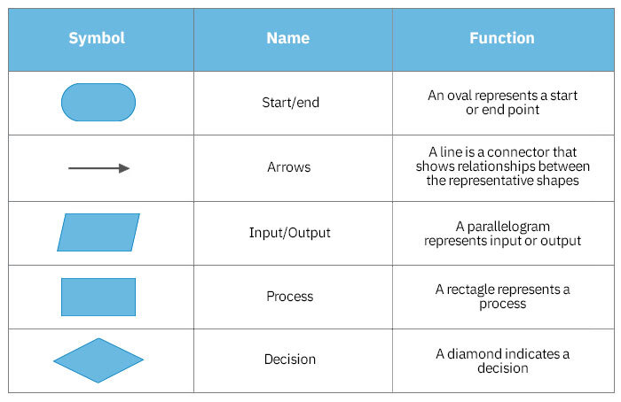

---
tags:
  - PSUC
  - ETE
  - extra-practice
---

# PSUC — Extra Practice

Return to [[PSUC - Ultimate ETE Notes]]. This companion preserves supporting source topics and supplies extra program patterns. **Finish the main five modules first.** The advanced catalogue reflects names in the recursion PDF, not a forecast of exam questions.

## Algorithms and flowcharts

**Algorithm:** A finite, step-by-step procedure for solving a problem.

| Characteristic | Meaning |
|---|---|
| Input | Zero or more inputs |
| Output | At least one output/result |
| Definiteness | Each step is clear and unambiguous |
| Finiteness | Terminates after finitely many steps |
| Effectiveness | Each operation can actually be carried out |

**Sum of two numbers:** Start → read a,b → sum=a+b → display sum → stop.

**Maximum of two:** Read a,b → if a≥b, max=a, otherwise max=b → display max. Equal inputs have the same maximum.

**Maximum of three:** Read a,b,c → max=a → if b>max, max=b → if c>max, max=c → display max.

**Factorial:** Read valid n≥0 → fact=1, i=1 → while i≤n, fact=fact*i and i=i+1 → display fact → stop.

**Multiplication table:** Read n → for i from 1 through 10, display n,i,n*i → stop.

**Account login, conceptual example from the flowchart slide:** Start → read credentials → validate → if valid, display account; otherwise display an error and end/retry according to the specified rule → stop. No actual credential-handling implementation is required by the supplied material.

**Flowchart:** A graphical representation of an algorithm/program's control flow.



*Lecture 7 flowchart, slide 4.*

| Symbol | Meaning |
|---|---|
| Oval / rounded terminator | Start or stop |
| Parallelogram | Input/output |
| Rectangle | Process/calculation |
| Diamond | Decision; label outgoing branches |
| Arrow | Direction of control |
| Small circle | On-page connector |
| Pentagon-style connector | Off-page connector |
| Rectangle with doubled vertical sides | Predefined process/subroutine |
| Hexagon | Preparation, often loop initialisation |
| Cylinder | Database/stored data |

**Class conventions:** One start and one stop; top-to-bottom or left-to-right flow; avoid crossing arrows; matching on-page connector labels use numbers, off-page labels use letters in these slides. These numbering conventions are classroom rules rather than universal naming requirements.

**Advantages:** Communicates logic, supports planning, reveals missing branches, documents the process, helps debugging. **Limitations:** Large problems can produce bulky diagrams; changes may require redrawing. Practise the sum, maximum and factorial diagrams using the correct shapes.

## Standard headers and quick viva

| Header | Functions/types you should recognise |
|---|---|
| `<stdio.h>` | `printf`, `scanf`, `fgets`, `puts`, `getchar`, `putchar`, `FILE` |
| `<string.h>` | `strlen`, `strcpy`, `strcat`, `strcmp`, `strchr`, `strrchr`, `strstr`, `strcspn` |
| `<math.h>` | `sqrt`, `pow`, `fabs`, `ceil`, `floor` |
| `<ctype.h>` | `toupper`, `tolower`, `isalpha`, `isdigit`, `isspace` |
| `<stdlib.h>` | `abs`, `malloc`, `calloc`, `realloc`, `free`, `exit` |
| `<stddef.h>` | `size_t`, `ptrdiff_t`, `NULL` |
| `<limits.h>` | Integer range constants such as `INT_MAX`, `CHAR_BIT` |

`sqrt(25.0)=5.0`, `pow(2.0,3.0)=8.0`, `fabs(-2.5)=2.5`, `ceil(2.3)=3.0`, `floor(2.9)=2.0`. Mathematical library functions return floating results here. `abs` takes an int; `fabs` handles double. Use only results representable in the selected type.

- **What is `#`?** Introduces preprocessing directives.
- **What is a preprocessor?** Handles includes, macros and conditional compilation before C compilation.
- **Why headers?** Supply shared declarations, macros and types consistently.
- **Header types?** Standard headers such as `<stdio.h>` and user headers such as `"student.h"`.
- **What is `main`?** Entry function of the ordinary hosted C program.
- **Why int return type?** Returns execution status to the environment; 0 means success.
- **More than one definition of main?** Invalid in one ordinary program.
- **What if main is absent?** Normal hosted executable linking fails; special freestanding systems use their own startup rules.
- **What is ISO?** International Organization for Standardization; ISO/IEC standardise C.
- **Compiler versus preprocessor?** Preprocessor transforms source tokens/directives; compiler translates/checks C.
- **Are headers the compiled library?** No; declarations describe functions, while the implementation/library supplies their code.
- **Can an ordinary function have zero return statements?** A void function may simply reach its end; a value-returning function used for its result must return a suitable value. `main` has a special successful-return rule on reaching its end in modern C.

**Classic 32 C90 keywords shown in the token slide:**

```text
auto break case char const continue default do
double else enum extern float for goto if
int long register return short signed sizeof static
struct switch typedef union unsigned void volatile while
```

Later C standards add keywords. The table reproduces the classic set used in your slides, not a claim that every version of C has exactly 32.

## Original conversion-slide exercises

The final conversion slide asks for exactly these values. Work them on paper before checking the table; show repeated divisions or binary grouping rather than memorising answers.

| Given | Decimal | Binary | Octal | Hexadecimal |
|---|---:|---|---|---|
| `125₁₀` | 125 | 1111101 | 175 | 7D |
| `250₁₀` | 250 | 11111010 | 372 | FA |
| `10110110₂` | 182 | 10110110 | 266 | B6 |
| `11101101₂` | 237 | 11101101 | 355 | ED |
| `345₈` | 229 | 11100101 | 345 | E5 |
| `726₈` | 470 | 111010110 | 726 | 1D6 |
| `7D₁₆` | 125 | 1111101 | 175 | 7D |
| `3AF₁₆` | 943 | 1110101111 | 1657 | 3AF |

Leading zeros in a binary representation may be added for grouping without changing value, e.g. `011 100 101` for `345₈`.

## More slide traces

| Fresh values / operation | Correct result |
|---|---|
| a=100,b=2,c=25,d=4; `a*b+c*d` | 300 |
| Same initial values; `result=a=(b+c*d)` | a=102 and result=102 |
| var1=5; `printf("%d",var1++)` | Prints 5, then var1=6 |
| var2=5; `printf("%d",++var2)` | var2=6, prints 6 |
| a=1,b=1; `c=a++ + b` | a=2,b=1,c=2 |
| Switch selector 2, default before case 1/case 2, break at case 2 | Starts directly at case 2, not at default |
| Switch selector 1, assignment before the first case label | That assignment is skipped on switch entry |

`getchar()` reads the next input character and returns an int so it can also represent `EOF`; `putchar(ch)` outputs one character. `puts(s)` writes the string and adds a newline, while `printf("%s",s)` adds no automatic newline.

## Additional recursive programs

All definitions below assume valid input domains. Small ordinary inputs are intended: intermediate/result arithmetic must fit its type, and arrays/strings must remain within bounds. These are **function definitions to call from main**, not separate complete executables.

### Digits, reverse and numeric palindrome

```c
int countDigits(unsigned int n)
{
    if (n<10) return 1;             // includes n=0
    return 1+countDigits(n/10);
}

unsigned int reverseAcc(unsigned int n, unsigned int result)
{
    if (n==0) return result;
    return reverseAcc(n/10,result*10+n%10);
}

int numericPalindrome(unsigned int n)
{
    return n==reverseAcc(n,0);
}
```

`countDigits(0)=1`; `reverseAcc(472,0)=274`; `numericPalindrome(121)=1`. The accumulator holds the reverse built so far. Check representability: reversing an arbitrary maximum-width input may exceed the type.

### Recursive prime and multiplication

```c
int primeFrom(int n, int divisor)
{
    if (n<2) return 0;
    if (divisor>n/divisor) return 1;
    if (n%divisor==0) return 0;
    return primeFrom(n,divisor+1);
}

unsigned int multiply(unsigned int a, unsigned int b)
{
    if (b==0) return 0;
    return a+multiply(a,b-1);
}
```

Call prime as `primeFrom(n,2)`. `primeFrom(17,2)=1`; `primeFrom(9,2)=0`; `multiply(6,4)=24`. Multiplication uses repeated addition; b is reduced each call.

### Decimal to binary using recursion

```c
void printBinary(unsigned int n)
{
    if (n>1) printBinary(n/2);
    putchar('0'+(int)(n%2));
}
```

Call `printBinary(0)` → `0`; `printBinary(25)` → `11001`. Include `<stdio.h>`. Dividing first and printing while returning puts the bits in the correct order.

### Recursive array sum and maximum

```c
int recursiveArraySum(const int a[], int n)  // n >= 0
{
    if (n==0) return 0;
    return a[n-1]+recursiveArraySum(a,n-1);
}

int recursiveArrayMax(const int a[], int n)  // n >= 1
{
    if (n==1) return a[0];
    int previous=recursiveArrayMax(a,n-1);
    return a[n-1]>previous ? a[n-1] : previous;
}
```

For `{3,8,2}`, sum=13, maximum=8. Maximum needs a nonempty array because there is no first element for an empty array.

### Recursive binary search

**Binary search:** Repeatedly halves the search interval of a **sorted array**. This is extra from the recursion PDF; the main blueprint specifically requires linear search.

```c
int binarySearch(const int a[], int left, int right, int key)
{
    if (left>right) return -1;
    int mid=left+(right-left)/2;
    if (a[mid]==key) return mid;
    if (key<a[mid]) return binarySearch(a,left,mid-1,key);
    return binarySearch(a,mid+1,right,key);
}
```

Call `binarySearch(a,0,n-1,key)`. Time O(log n); recursive stack O(log n). `{2,4,6,8,10}`, key 8 → index 3. With duplicates this version returns a matching index, not necessarily the first.

### Recursive string reverse and palindrome

```c
void recursiveReverse(char s[], int left, int right)
{
    if (left>=right) return;
    char t=s[left];
    s[left]=s[right];
    s[right]=t;
    recursiveReverse(s,left+1,right-1);
}

int recursivePalindrome(const char s[], int left, int right)
{
    if (left>=right) return 1;
    if (s[left]!=s[right]) return 0;
    return recursivePalindrome(s,left+1,right-1);
}
```

For a string of length n, call with `0,n-1`. Empty and one-character strings are palindromes under these tests; the null terminator is left in place.

### Tower of Hanoi complete driver

```c
#include <stdio.h>

void hanoi(int n, char source, char auxiliary, char destination)
{
    if (n==0) return;
    hanoi(n-1,source,destination,auxiliary);
    printf("Move disk %d from %c to %c\n", n,source,destination);
    hanoi(n-1,auxiliary,source,destination);
}

int main(void)
{
    int n;
    if (scanf("%d", &n)!=1 || n<1 || n>10) return 1;
    hanoi(n,'A','B','C');
    return 0;
}
```

For n=2:

```text
Move disk 1 from A to B
Move disk 2 from A to C
Move disk 1 from B to C
```

### Full recursion-PDF practice catalogue

All 24 listed tasks are mapped below. The source provides worked code for eight basic examples and lists the others for practice. Learn the main-note patterns and the functions above before the advanced entries.

| PDF no. | Topic | Where / recursive idea |
|---:|---|---|
| 1 | Print 1 to N / N to 1 | Main: call before/after print |
| 2 | Sum first N naturals | Main: n + sum(n−1) |
| 3 | Factorial | Main: n × factorial(n−1) |
| 4 | Fibonacci series / nth term | Main: F(n−1)+F(n−2) |
| 5 | Power aⁿ | Main: a × power(a,n−1) |
| 6 | Sum digits | Main: n%10 + sumDigits(n/10) |
| 7 | Count digits | Above: 1 + count(n/10), base n<10 |
| 8 | Reverse number | Above: accumulator and n/10 |
| 9 | GCD and LCM | Main: Euclid, then (a/GCD)×b |
| 10 | Palindrome number | Above: compare original and recursive reverse |
| 11 | Prime check | Above: test divisors recursively |
| 12 | Decimal to binary | Above: recurse on n/2 then print n%2 |
| 13 | Array sum/maximum | Above: combine last element with result for n−1 |
| 14 | Binary search | Above: recurse into one sorted half |
| 15 | Reverse string | Above: swap ends and recurse inward |
| 16 | String palindrome | Above: compare ends and recurse inward |
| 17 | Recursive multiplication | Above: a + multiply(a,b−1) |
| 18 | Tower of Hanoi | Main plus full driver above |
| 19 | Merge sort | Split array into halves, recursively sort both, merge; O(n log n) time |
| 20 | Quick sort | Partition around pivot, recursively sort two sides; average O(n log n), worst O(n²) |
| 21 | String permutations | Choose/swap a character into current position, recurse, undo swap |
| 22 | Subsets of a set | At each element branch into include/exclude; base after final element |
| 23 | N-Queens | Place one queen per row; recurse on safe columns, undo choices on failure |
| 24 | Rat in a maze | Explore valid neighbouring cells recursively, track visited/path, backtrack |

**Backtracking:** Try a choice, recursively explore, then undo it to try alternatives. This is the common idea behind the last four advanced entries. No full code for those advanced algorithms was supplied, and they are outside the core five-module preparation route here.

## Magic square checker

This covers the example singled out in your C notes. It checks a **normal** magic square: numbers 1..n² exactly once and all required sums equal. Time O(n²); fixed arrays keep the implementation simple.

```c
#include <stdio.h>

int main(void)
{
    int n, a[10][10], seen[101]={0}, valid=1;
    if (scanf("%d", &n)!=1 || n<1 || n>10) return 1;
    for (int i=0; i<n; ++i) {
        for (int j=0; j<n; ++j) {
            if (scanf("%d", &a[i][j])!=1) return 1;
            int value=a[i][j];
            if (value<1 || value>n*n) valid=0;
            else if (seen[value]) valid=0;
            else seen[value]=1;
        }
    }
    int target=n*(n*n+1)/2;
    int d1=0,d2=0;
    for (int i=0; i<n; ++i) {
        int row=0,column=0;
        for (int j=0; j<n; ++j) {
            row+=a[i][j];
            column+=a[j][i];
        }
        if (row!=target || column!=target) valid=0;
        d1+=a[i][i];
        d2+=a[i][n-1-i];
    }
    if (d1!=target || d2!=target) valid=0;
    puts(valid ? "Normal magic square" : "Not a normal magic square");
    return 0;
}
```

Use small input integers so summing invalid values also stays within int range. Test a valid 3×3 square, a duplicate-filled square and n=1 with element 1.

## Manual substring and string comparison

These reinforce the handwritten `strstr`/`strcmp` material without relying on the corresponding library calls.

```c
int findSubstring(const char text[], const char pattern[])
{
    if (pattern[0]=='\0') return 0;
    for (int i=0; text[i]!='\0'; ++i) {
        int j=0;
        while (pattern[j]!='\0' && text[i+j]!='\0' &&
               text[i+j]==pattern[j]) ++j;
        if (pattern[j]=='\0') return i;
    }
    return -1;
}

int compareStrings(const char a[], const char b[])
{
    int i=0;
    while (a[i]!='\0' && a[i]==b[i]) ++i;
    unsigned char x=(unsigned char)a[i], y=(unsigned char)b[i];
    return (x>y)-(x<y);  // one of -1, 0, 1; same sign convention as strcmp
}
```

Examples: `findSubstring("computer","put")=3`; `findSubstring("abc","z")=-1`; empty pattern → 0. `compareStrings("abc","abc")=0`; `compareStrings("abc","abd")<0`.

## Source questions with incomplete information

The weight/price note gives bands `0–100g: 50`, `100–150: 50+2`, `150–200: 100+5`, `200+: 350+10`, but does not say whether added charges are per gram, per block or fixed, and the boundary at 100 overlaps. A unique numeric pricing program cannot be recovered from that text.

**What to learn:** Validate weight, choose non-overlapping bands with an else-if ladder, then use the precise tariff printed in the exam. If charges apply per excess gram, a generic band formula is `baseCharge + rate*(weight-bandStart)`; this is a pattern, **not the missing original tariff**.

Likewise, “PCM marks” and lab question numbers have no full question statements attached. Revise input/validation/total/percentage and the available program patterns; use the exam's actual thresholds and conditions.

## Supporting topics outside the five-module table

### Harvard architecture

Separate instruction and data memories/paths allow instruction and data access in parallel. Von Neumann uses unified instruction/data memory in the basic model. Your lecture note explicitly marks Harvard outside this exam; a one-line comparison is enough unless your teacher updates the scope.

**ISA (instruction set architecture):** Defines the instructions and programmer-visible machine interface. It is not a synonym for Von Neumann architecture; either memory organisation still needs an instruction set.

### File handling overview

Older syllabus images mention this; the ETE module table does not give it a separate assessed allocation. Know the vocabulary without letting it displace Module 4.

**File:** Named data stored for later use. `FILE *fp` is a standard-library stream handle. `fopen` opens; `fclose` closes. Modes: `"r"` read existing file; `"w"` create/truncate for writing; `"a"` append. `"rb"/"wb"` are binary modes. `fprintf/fscanf` perform formatted file I/O; `fgets/fputs` handle lines; `fgetc/fputc` characters. Check `fp!=NULL` before using an opened file.

An extra example shape is `FILE *fp=fopen("data.txt","r");`, check success, read/process, then `fclose(fp);`. Do not treat file processing as merely using `printf` without a file handle.

### Elementary data structures

**Data structure:** A way to organise data for storage and operations. Arrays and structures are the core examples used throughout this pack.

| Structure | Simple idea |
|---|---|
| Array | Contiguous same-type elements, indexed access |
| Record/structure | Related named fields of possibly different types |
| Linked list | Nodes connected by pointers; not necessarily contiguous |
| Stack | Last in, first out (LIFO); push/pop; recursion uses a call stack |
| Queue | First in, first out (FIFO); enqueue/dequeue |

Your C notes say linked lists are for later DSA, outside this exam. No linked-list implementation or file-handling program was supplied. These brief definitions preserve the broad opening syllabus wording without inventing an extra ETE module.

### Optional dynamic-storage vocabulary

The storage-class slides mention lifetime until explicit freeing. `malloc` allocates a requested number of bytes; `calloc` allocates zero-initialised storage; `realloc` resizes an allocation; `free` releases it. Check allocation success, use only valid bounds and do not use memory after freeing. These names help distinguish allocated storage from a runtime-sized automatic array; detailed allocation exercises are not part of the supplied five-module table.
