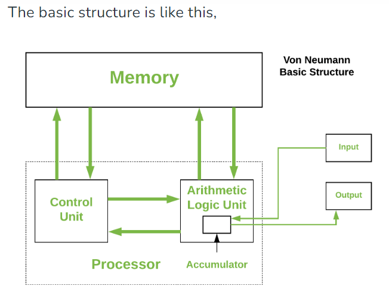
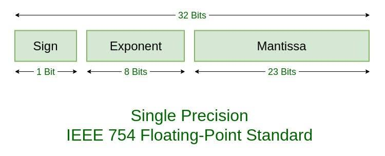
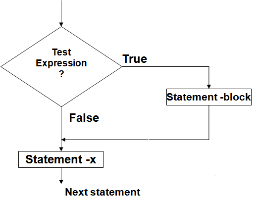

# PSUC — Ultimate ETE Study Notes

**CSC1101 · MUJ · 80 marks · 1½-day preparation**

> [!important] Start here
> Learn the **definition → rule → example → program pattern**, then close the note and reproduce it. Your first priority is **Module 4**, followed by **Module 2**. The blueprint controls module placement and marks; comments such as “100% chance” in class notes are revision hints, not guaranteed questions.

These notes prefer the wording in **Lectures - C.md**, with light corrections for accuracy. Slides supply missing explanations and examples. The recursion PDF and all five handwritten pages are incorporated. Worked examples and missing blueprint topics have been added. **CORE** means first-pass study; **EXTRA** preserves supporting material for later review. Programs use standard C11-style syntax unless explicitly marked otherwise.

## Navigation

- [[#Your 1½-day study route]]
- [[#Module 1 — Foundations and C essentials]]
- [[#Module 2 — Decisions and loops]]
- [[#Module 3 — Arrays and strings]]
- [[#Module 4 — Functions recursion and pointers]]
- [[#Module 5 — Structures and unions]]
- [[#Exam practice and answer method]]
- [[#Corrections to remember from the source material]]
- [[#Source coverage and scope]]
- [[PSUC - Last Hour Revision]]
- [[PSUC - Extra Practice#Additional recursive programs]]

## Your 1½-day study route

### What the blueprint actually says

| Module | Content | Blueprint marks | Study priority |
|---|---|---:|---|
| 1 | Architecture, languages, numbers, C basics, types, storage classes, operators, conversions, formatting | **12–14** | Secure short theory and tracing marks |
| 2 | Conditions, branching, jumps, loops | **16–20** | High; learn program patterns |
| 3 | 1D/2D arrays, strings, linear search, bubble sort | **6–10** | Essential foundation for Module 4 |
| 4 | Functions, parameter passing, recursion, pointers, pointers and arrays | **24–28** | **Highest** |
| 5 | Structures, nested structures, arrays of structures, unions | **10–12** | High; compact, learnable unit |

**These are ranges, not five fixed allocations that must add to 80.** The supplied blueprint does not specify Section A/B/C/D question counts or individual question marks. Earlier lecture syllabus images divide the course differently; use the five modules above for this ETE.

### A realistic 18-hour focused plan

Use this across roughly 36 elapsed hours, allowing meals, short breaks and a full night's sleep. Hours below are **study time**, not a demand to stay awake for 18 hours straight. Work for about 50 minutes, then pause for 10.

| Stage | Focused time | What to do | Finish when you can… |
|---|---:|---|---|
| Day 1, block 1 | 1 h | M1: program skeleton, types, I/O, operators | Write a working C program and trace simple expressions |
| Day 1, block 2 | 2.5 h | M2: decisions, switch, loops, digit and pattern programs | Write calculator, prime, reverse and pyramid without looking |
| Day 1, block 3 | 2 h | M3: array traversal, search/sort, strings, matrices | Explain indexes, `\0`, bubble bounds and matrix loops |
| Day 1, block 4 | 4 h | M4: functions, swap by address, pointers, recursion | Trace pointer expressions and write factorial/Fibonacci |
| Day 1, block 5 | 1.5 h | M5: structures and unions | Write an array-of-structures program and the comparison |
| Day 2, block 1 | 2 h | M1: architecture, conversions, representation, macros, storage | Explain a diagram, solve conversions, trace static variables |
| Day 2, block 2 | 2 h | Closed-note mixed practice | Correct mistakes in the mini mock and rewrite weak programs |
| Day 2, final block | 3 h | M4 recall (1 h), other weak areas (1 h), last-hour sheet (1 h) | Recall definitions, syntax and common traps quickly |

**If you fall behind:** keep the core program patterns, M4, M2, M5 and the last-hour sheet. Defer the advanced recursion catalogue and historical/extra topics. Do not spend an hour memorising an entire ASCII table.

### First-pass checklist

- [ ] Explain call by value versus address and write `swap(&a, &b)`.
- [ ] Trace `*p`, `p+1`, `*p++`, `(*p)++`, arrays and pointer subtraction.
- [ ] Write factorial, Fibonacci and one recursive digit/array function.
- [ ] Write `if`, `switch`, three loops, prime, reverse and a pyramid.
- [ ] Write linear search, bubble sort, matrix multiplication and string palindrome.
- [ ] Write a structure, nested structure and array of structures; compare union.
- [ ] Revise storage classes, macros, formatting, conversions and Von Neumann.

---

## Module 1 — Foundations and C essentials

**12–14 marks · Sources: your three Markdown notes; Lectures 1–4, 7–10; storage-class slides.**

### 1.1 Computer fundamentals and Von Neumann architecture — CORE

**Computer:** An electronic device that accepts data, processes it according to instructions, stores it and produces results.

**Data:** Raw facts given to a computer. **Information:** Meaningful results obtained after processing data.

**Hardware:** The physical parts of a computer, such as CPU, keyboard and memory. **Software:** Programs and related data used to perform tasks. **Program:** A sequence of instructions written to perform a specific task.

**Digital computer:** Processes information using discrete values, represented internally by binary states. **Fixed-program system:** Built for a particular fixed task. **Stored-program system:** Keeps instructions in memory and can perform different tasks by changing the program. **Operating system:** System software that manages hardware/resources and provides services for programs; application software performs user tasks.

**Von Neumann architecture:** A computer architecture in which **program instructions and data are stored in the same memory**. This is the **stored-program concept**.



*Diagram from Lecture 1PSUC, slide 16. Practise drawing and labelling memory, CPU/CU/ALU, input and output.*

| Unit | Simple function |
|---|---|
| Input unit | Accepts data and instructions, e.g. keyboard |
| Memory unit | Stores instructions, data and intermediate results |
| Control unit (CU) | Fetches/decodes instructions and coordinates operations |
| Arithmetic logic unit (ALU) | Performs arithmetic, comparisons and logical operations |
| Registers | Very small, fast storage inside the CPU |
| Output unit | Presents processed results, e.g. screen or printer |

**CPU = CU + ALU + registers.** A clock coordinates processor activity; clock frequency is measured in hertz (cycles per second). A 3 GHz clock has about 3 billion cycles per second; **cycles and completed instructions are not the same thing**.

**Important registers:**

- **PC:** Address of the next instruction.
- **IR:** Current instruction.
- **Accumulator:** Intermediate arithmetic/logic results.
- **MAR:** Address of the memory location being accessed.
- **MDR:** Data being transferred to/from memory.
- **Status register:** Flags such as zero, carry and overflow.

**Fetch–decode–execute–store cycle:**

1. **Fetch:** Read the next instruction from memory using the PC; update the PC as appropriate.
2. **Decode:** CU interprets the instruction and identifies operands.
3. **Execute:** CPU performs the operation, using ALU/I/O/memory as required.
4. **Store:** Save the result in a register or memory if required. Repeat.

**Buses:** Data bus carries data; address bus carries addresses; control bus carries control/status signals.

**Von Neumann bottleneck:** Instructions and data share a transfer path, limiting how quickly the CPU can obtain both. Advantages: simple unified memory, easy program storage/modification, general-purpose use. Limitation: shared memory/bus traffic can make the CPU wait.

### 1.2 Memory and storage — CORE short theory

**Fastest/smallest to slower/larger:** `Registers → Cache → RAM → Secondary storage`.

| Type | Meaning / property |
|---|---|
| Register | Fastest small working storage inside CPU |
| Cache | Fast memory on/near CPU holding frequently used data/instructions |
| RAM | Main read/write working memory; volatile |
| ROM | Non-volatile memory for firmware; some ROM families can be reprogrammed |
| HDD | Non-volatile magnetic storage; rotating disks |
| SSD | Non-volatile electronic flash storage; no rotating disk |

**Volatile:** Loses stored contents when power is removed. **Non-volatile:** Retains contents without power.

- Bit = one binary digit, `0` or `1`.
- Byte = normally 8 bits in this course.
- Word = a processor's natural data unit, e.g. 16, 32 or 64 bits; architecture-dependent.
- Cache typically uses SRAM; ordinary main RAM commonly uses DRAM, whose stored charge needs refresh.
- Cache levels: L1 is usually the smallest and fastest, followed by larger/slower L2 and L3.
- Secondary storage includes HDD, SSD, optical disks and tape; it is not all magnetic.
- EEPROM/flash can be electrically rewritten, with finite endurance. Specific sizes, prices and speeds in slides are examples, not permanent definitions.

### 1.3 Languages, translators and paradigms — CORE

**Machine language:** Instructions written in binary that the CPU executes directly.

**Assembly language:** A low-level language using mnemonics such as `MOV`, `ADD`, `SUB` instead of binary instructions.

**High-level language:** A language with human-readable constructs that hide many hardware details, e.g. C, Python, Java.

| Feature | Machine language | Assembly language | High-level language |
|---|---|---|---|
| Form | Binary instructions | Mnemonics and symbolic names | Statements/expressions |
| Translation | CPU executes native instructions | Assembler | Compiler/interpreter |
| Ease | Very difficult | Hardware knowledge needed | Easier to write/debug |
| Portability | Machine-dependent | Machine-dependent | Usually more portable; may need recompilation |
| Hardware control | Direct | Direct and readable relative to binary | Usually more abstract |

**Assembly advantages:** Direct hardware control, fine control of resources, useful for specialised low-level work. **Disadvantages:** Machine-dependent, more verbose, difficult to maintain/debug, requires an assembler. High-level code can also compile to efficient machine code; language level alone does not guarantee speed.

| Translator | Definition | Usual course comparison |
|---|---|---|
| Compiler | Translates a source program into target code before execution | Reports compilation errors; resulting native program can run repeatedly |
| Interpreter | Executes a program through a runtime, translating/processing as needed | Execution and error reporting happen through the runtime |
| Assembler | Translates assembly instructions into machine/object code | Example: NASM/MASM |

**Compiler examples:** GCC for C, `javac` for Java bytecode. “Compiler translates whole program; interpreter executes statement by statement” is the basic exam comparison. Real systems can combine compilation, bytecode and interpretation.

**Programming paradigm:** A style of organising a program. **Procedural:** Break a task into functions/steps (C). **Object-oriented:** Organise around objects/classes. **Functional:** Emphasise functions and expression evaluation. **Logic:** Express facts/rules. Learn one-line meanings; C work here is procedural.

### 1.4 Number systems and conversions — CORE

**Number system:** A method of representing numbers using digits and a base. In positional notation, each digit's value depends on its position.

| System | Base | Digits |
|---|---:|---|
| Binary | 2 | 0, 1 |
| Octal | 8 | 0–7 |
| Decimal | 10 | 0–9 |
| Hexadecimal | 16 | 0–9, A–F, where A=10 … F=15 |

For base `b`, positions to the left of the point have weights `b⁰, b¹, b²…` from right to left. Fractional positions have weights `b⁻¹, b⁻²…`.

#### Decimal to binary, octal or hexadecimal

Repeatedly divide the **integer part** by the target base. Record remainders and read them **bottom to top**.

| 25 ÷ 2 | Quotient | Remainder |
|---|---:|---:|
| 25 ÷ 2 | 12 | 1 |
| 12 ÷ 2 | 6 | 0 |
| 6 ÷ 2 | 3 | 0 |
| 3 ÷ 2 | 1 | 1 |
| 1 ÷ 2 | 0 | 1 |

Therefore `(25)₁₀ = (11001)₂`.

- `(125)₁₀`: divide by 8 → remainders `5,7,1` → `(175)₈`.
- `(250)₁₀`: divide by 16 → remainders `10=A,15=F` → `(FA)₁₆`.

#### Binary, octal or hexadecimal to decimal

Multiply each digit by its positional weight, then add.

- `(101101)₂ = 32 + 8 + 4 + 1 = (45)₁₀`.
- `(345)₈ = 3×8² + 4×8 + 5 = 192+32+5 = (229)₁₀`.
- `(2A)₁₆ = 2×16 + 10 = (42)₁₀`.

#### Conversions through binary

**Octal ↔ binary: groups of 3. Hexadecimal ↔ binary: groups of 4.** For an integer, group from the right, padding zeros on the left as necessary.

| Octal digit | Binary | Hex digit | Binary |
|---:|---|---|---|
| 0 | 000 | 8 | 1000 |
| 1 | 001 | 9 | 1001 |
| 2 | 010 | A | 1010 |
| 3 | 011 | B | 1011 |
| 4 | 100 | C | 1100 |
| 5 | 101 | D | 1101 |
| 6 | 110 | E | 1110 |
| 7 | 111 | F | 1111 |

Hex digits 0–7 use the corresponding 4-bit value, e.g. 3=`0011`.

- **Binary → octal:** `1101011 → 001 101 011 → 153₈`.
- **Binary → hex:** `11111010 → 1111 1010 → FA₁₆`.
- **Octal → binary:** `345₈ → 011 100 101₂`.
- **Hex → binary:** `2A₁₆ → 0010 1010₂`.
- **Octal → hex:** `345₈ → 011100101₂ → 0000 1110 0101 → E5₁₆`.
- **Hex → octal:** `2A₁₆ → 00101010₂ → 000 101 010 → 52₈`.

Binary is a convenient intermediate, not the only possible method: conversion via decimal also works.

**Fractions:** Repeatedly multiply a decimal fraction by the target base and read the integer parts **top to bottom**. Example: `.625×2=1.25`, `.25×2=.5`, `.5×2=1.0`, so `.625₁₀=.101₂`. For grouping, start at the point and group outward on each side; pad the fractional side on the right. Example `10.101₂=2.625₁₀`.

> [!tip] Conversion practice
> Convert `45₁₀`, `101101₂`, `175₈`, `FA₁₆` into the other three bases. Answers appear in [[#Exam practice and answer method]]. Always write bases and the intermediate grouping/division.

### 1.5 Integer and floating-point representation — CORE

For an **n-bit unsigned integer**, range = `0` to `2ⁿ−1`.

For an **n-bit signed two's-complement integer**, range = `−2ⁿ⁻¹` to `2ⁿ⁻¹−1`.

| Width | Unsigned | Signed two's complement |
|---:|---|---|
| 8 | 0 to 255 | −128 to 127 |
| 16 | 0 to 65,535 | −32,768 to 32,767 |
| 32 | 0 to 4,294,967,295 | −2,147,483,648 to 2,147,483,647 |

**Represent −5 in 8-bit two's complement:**

```text
+5       00000101
Invert   11111010   (one's complement)
Add 1    11111011   (two's complement = −5)
```

In two's complement the highest bit has weight `−2ⁿ⁻¹`; the remaining bits have positive positional weights. It is **not** a separate sign plus ordinary magnitude. To decode `11111011`: `−128+64+32+16+8+2+1 = −5`.

**Overflow warning:** Unsigned arithmetic wraps modulo `2ⁿ` for its width. Signed integer arithmetic overflow has no defined result in standard C. Do not assume every overflow “becomes negative.” Plain `char` may be signed or unsigned; the `130 → −126` example assumes an 8-bit signed representation and implementation-specific conversion behaviour.

#### Floating-point basics

**Floating-point representation:** Stores a real value approximately using a sign, significand (often called mantissa) and exponent.



*Lecture 8, slide 6: common IEEE 754 binary32 format.*

| Common IEEE format | Sign | Exponent | Fraction | Bias |
|---|---:|---:|---:|---:|
| binary32, commonly `float` | 1 | 8 | 23 | 127 |
| binary64, commonly `double` | 1 | 11 | 52 | 1023 |

For an ordinary normal binary32 value:

`value = (−1)^sign × (1.fraction)₂ × 2^(stored exponent − 127)`.

**Slide example: 19.125**

1. `19 = 10011₂`; `.125 = .001₂`.
2. `19.125 = 10011.001₂ = 1.0011001₂ × 2⁴`.
3. Sign=`0`; exponent=`4+127=131=10000011₂`.
4. Fraction: remove the leading implicit `1`, giving `00110010000000000000000`.
5. Final: `0 | 10000011 | 00110010000000000000000`.

`3.14` is a `double` constant; `3.14f` is `float`; `3.14L` is `long double`. `6.022e23` means `6.022×10²³`. Many decimal fractions cannot be represented exactly in binary. All comparisons are legal for floating types, but exact equality may be unsuitable for computed approximate values.

### 1.6 Basic C program and compilation — CORE

```c
#include <stdio.h>
#define PI 3.14159

int main(void)
{
    double radius = 2.0;
    printf("Area = %.2f\n", PI * radius * radius);
    return 0;
}
```

Output: `Area = 12.57`.

- `#include`: Include the contents of a header before compilation.
- `stdio.h`: Standard input/output header; declares functions such as `printf`, `scanf`, `getchar`, `putchar`.
- `int main(void)`: Program entry function in the normal hosted C environment; takes no arguments here and returns an integer status.
- `{ }`: A block or function body.
- `;`: Ends many declarations and statements.
- `return 0;`: Successful termination.
- `// …` and `/* … */`: Comments.

**Expression:** A combination of operands and operators that computes a value, e.g. `a+b*2`. **Expression statement:** An expression followed by `;`, e.g. `a++;`. **Compound statement:** A group of statements inside braces. A lone `;` is a **null statement**.

**Compilation mnemonic: PCAL**

`Source .c → Preprocessor → Compiler → Assembler → Linker → Executable`.

| Stage | Work |
|---|---|
| Preprocessor | Includes headers, expands macros, handles conditional compilation; comments removed during translation |
| Compiler | Checks/translates preprocessed C, commonly into assembly |
| Assembler | Translates assembly into relocatable object code |
| Linker | Combines object files and required library code, resolving references |
| Loader | Loads executable into memory for execution; a later OS step |

**Header:** Contains declarations, macros and type definitions. **Declaration:** Describes a name/type, e.g. `double sqrt(double);`. **Definition:** Supplies a function body or defines an object. `sqrt(100.0)` is a **function call**, not a declaration.

Other directive names to recognise: `#undef` removes a macro definition; `#if`, `#ifdef`, `#ifndef`, `#elif`, `#else`, `#endif` control conditional compilation.

`#include <stdio.h>` uses the implementation's standard header search. `#include "myheader.h"` usually searches locally first, then standard paths. Use `.h` for an ordinary user header. `include` is a directive name, not an ordinary C keyword. `#` introduces preprocessing directives; `#define` defines a macro.

### 1.7 Macros and constants — CORE

**Macro, in your lecture wording:** A symbolic name used to represent a constant value. More generally, a macro performs **token replacement before compilation**.

```c
#define PI 3.14159
#define NAME "MUJ"
#define SQUARE(x) ((x) * (x))
#define MAX(a,b) ((a) > (b) ? (a) : (b))
```

Object-like macro: `PI`. Function-like macro: `SQUARE(x)`. There is no space between a function-like macro's name and its parameter `(` in the definition. Avoid an extra terminating semicolon in these definitions.

- `SQUARE(2+3)` expands to `((2+3)*(2+3))` → **25**.
- Bad definition `#define SQUARE(x) x*x` expands `SQUARE(2+3)` to `2+3*2+3` → **11**.
- `MAX(8,5)` → **8**.
- Macro advantages: symbolic meaning, less repetition, no normal function-call mechanism for the expansion.
- Limitations: no parameter type checking, harder debugging, repeated argument evaluation. **Do not call `SQUARE(i++)`.** Parentheses do not solve repeated side effects.
- Expansion happens during preprocessing; the resulting expression can still execute at runtime. Macro use does not guarantee faster code.

| `#define LIMIT 100` | `const int limit = 100;` |
|---|---|
| Preprocessor replacement | Typed C object |
| No object/type created for macro name itself | Has a declared type and normal scope |
| Can represent expressions/code | Provides a value that cannot be modified through that name |
| Compiler sees expanded tokens | Compiler checks normal typed uses |

**Constant:** A fixed value. Integer: `12`, `017`, `0xFA`; floating: `12.5f`; character: `'A'`; string literal: `"MUJ"`.

**Leading zero trap:** `017 = 15₁₀`; if `a=017`, `b=2`, then `a+b=17`. `09` is not a valid octal literal. Binary literal `0b1010` exists in some compilers/newer C; use decimal/hex when writing portable C11 answers.

### 1.8 Tokens, identifiers, variables and types — CORE

**Token:** The smallest individual element/unit of a program.

| Token category | Examples |
|---|---|
| Keyword | `int`, `if`, `return`, `static` |
| Identifier | `total`, `main`, `marks` |
| Constant | `10`, `3.5`, `'A'` |
| String literal | `"Hello"` |
| Operator | `+`, `=`, `&&` |
| Punctuator/separator | `;`, `,`, `(`, `)`, `{`, `}` |

The token slide also groups **preprocessor directives** as a teaching category. `#include` and `#define` are instructions for preprocessing.

**Identifier:** A programmer-defined name for a variable, function, array or other entity. Letters, digits and underscore allowed; cannot begin with a digit; cannot be a keyword; no spaces; case-sensitive. `sum`, `Sum`, `SUM` differ. Avoid reserved underscore forms in your own names.

Valid: `sum`, `total_marks`, `value2`. Invalid: `1sum`, `sum value`, `@value`, `float`, `a+b`.

**Variable, from your notes:** Name of a memory location whose value can be changed during execution of the program.

**Data type, from your notes:** Specifies the type of value stored in a variable and its memory requirements.

```c
int age;                 // declaration; no initial value for an automatic local
int marks = 90;          // definition with initialization
marks = 95;              // assignment after declaration
const int DAYS = 7;      // cannot later assign DAYS = 8
```

| Type | Common size | `printf` | `scanf` |
|---|---:|---|---|
| `char` | 1 byte | `%c` (character), `%d` (promoted numeric value) | `%c` |
| `short int` | 2 bytes | `%hd` | `%hd` |
| `int` | 4 bytes | `%d` | `%d` |
| `unsigned int` | 4 bytes | `%u` | `%u` |
| `long int` | 4 or 8 bytes | `%ld` | `%ld` |
| `long long int` | 8 bytes | `%lld` | `%lld` |
| `float` | 4 bytes | `%f` | **`%f`** |
| `double` | 8 bytes | `%f` | **`%lf`** |
| `long double` | implementation-dependent | `%Lf` | `%Lf` |
| `size_t`, e.g. `sizeof`/`strlen` result | implementation-dependent | `%zu` | `%zu` |

Sizes are common examples, not universal guarantees. Use `sizeof(type)` for the implementation. `sizeof(char)` is always 1 C byte. `void` means absence of a value/type-specific object here; ordinary `void` objects are invalid. C has no built-in `string` data type; a string uses a character array or pointer.

**Type modifiers:** `signed`, `unsigned`, `short`, `long`. Examples: `unsigned int`, `long long int`, `long double`. Suffixes: `12u`, `12L`, `12LL`, `12UL`, `12ULL`.

**Character versus number versus string:** `5` is a number; `'5'` is a character constant (ASCII 53 on an ASCII system); `"5"` is a string with `'5'` and `\0`. ASCII `'A'=65`, `'a'=97`, `'0'=48`, space=32, `\0=0`. Basic ASCII has 128 codes; 256 possible values describes an 8-bit byte, not basic ASCII.

**String literal:** Characters enclosed in double quotes. A terminating null character `\0` is added automatically. Thus `sizeof("MUJ")` is **4**, while its string length is **3**.

### 1.9 Enumerated data types — CORE

**`enum`, from your notes:** A keyword used to create a list of named integer constants. The first is 0 by default; each next value is the previous value plus 1 unless explicitly set.

```c
enum Day { SUN, MON, TUE, WED, THU, FRI, SAT };
enum Day today = WED;                    // value 3
enum Number { A = 5, B, C = 10, D, E }; // 5, 6, 10, 11, 12
```

Useful for readable choices: `enum Traffic { RED, YELLOW, GREEN };`. `enum` constants can be used as `case` labels.

### 1.10 Storage classes, scope and lifetime — CORE

**Scope, from your notes:** The area in which a variable's name is accessible. **Lifetime:** How long the object exists during execution.

**Local variable:** Declared inside a function/block; accessible within its scope. **Global variable:** Declared outside all functions; has file scope from its declaration onward. A local name can hide an outer/global name. Ordinary C has no C++ `::` scope-resolution operator.

| Storage class | Typical use / scope | Lifetime | Initial value if omitted | Key fact |
|---|---|---|---|---|
| `auto` | Local block | Block execution | Indeterminate | Default for ordinary local variables |
| `register` | Local block | Block execution | Indeterminate | Old-style optimisation request; cannot apply `&` to such an object in C11 |
| local `static` | Local block | Entire program | Zero | Retains value between calls |
| file-scope `static` | File | Entire program | Zero | Internal linkage, restricts sharing to translation unit |
| `extern` declaration | Wherever declared; commonly file scope | Refers to an object usually lasting entire program | Definition with static storage is zero-initialised if needed | Declares an object defined elsewhere |

“Garbage” in slides means **indeterminate**, not a predictable random number. Initialise automatic variables before reading them. `register` does not guarantee faster execution or physical register placement. An `extern` declaration such as `extern int x;` does not itself create a second object.

```c
#include <stdio.h>

void count(void)
{
    int a = 0;
    static int b;    // initialized once to 0
    ++a;
    ++b;
    printf("a=%d b=%d\n", a, b);
}

int main(void)
{
    count();
    count();
    count();
    return 0;
}
```

Output: `a=1 b=1`, then `a=1 b=2`, then `a=1 b=3` on separate lines. **Static local: scope local, lifetime whole program.**

For two files: `int x = 100;` is a definition in one file; `extern int x;` declares that shared object in another. The program links both files. A global `static int x;` cannot be shared that way.

**Scope types from the slides:** Block scope (locals), file scope (outside functions), function scope (labels), function-prototype scope (parameter names in a prototype).

### 1.11 Operators, expressions and conversions — CORE

**Operator:** A symbol that performs an operation on operand(s). Unary has one operand (`!a`); binary has two (`a+b`); ternary has three (`condition ? x : y`).

| Group | Operators | Remember |
|---|---|---|
| Arithmetic | `+ - * / %` | Integer `/` discards fractional part; `%` is integer remainder |
| Increment/decrement | `++ --` | Prefix changes before yielding value; postfix yields old value |
| Relational | `< <= > >=` | Result is 0 or 1 |
| Equality | `== !=` | `=` assigns; `==` compares |
| Logical | `&&`, `\|\|`, `!` | Treat zero as false, nonzero as true; result 0 or 1 |
| Bitwise | `&`, `\|`, `^`, `~`, `<<`, `>>` | Operate on integer bits |
| Assignment | `= += -= *= /= %= &= \|= ^= <<= >>=` | Change left operand |
| Conditional | `?:` | Select one of two expressions |
| Other | `sizeof`, `&`, `*`, comma | Size, address, dereference, sequencing via comma |

`7/2=3`, `7%2=1`, `7.0/2=3.5`, `-7/2=-3`, `-7%2=-1` in C11. Division/remainder by zero is invalid. `^` is XOR, **not exponentiation**.

**Type conversion:** Automatic conversion by C, e.g. an `int` converted when combined with `double`. **Type casting:** Explicitly converting with `(type)expression`.

```c
int a = 5, b = 2;
double x = a / b;          // 2.0: integer division occurred first
double y = (double)a / b;  // 2.5: cast before division
int z = (int)3.9;          // 3: fractional part discarded
```

#### Prefix, postfix and side effects

With a fresh `int m=5;`: `y=++m;` gives `m=6,y=6`; `y=m++;` gives `m=6,y=5`. With `a=1,b=1`, `c=a++ + b;` gives `a=2,b=1,c=2`.

Increment requires a modifiable object, e.g. `x` or `a[i]`. `++5`, `++(x+1)` and incrementing a `const` object are invalid.

> [!warning] No guaranteed output
> Expressions such as `i++ + ++i` and `printf("%d %d", i++, i++)` have unsequenced modifications in C11. Do not invent a left-to-right answer. **Precedence and associativity group expressions; they do not generally specify operand evaluation order.**

#### Precedence and associativity

Highest to lowest; parentheses can override grouping.

| Level | Operators | Associativity |
|---:|---|---|
| 1 | Postfix `() [] . -> x++ x--` | Left to right |
| 2 | Unary `++ -- + - ! ~ * & sizeof`, cast | Right to left |
| 3 | `* / %` | Left to right |
| 4 | `+ -` | Left to right |
| 5 | `<< >>` | Left to right |
| 6 | `< <= > >=` | Left to right |
| 7 | `== !=` | Left to right |
| 8 | Bitwise `&` | Left to right |
| 9 | Bitwise `^` | Left to right |
| 10 | Bitwise `\|` | Left to right |
| 11 | `&&` | Left to right |
| 12 | `\|\|` | Left to right |
| 13 | `?:` | Right to left |
| 14 | Assignments | Right to left |
| 15 | Comma operator | Left to right |

Examples: `2+3*4=14`; `20/5*2=(20/5)*2=8`; `a=b=10` groups `a=(b=10)`; `a/=b+c` means `a=a/(b+c)`.

#### Logical and bitwise operations

| A truth | B truth | `A && B` | `A \|\| B` |
|---|---|---:|---:|
| False | False | 0 | 0 |
| False | True | 0 | 1 |
| True | False | 0 | 1 |
| True | True | 1 | 1 |

**Short circuit:** `&&` skips the right side if the left is false; `||` skips it if the left is true. `d!=0 && n/d>2` safely avoids division when `d==0`. Bitwise `&` and `|` do not provide that short circuit.

```text
12 = 00001100
25 = 00011001
&    00001000 = 8
|    00011101 = 29
^    00010101 = 21
```

- XOR: same bits → 0, different bits → 1.
- `12u << 1 = 24u`; `12u >> 1 = 6u`.
- For suitable unsigned values, left shift by k corresponds to multiplication by `2ᵏ` modulo width; right shift corresponds to integer division by `2ᵏ`.
- Use unsigned values for bit exercises. Negative or too-large shift counts are invalid; avoid shifting negative signed values.
- On ordinary two's-complement signed implementations, `~35` is **−36**. The **low 8-bit pattern** is `11011100`, which is **220 when interpreted as unsigned 8-bit**. State width and signedness.

**Swap using XOR** for two distinct integer objects: `a ^= b; b ^= a; a ^= b;`. A temporary variable is clearer. The addition/subtraction version can overflow, so do not describe it as universally safe.

**Conditional operator:** `max = a>b ? a : b;`. Only the selected result expression executes. Can be nested; use parentheses for readability.

### 1.12 Formatted input/output — CORE

**Stream:** A sequence of bytes used for I/O. Standard streams: `stdin` (input), `stdout` (output), `stderr` (errors). Usually keyboard/screen, but may be redirected. Standard I/O is not defined simply as “from RAM”; `conio.h` is nonstandard and unnecessary for these programs.

**`printf`:** Outputs formatted data. **`scanf`:** Reads formatted data into objects using their addresses.

```c
int age;
double marks;
char grade;
scanf("%d %lf %c", &age, &marks, &grade);
printf("Age=%d Marks=%.2f Grade=%c\n", age, marks, grade);
```

`scanf` returns the number of successful assignments, or `EOF` for an input failure before any assignment. A useful check: `if (scanf("%d", &n) != 1) return 1;`.

#### `printf` width and precision

Format shape: `%[flags][width][.precision][length]specifier`.

| Example | Output / effect |
|---|---|
| `printf("%5d", 42)` | `   42` (three leading spaces) |
| `printf("%-5d", 42)` | `42   ` (left justified) |
| `printf("%05d", 42)` | `00042` |
| `printf("%.4d", 42)` | `0042` (minimum integer digits) |
| `printf("%9.3f", 123.456789)` | `  123.457` |
| `printf("%*.*f", 7, 2, 98.736)` | `  98.74` |
| `printf("%.3s", "Computer")` | `Com` (maximum string characters) |
| `printf("%e", 150.4582)` | `1.504582e+02` |
| `printf("%g", 87.50)` | `87.5` |
| `printf("%#x", 250u)` | `0xfa` |
| `printf("%%")` | `%` |

Width is a **minimum**, so `%2d` does not cut `1234` down to two digits. Floating precision for `%f/%e` means digits after the point and rounds the displayed value. `%g` precision means significant digits; it chooses fixed/exponential notation and normally removes trailing fractional zeros. At default precision, `.0000875 → 8.75e-05`, `8750000.0 → 8.75e+06`.

Flags also include `+` (force sign), space (blank for positive sign), `#` (alternate form). `%o` prints unsigned octal; `%x/%X` unsigned hex; `%p` prints a pointer supplied as `(void *)p`. `%s` output continues until `\0`, including any spaces in the string.

#### `scanf` details

| Format | Meaning |
|---|---|
| `%d` | Decimal integer |
| `%i` | Integer with base detection: `070` octal, `0x70` hex |
| `%o`, `%x` | Unsigned octal, unsigned hex |
| `%2d` | At most two characters for this integer conversion |
| `%*d` | Read/discard an integer; no matching argument |
| `%d:%d` | Two integers with literal colon between |
| `%d/%d/%d` | Date with literal slash separators |
| `%d%*c%d%*c%d` | Integers with one discarded separator character each |
| `%9s` | At most 9 non-whitespace characters; needs array of at least 10 |
| `%9[aeiou]` | Scan consecutive listed characters |
| `%9[^\n]` | Scan up to newline, including spaces |
| `%c` | One character, including whitespace; adds no `\0` |
| ` %c` | Skip leading whitespace, then read one character |

Most numeric conversions and `%s` skip leading whitespace. `%c` and `%[` do not unless the format supplies whitespace. Literal separators must match input. Input `123456` with `%2d%d` gives first integer **12**, second **3456**. Input `070` with `%i` gives **56 decimal**; `%d` gives **70**.

`%*d` assignment suppression is different from `printf`'s `*` width. A scanset that matches nothing fails: **check the return value; do not assume the array was filled or null-terminated**. `%n` stores the count of characters processed in an `int *` and does not count as an assignment in `scanf`'s return value; this is extra detail from the I/O tables.

**Escape sequences:** `\n` newline, `\t` tab, `\\` backslash, `\"` quote, `\'` single quote, `\r` carriage return, `\b` backspace, `\a` alert, `\f` form feed, `\v` vertical tab, `\0` null. `\0` is not the digit `'0'`.

---

## Module 2 — Decisions and loops

**16–20 marks · Sources: Lectures 11–14 and your Markdown notes.**

### 2.1 Control structures and if forms — CORE

**Control structure:** Determines the order in which program statements execute. **Sequence:** In written order. **Selection:** Choose a path using a condition. **Iteration:** Repeat statements.

**If-else, from your notes:** When execution of a statement depends on some condition, we use an if-else statement. Zero is false; nonzero is true.

```c
if (x > 0) {
    printf("Positive\n");
}

if (x % 2 == 0) {
    printf("Even\n");
} else {
    printf("Odd\n");
}
```

Braces may be omitted for a single controlled statement, but keeping them avoids mistakes. For negative odd integers use `x%2 != 0`, not `x%2 == 1`.



*Lecture 11, slide 7: if the condition is false, skip the controlled block and continue.*

**Nested if:** An `if`/`else` inside another. **Else-if ladder:** Checks conditions in order; executes only the first true branch, otherwise the final `else`.

```c
// Smallest of three: a, b, c have already been read
int smallest;
if (a < b) {
    if (a < c) smallest = a;
    else smallest = c;
} else {
    if (b < c) smallest = b;
    else smallest = c;
}
```

**Largest of three:** Reverse the comparisons above. **Absolute value:** `if (n<0) n=-n;` for ordinary values whose positive magnitude fits the type. **Sign function:** Negative → −1, zero → 0, positive → 1.

**Grading ladder from slides:**

```c
char grade;
if (marks < 0 || marks > 100) grade = '?';
else if (marks >= 80) grade = 'A';
else if (marks >= 60) grade = 'B';
else if (marks >= 50) grade = 'C';
else if (marks >= 40) grade = 'D';
else grade = 'F';
```

For a PCM question, read all three marks, validate each in `0..100`, compute `total=p+c+m` and `percentage=total/3.0`, then use the **thresholds given in that question**. No exact PCM eligibility rule is supplied in your notes.

#### Three frequent if mistakes

1. **Dangling else:** `else` belongs to the nearest unmatched `if`, unless braces show otherwise.
2. **Extra semicolon:** `if (x==0); printf("Zero");` prints `Zero` regardless of `x`, because the controlled statement is empty.
3. **Range test:** Use `x>=5 && x<=10`. `5<=x<=10` groups as `(5<=x)<=10`, always true for an ordinary integer `x`.

With separate `if`s for lowercase, uppercase and digit, a final `else` belongs only to the last `if`. Use an **else-if ladder** when categories are exclusive.

#### Leap year — learn the condition

`year%400==0 || (year%4==0 && year%100!=0)`.

Examples: 2000 yes; 1900 no; 2024 yes; 2025 no. A year divisible by 100 must also be divisible by 400.

#### Quadratic roots — CORE pattern

For `ax²+bx+c=0`, discriminant `d=b*b−4*a*c`:

- `d>0`: two real distinct roots `(-b±sqrt(d))/(2*a)`.
- `d==0`: repeated real root `-b/(2*a)`.
- `d<0`: real part `-b/(2*a)`, imaginary magnitude `sqrt(-d)/fabs(2*a)`.
- Check `a==0` before dividing; then it is not a quadratic equation.

```c
#include <stdio.h>
#include <math.h>

int main(void)
{
    double a, b, c;
    if (scanf("%lf%lf%lf", &a, &b, &c) != 3) return 1;
    if (a == 0) {
        puts("Not a quadratic equation");
        return 0;
    }
    double d = b*b - 4*a*c;
    if (d > 0) {
        printf("%.2f %.2f\n", (-b+sqrt(d))/(2*a),
                                (-b-sqrt(d))/(2*a));
    } else if (d == 0) {
        printf("Repeated root %.2f\n", -b/(2*a));
    } else {
        double re = -b/(2*a), im = sqrt(-d)/fabs(2*a);
        printf("%.2f + %.2fi, %.2f - %.2fi\n", re, im, re, im);
    }
    return 0;
}
```

For classroom inputs, this exact discriminant comparison follows the slides. Numerical software often uses a tolerance and more careful formulas.

### 2.2 Switch statement — CORE

**Switch, in your lecture style:** Used when execution depends on matching the value of an integer expression with constant choices.

```c
switch (choice) {
case 1:
    printf("Yes\n");
    break;
case 2:
    printf("No\n");
    break;
default:
    printf("Invalid choice\n");
}
```

**Working:** Evaluate expression once → find matching `case` → begin there → execute until `break`/other exit or switch end. If none matches, begin at `default`, if present.

Rules to memorise:

- Expression must have integer type, including `char`/`enum`; no `float`, `double` or strings.
- Case labels must be integer constant expressions, e.g. `case 2:`, `case 'A':`, `case 1+1:`.
- Duplicate values are invalid: `case 2:` and `case 1+1:` duplicate each other.
- A normal variable, even an ordinary `const int` in C11, is not a case constant expression.
- `default` is optional, unique, and can appear anywhere.
- Without `break`, execution falls through subsequent labels. Labels do not re-test the expression.
- A nested switch is allowed. Code before the first label is skipped when control enters the switch.
- `case 80 ... 89:` is a compiler extension; use a ladder or a suitable expression such as `marks/10` for standard C.

**Fall-through trace from slides:** With department code 115 and cases `110: HRD`, `115: IVS`, `125: E&R`, `135: CCD` and no breaks, output is **`IVS E&R CCD`**.

**Grouped cases:**

```c
switch (ch) {
case 'a': case 'e': case 'i': case 'o': case 'u':
case 'A': case 'E': case 'I': case 'O': case 'U':
    puts("Vowel");
    break;
default:
    puts("Not a vowel");
}
```

“Not a vowel” includes digits and punctuation. To print “consonant,” first ensure it is an alphabetic character.

#### Switch calculator — CORE full program

```c
#include <stdio.h>

int main(void)
{
    double a, b;
    char op;
    if (scanf("%lf %c %lf", &a, &op, &b) != 3) return 1;
    switch (op) {
    case '+': printf("%.2f\n", a+b); break;
    case '-': printf("%.2f\n", a-b); break;
    case '*': printf("%.2f\n", a*b); break;
    case '/':
        if (b == 0) puts("Division by zero");
        else printf("%.2f\n", a/b);
        break;
    default: puts("Unknown operator");
    }
    return 0;
}
```

For an `if-else` version, replace each case with a comparison such as `if(op=='+')`. Keep the zero-divisor check. For integer `%`, use integer operands.

| If-else ladder | Switch |
|---|---|
| Tests arbitrary conditions/ranges | Matches one integer value |
| Can compare floating values | Integer/char/enum selector |
| First true condition wins | Matching case starts execution; possible fall-through |

### 2.3 Jump statements — CORE

| Statement | Meaning |
|---|---|
| `break;` | Exits the nearest enclosing **loop or switch** |
| `continue;` | Skips the rest of the current iteration of the nearest loop |
| `goto label;` | Jumps to a label in the same function |
| `return;` / `return value;` | Ends the current function call |

`break` does not exit an arbitrary `{}` block. In nested loops it exits only the innermost loop. `continue` in a `for` goes to the update expression, then the test; in `while` it goes to the test; in `do-while` to its bottom test.

```c
// Label example: n has already been read
if (n < 0) goto invalid;
printf("Valid\n");
goto done;
invalid:
printf("Invalid\n");
done:
; // null statement after label
```

Use structured loops where possible. `goto` and its label must remain within the same function. There is no `jump` keyword in C.

### 2.4 Three loops — CORE

**Loop, from your notes:** Used to execute statements repeatedly. A loop should make progress toward its stopping condition.

```c
for (int i=1; i<=5; ++i) {
    printf("%d ", i);
}

int j=1;
while (j<=5) {
    printf("%d ", j);
    ++j;
}

int k=1;
do {
    printf("%d ", k);
    ++k;
} while (k<=5);   // semicolon required
```

| Loop | Test | Minimum body executions | Common use |
|---|---|---:|---|
| `for` | Before body | 0 | Counting/index traversal |
| `while` | Before body | 0 | Repeat until condition changes |
| `do-while` | After body | 1 | Menu/input that must run once |

**For order:** Initialise once → test → body → update → test again. All three header parts are optional. Missing test is treated as true: `for(;;)` is an infinite loop until an explicit exit. Conditions need a scalar value, not specifically an `int` expression.

`for(i=0,j=9; i<j; ++i,--j)` uses comma expressions in initialisation/update. Each loop in nesting has its own test/update. A stray `;` after `for`/`while` can create an empty body.

**Loop trace habit:** Make columns `i | condition | body/output | next i`. Check `<` versus `<=`. The slide's `while(n<100)` with `n=1` sums **1 through 99 = 4950**; to include 100 use `n<=100`, result **5050**.

### 2.5 Loop program patterns — CORE

For the following **body snippets**, put declarations and code inside `int main(void)` with `#include <stdio.h>`, supply/read the shown input variables, and end with `return 0;`. Full programs elsewhere already include their own `main`.

#### Counting, sums and tables

```c
// Assume int n >= 0, small enough to avoid sum overflow
int sum = 0;
for (int i=1; i<=n; ++i) sum += i;
printf("%d\n", sum);

// Even numbers: start at 2 and step by 2; odd numbers: start at 1
for (int i=2; i<=n; i+=2) printf("%d ", i);

// Multiplication table for 19
for (int i=1; i<=10; ++i) printf("19 x %d = %d\n", i, 19*i);

// Complete multiplication tables from 10 to 20
for (int t=10; t<=20; ++t) {
    for (int i=1; i<=10; ++i) printf("%d x %d = %d\n", t, i, t*i);
    putchar('\n');
}
```

For “sum of natural numbers divisible by k,” test `i%k==0` with nonzero `k`, or loop `i=k; i<=n; i+=k` for positive `k`.

#### Digit sum, count and reverse

**Last digit = `n%10`; remove last digit = `n/10`.** Preserve the original before changing it. Use non-negative input for these versions; assume reverse fits its result type.

```c
// Assume int n >= 0
int temp=n, sum=0, reverse=0, digits=0;
do {
    int digit = temp % 10;
    sum += digit;
    reverse = reverse*10 + digit;
    ++digits;
    temp /= 10;
} while (temp != 0);
printf("sum=%d reverse=%d digits=%d\n", sum, reverse, digits);
printf("%s\n", n==reverse ? "Palindrome" : "Not palindrome");
```

Input 472 → sum=13, reverse=274, digits=3. Input 0 → sum=0, reverse=0, digits=1. Input 120 → reverse=21; leading zero is not retained in an integer.

#### Factorial and Fibonacci with loops

```c
// Factorial, assume 0 <= n <= 20 on a usual 64-bit long long system
long long fact=1;
for (int i=2; i<=n; ++i) fact *= i;
printf("%lld\n", fact);
```

`0!=1` and `1!=1`. Initialise product to **1**, sum to **0**.

```c
// Print n Fibonacci terms, assume 0 <= n <= 40
long long a=0, b=1;
for (int i=0; i<n; ++i) {
    printf("%lld ", a);
    long long next=a+b;
    a=b;
    b=next;
}
```

For n=7: `0 1 1 2 3 5 8`. Distinguish **n terms** from the **nth term**, especially with indexing from zero.

#### Prime number — CORE full program

**Prime:** An integer greater than 1 with exactly two positive divisors: 1 and itself.

```c
#include <stdio.h>

int main(void)
{
    int n;
    if (scanf("%d", &n) != 1) return 1;
    int prime = (n >= 2);
    for (int d=2; prime && d<=n/d; ++d) {
        if (n%d == 0) prime=0;
    }
    puts(prime ? "Prime" : "Not prime");
    return 0;
}
```

`d<=n/d` checks divisors up to √n without computing `d*d`. Check 1, 2, a composite such as 9, and 17. **1 is not prime.**

#### Continue to avoid division by zero

```c
// Assume int numerator; each denominator is read in turn
for (int i=0; i<5; ++i) {
    int denominator;
    if (scanf("%d", &denominator) != 1) break;
    if (denominator == 0) continue;
    printf("%.2f\n", (double)numerator/denominator);
}
```

#### Pyramid and other nested-loop patterns — CORE

The outer loop controls rows. Inner loops control spaces and printed symbols.

```c
#include <stdio.h>

int main(void)
{
    int n;
    if (scanf("%d", &n) != 1 || n<1) return 1;
    for (int row=1; row<=n; ++row) {
        for (int s=1; s<=n-row; ++s) putchar(' ');
        for (int star=1; star<=2*row-1; ++star) putchar('*');
        putchar('\n');
    }
    return 0;
}
```

For n=4:

```text
   *
  ***
 *****
*******
```

**Variations:** Left triangle: omit spaces and print `row` stars. Inverted triangle: print `n-row+1` stars. Number triangle: print `col` for `col=1..row`. Floyd's triangle: initialise `value=1` before outer loop and print `value++` each cell. These are adaptations of one pattern, not separate programs to memorise.

---

## Module 3 — Arrays and strings

**6–10 marks · Sources: array slides, your C notes and all five handwritten pages.**

### 3.1 One-dimensional arrays — CORE

**Array, from your notes:** A collection of homogeneous elements. More fully, elements of the same type stored in contiguous memory and accessed by an index.

```c
int a[5];
int b[5] = {3, 58, 89, 42, 1};
int c[] = {10, 20, 30};     // size inferred as 3
int d[5] = {90, 85};        // 90,85,0,0,0
int e[5] = {0};             // all zero
```

Index range for n elements: **0 to n−1**. `a[3]` is the fourth element. C does **no automatic bounds checking**; an invalid access has no defined result. An uninitialised automatic array does not automatically contain zeros.

**Size in bytes:** `sizeof(a)`. **Element count where a is an actual array:** `sizeof(a)/sizeof(a[0])`. That formula does not recover length from a pointer/function array parameter.

```c
// int a[100], n; assume 1 <= n <= 100
for (int i=0; i<n; ++i) scanf("%d", &a[i]);
for (int i=0; i<n; ++i) printf("%d ", a[i]);
```

Conceptually, address of `a[i]` = base address + `i*sizeof(a[0])` bytes.

#### Essential array operations

```c
// Assume int a[100], n with 1 <= n <= 100, already filled
int sum=0, smallest=a[0], largest=a[0];
for (int i=0; i<n; ++i) {
    sum += a[i];
    if (a[i]<smallest) smallest=a[i];
    if (a[i]>largest) largest=a[i];
}
printf("sum=%d min=%d max=%d\n", sum, smallest, largest);
```

**Subarray between indexes l and r, inclusive:** First check `0<=l && l<=r && r<n`, then print `a[i]` for `i=l..r`.

**Reverse using auxiliary array:** `for(i=0;i<n;++i) reverse[i]=a[n-1-i];` with `reverse` large enough. **Reverse in place:** Swap `a[left]` and `a[right]`, starting `left=0,right=n-1`, while `left<right`.

### 3.2 Linear search — CORE, explicitly in blueprint

**Linear search:** Checks elements one by one until the key is found or the array ends. Works with unsorted arrays. Returns first matching index here; **−1** means absent. Worst case O(n).

```c
int linearSearch(const int a[], int n, int key)
{
    for (int i=0; i<n; ++i) {
        if (a[i] == key) return i;
    }
    return -1;
}
```

For `{4,8,2,8}`, key 8 → index **1**, position **2**. Key 5 → −1. State whether an answer is an index or position.

### 3.3 Bubble sort and selection sort — CORE plus slide extra

**Bubble sort:** Repeatedly compares adjacent elements and swaps them if they are in the wrong order. In ascending order, each pass places the largest remaining element at the right end.

```c
void bubbleSort(int a[], int n)
{
    for (int pass=0; pass<n-1; ++pass) {
        int swapped=0;
        for (int j=0; j<n-1-pass; ++j) {
            if (a[j] > a[j+1]) {
                int t=a[j];
                a[j]=a[j+1];
                a[j+1]=t;
                swapped=1;
            }
        }
        if (!swapped) break;
    }
}
```

Trace for `[5,1,4,2,8]` with this code:

| Pass | Result |
|---|---|
| 1 | `[1,4,2,5,8]` |
| 2 | `[1,2,4,5,8]` |
| 3 | No swaps; stop |

Worst/average time O(n²), best O(n) with the no-swap check; extra space O(1). For descending order change `>` to `<`. **Inner bound must protect `a[j+1]`.**

**Selection sort, included in Lecture 16:** Repeatedly selects the smallest remaining element and places it at the start of the unsorted part.

```c
void selectionSort(int a[], int n)
{
    for (int i=0; i<n-1; ++i) {
        int minIndex=i;
        for (int j=i+1; j<n; ++j)
            if (a[j]<a[minIndex]) minIndex=j;
        int t=a[i];
        a[i]=a[minIndex];
        a[minIndex]=t;
    }
}
```

Slide example `[64,25,12,22,11]`: passes → `[11,25,12,22,64]`, `[11,12,25,22,64]`, `[11,12,22,25,64]`. Selection chooses a minimum; bubble swaps neighbours. Selection sort remains O(n²) even for sorted input.

### 3.4 Two-dimensional arrays — CORE

**2D array, from your notes:** Used to arrange data in rows and columns/tabular form. `int a[2][3];` has 2 rows, 3 columns and 6 elements.

```c
int a[2][3] = {{1,2,3}, {4,5,6}};
for (int i=0; i<2; ++i) {
    for (int j=0; j<3; ++j) printf("%d ", a[i][j]);
    putchar('\n');
}
```

Stored **row by row** (row-major): `1,2,3,4,5,6`. Address offset of `a[i][j]` for a matrix with C columns = `(i*C+j)*sizeof(a[0][0])` bytes.

**Row-wise processing:** Outer loop rows, inner columns. **Column-wise processing:** Outer columns, inner rows. For input use `scanf("%d", &a[i][j]);`.

| Operation | Formula / loop pattern |
|---|---|
| Addition | Same dimensions; `c[i][j]=a[i][j]+b[i][j]` |
| Subtraction | Same dimensions; `c[i][j]=a[i][j]-b[i][j]` |
| Transpose | `t[j][i]=a[i][j]`; output dimensions reversed |
| Row sum | Reset `sum=0` for each row, add columns |
| Column sum | Reset `sum=0` for each column, add rows |
| Main diagonal | Square matrix; elements with `i==j` |
| Secondary diagonal | Square matrix; elements with `i+j==n-1` |
| Symmetry | Square matrix; check `a[i][j]==a[j][i]` |

#### Matrix multiplication — CORE full program

If A is `r1×c1` and B is `r2×c2`, multiplication requires **c1=r2** and result size is **r1×c2**. Each output cell is a row–column dot product.

```c
#include <stdio.h>

int main(void)
{
    int a[10][10], b[10][10], c[10][10];
    int r1,c1,r2,c2;
    if (scanf("%d%d%d%d", &r1,&c1,&r2,&c2) != 4) return 1;
    if (r1<1 || r1>10 || c1<1 || c1>10 ||
        r2<1 || r2>10 || c2<1 || c2>10 || c1!=r2) {
        puts("Invalid dimensions");
        return 1;
    }
    for (int i=0; i<r1; ++i)
        for (int j=0; j<c1; ++j) scanf("%d", &a[i][j]);
    for (int i=0; i<r2; ++i)
        for (int j=0; j<c2; ++j) scanf("%d", &b[i][j]);
    for (int i=0; i<r1; ++i) {
        for (int j=0; j<c2; ++j) {
            c[i][j]=0;
            for (int k=0; k<c1; ++k) c[i][j] += a[i][k]*b[k][j];
            printf("%d ", c[i][j]);
        }
        putchar('\n');
    }
    return 0;
}
```

Example A=`[[1,2],[3,4]]`, B=`[[5,6],[7,8]]` → C=`[[19,22],[43,50]]`. Assume products/sums fit `int`. **Do not write element-by-element multiplication when asked for matrix multiplication.**

**Magic square**, mentioned in your C notes: A normal n×n magic square contains 1 through n² once each, with each row, column and both diagonals having sum `n(n²+1)/2`. Example:

```text
8 1 6
3 5 7     every row, column and diagonal sums to 15
4 9 2
```

To check: verify range and uniqueness, then all row sums, column sums and both diagonal sums. Equal sums alone do not prove it is a **normal** magic square. A complete checker is in [[PSUC - Extra Practice#Magic square checker]].

`int a[r][c]` with runtime dimensions is a **variable-length array** on supporting C implementations; it is not the same as heap allocation with `malloc`. Fixed bounds are enough for these exam programs.

### 3.5 Character arrays and strings — CORE

**String, in your notes:** A sequence of characters enclosed in double quotes. In storage, a C string is a sequence of characters **terminated by the null character `\0`**.

```c
char name[20] = "Arvind";
char college[] = "MUJ";            // 4 elements including '\0'
char letters[] = {'M','U','J'};     // not a C string: no '\0'
char a[15] = "ABCD";
```

For `a`: `sizeof(a)=15` bytes, `strlen(a)=4`, and `a[4]=='\0'`. All remaining elements of this initialized array are zero. With `char a[]="ABCD"`, `sizeof(a)=5`.

```text
Index      0    1    2    3    4
Contents  'A'  'B'  'C'  'D' '\0'
```

**`\0`** terminates strings, **`'0'`** is the digit character, **`NULL`** is for null pointers. `while(s[i] != '\0')` is the clear string traversal condition.

#### Safe input patterns

```c
char word[20];
scanf("%19s", word);           // one word; stops at whitespace

char line[100];
fgets(line, sizeof line, stdin); // includes spaces; may retain newline
```

`word` already converts to a pointer to its first character; `%s` uses `word` or `&word[0]`, not `&word`. `scanf("%99[^\n]", line)` is an alternative bounded scanset; check success. A leading format space skips all leading whitespace, which may matter for the input.

**Do not use `gets`** from the old notes: it cannot limit input and was removed from standard C. After successful `fgets`, remove the newline if needed: `line[strcspn(line,"\n")]='\0';` with `<string.h>`. When mixing numeric `scanf` and `fgets`, consume the pending newline before reading a new full line, or consistently read lines and parse them.

### 3.6 String functions — CORE, including handwritten material

Include **`<string.h>`**, not `<str.h>`. Destination arrays must have sufficient capacity, including `\0`. Do not assume functions automatically grow arrays.

| Function | Meaning | Example / result |
|---|---|---|
| `strlen(s)` | Count characters before `\0`; excludes terminator | `strlen("ABCD")` → 4; result type `size_t` |
| `strcpy(dest,src)` | Copy source, including `\0` | `strcpy(b,a)` copies **a into b** |
| `strcat(dest,src)` | Append source to destination | `"AB" + "CD"` stored as `"ABCD"` |
| `strcmp(a,b)` | Lexicographic comparison | 0 equal; negative if a<b; positive if a>b |
| `strchr(s,ch)` | Pointer to first occurrence | `strchr("banana",'a')` → first a |
| `strrchr(s,ch)` | Pointer to last occurrence | `strrchr("banana",'a')` → last a |
| `strstr(text,sub)` | Pointer to first matching substring | `strstr("computer","put")` → `"puter"` position |
| `strcspn(s,reject)` | Length of initial part with none of reject characters | Useful to remove newline after `fgets` |

The six named at the end of your C notes are **strlen, strcpy, strcat, strcmp, strchr, strstr**. Handwriting adds reverse, case conversion and last occurrence. `strrev`, `strupr`, `strlwr` are **nonstandard extensions**; know their intended meaning, and use loops/`toupper`/`tolower` for portable code.

Important details:

- `strcmp` compares corresponding character values until a difference or terminator. In ASCII-based examples, this follows ASCII ordering.
- Equality check: **`strcmp(a,b)==0`**, not `a==b`. Array/pointer `==` compares addresses, not string contents.
- Do not assume `strcmp` returns exactly −1 or +1; only its sign is specified.
- `strstr`/`strchr`/`strrchr` return `NULL` when no match exists. Check before dereferencing or printing as a string.
- `strcat(a,b)` changes `a`; it is not an arithmetic `a=a+b` operation in C.
- Manual copies/concatenation must copy/add the terminating `\0`.

### 3.7 String program patterns — CORE

#### Length without a library function

```c
int stringLength(const char s[])
{
    int i=0;
    while (s[i] != '\0') ++i;
    return i;
}
```

For `ABCD`, loop stops at i=4. Print **i**, not `s[i]`: `s[4]` is the null character, not the length.

#### Reverse and palindrome

```c
// n is the number of characters before '\0'
void reverseString(char s[], int n)
{
    for (int left=0,right=n-1; left<right; ++left,--right) {
        char t=s[left];
        s[left]=s[right];
        s[right]=t;
    }
}

int palindromeString(const char s[], int n)
{
    for (int left=0,right=n-1; left<right; ++left,--right)
        if (s[left] != s[right]) return 0;
    return 1;
}
```

Start right at `n−1`; do not swap `\0` into the first position. Palindrome tests here are case-sensitive and include spaces/punctuation. `madam` yes, `Madam` no. For a “phrase palindrome” question, explicitly apply its case/spacing rules.

#### Count spaces / whitespace

```c
// Assume s is a valid string
int spaces=0, whitespace=0;
for (int i=0; s[i]!='\0'; ++i) {
    if (s[i]==' ') ++spaces;
    if (s[i]==' ' || s[i]=='\t' || s[i]=='\n') ++whitespace;
}
```

The question “number of spaces” means count `' '`; count tabs/newlines only if it asks for whitespace. `<ctype.h>` provides `isspace((unsigned char)s[i])` for the full whitespace category.

#### Copy and concatenate without string functions

```c
// Assume a and b are valid strings; dest has enough room
int i=0;
while (a[i]!='\0') { dest[i]=a[i]; ++i; }
dest[i]='\0';

// Append b to dest, starting at its current end i
int j=0;
while (b[j]!='\0') dest[i++]=b[j++];
dest[i]='\0';
```

#### Last occurrence and substring

Manual last occurrence: initialise `last=-1`; scan the string; whenever `s[i]==target`, set `last=i`. Print `last` (or `last+1` for position) after the loop.

```c
// Include <stdio.h>, <string.h>; this is a body snippet
char text[]="banana";
char *p=strrchr(text,'a');
if (p != NULL) printf("Last index = %td\n", p-text); // 5
char *q=strstr(text,"nan");
if (q != NULL) printf("Substring index = %td\n", q-text); // 2
```

Manual substring search: try each starting index, compare successive characters with the pattern, succeed if the pattern reaches `\0`; otherwise try the next start. Extra practice contains a function.

#### Lowercase/uppercase conversion

With `<ctype.h>`: `s[i]=(char)toupper((unsigned char)s[i]);` or `tolower`. On ASCII systems only, `'a'−'A'=32`, so subtract 32 **only for lowercase letters** and add 32 only for uppercase letters. Never blindly change every character.

#### One complete string practice program

```c
#include <stdio.h>
#include <string.h>

int main(void)
{
    char s[100];
    if (fgets(s, sizeof s, stdin) == NULL) return 1;
    s[strcspn(s,"\n")]='\0';
    int n=(int)strlen(s), spaces=0, palindrome=1;
    for (int i=0; i<n; ++i) if (s[i]==' ') ++spaces;
    for (int i=0,j=n-1; i<j; ++i,--j)
        if (s[i]!=s[j]) palindrome=0;
    printf("Length=%d Spaces=%d\n", n, spaces);
    puts(palindrome ? "Palindrome" : "Not palindrome");
    for (int i=0,j=n-1; i<j; ++i,--j) {
        char t=s[i]; s[i]=s[j]; s[j]=t;
    }
    printf("Reverse=%s\n", s);
    return 0;
}
```

Input `madam` → length 5, spaces 0, palindrome, reverse `madam`. Input `ab cd` → length 5, spaces 1, not palindrome, reverse `dc ba`.

---

## Module 4 — Functions recursion and pointers

**24–28 marks · Highest priority · Sources: your C notes, pointer slides and all six pages of the recursion PDF.**

### 4.1 Functions and their parts — CORE

**Function:** A named block of code that performs a specific task. It may receive inputs through parameters and may return a result.

**Library function:** Already supplied by a library, e.g. `printf`, `strlen`, `sqrt`.
**User-defined function:** Written by the programmer, e.g. `sum`, `swap`.

Advantages: reuse, modularity, easier testing/debugging, readable programs, less repetition.

```c
#include <stdio.h>

int add(int x, int y);          // declaration / prototype

int main(void)
{
    int a=5, b=7;
    int result=add(a,b);        // call; a,b are actual arguments
    printf("%d\n", result);
    return 0;
}

int add(int x, int y)           // definition; x,y are formal parameters
{
    return x+y;
}
```

Output: **12**. The prototype tells the compiler return type, function name and parameter types. A definition can also appear before `main`, avoiding a separate prototype.

**Actual arguments:** Values/expressions supplied at a call. **Formal parameters:** Local parameter objects receiving those values in the called function.

| Category | Prototype | Call example |
|---|---|---|
| No arguments, no returned value | `void greet(void);` | `greet();` |
| Arguments, no returned value | `void display(int n);` | `display(5);` |
| No arguments, returns a value | `int readNumber(void);` | `x=readNumber();` |
| Arguments and returned value | `int add(int a,int b);` | `x=add(2,3);` |

Use `void` explicitly for no parameters. `return value;` ends a call and supplies one result value; `return;` ends a `void` function. A function can contain several return statements, but only one is executed on a given return path. C can return a structure or pointer as one result; it cannot directly return an array. For an ordinary non-void function used for a result, ensure every relevant path returns a value.

### 4.2 Call by value versus call by address/reference — CORE

**Call by value, from your notes:** The value of an actual parameter is copied into a formal parameter. Changing that local copy does not change the caller's ordinary variable.

**Call by address, from your notes:** The address of an actual object is passed. The function can change that object through a pointer.

> [!important] How to phrase the exam answer
> The blueprint says **“Call by Reference.”** Use that heading if asked, and explain: **in C, reference-like behaviour is implemented by passing addresses to pointer parameters. C itself passes all arguments by value, including pointer values.**

| Call by value | Call by address / reference-like behaviour |
|---|---|
| Pass `a` | Pass `&a` |
| Formal parameter `int x` | Formal parameter `int *p` |
| `x` is a separate copy | `p` is a copied address of the caller's object |
| Changing `x` does not change `a` | Assigning `*p` changes `a` |
| Useful for inputs | Useful for modifying objects/returning results through parameters |

#### Swap: failed value swap versus successful pointer swap

```c
#include <stdio.h>

void swapValue(int a, int b)
{
    int t=a;
    a=b;
    b=t;
}

void swapAddress(int *a, int *b)
{
    int t=*a;
    *a=*b;
    *b=t;
}

int main(void)
{
    int x=5, y=7;
    swapValue(x,y);
    printf("After value: %d %d\n", x,y);
    swapAddress(&x,&y);
    printf("After address: %d %d\n", x,y);
    return 0;
}
```

Output:

```text
After value: 5 7
After address: 7 5
```

Trace pointer swap: `a=&x`, `b=&y` → `t=*a=5` → `*a=*b` writes 7 into x → `*b=t` writes 5 into y. **Passing `x,y` to a function expecting pointers is wrong. Swapping pointer variables alone does not swap the integers.**

Global variables are another sharing mechanism, but are not required to get results back: return a value or use pointer parameters. Prefer clear parameters for exam functions.

### 4.3 Pointer basics — CORE

**Pointer, from the slides:** A variable that stores a memory address. Its type identifies what kind of object it can point to.

```c
int x=10;
int *p=&x;
```

| Expression | Meaning |
|---|---|
| `x` | Value 10 |
| `&x` | Address of x |
| `p` | Address stored in p, here `&x` |
| `*p` | The int object at that address, here x |
| `&p` | Address of the pointer variable p itself |

**`&`:** Address-of operator. **`*`:** Pointer declarator in a declaration; dereference/value-at operator in an expression.

```c
#include <stdio.h>

int main(void)
{
    int x=10;
    int *p=&x;
    printf("x=%d pointed value=%d\n", x,*p);
    printf("address=%p stored=%p\n", (void *)&x,(void *)p);
    *p=25;
    printf("x=%d\n", x);
    return 0;
}
```

The two printed object addresses are equal; actual address text varies between runs/systems. Final x is 25. For input through p: `scanf("%d", p);`, because p already contains an `int` address.

**Declaration trap:** `int *p,q;` declares **p as pointer, q as int**. Use `int *p, *q;` for two pointers. Pointer size is not the same as pointed-to size; do not assume an int pointer is 4 bytes because int is 4 bytes.

### 4.4 Pointer types and safe use — CORE

| Term | Meaning / example |
|---|---|
| Null pointer | Points to no object: `int *p=NULL;` |
| Uninitialised/wild pointer | No valid known address: `int *p;` before assignment |
| Dangling pointer | Refers to an object whose lifetime ended |
| Void pointer | Generic object pointer: `void *p=&x;` |
| Pointer to pointer | Stores another pointer's address: `int **pp=&p;` |

Never dereference a null, uninitialised, dangling or out-of-range pointer. Do not return the address of an ordinary local automatic variable.

```c
int x=10;
float y=3.5f;
void *vp=&x;
printf("%d\n", *(int *)vp);     // cast to correct pointed-to type
vp=&y;
printf("%.1f\n", *(float *)vp);
```

`void *` can hold an object address, but cannot be directly dereferenced as a value of unknown type. Standard C does not define arithmetic on `void *`; use an appropriate typed pointer. A cast must match the actual object type, not merely suppress a compiler message.

**Extra useful distinction:** `const int *p` cannot modify the int through p; p may change. `int *const p=&x` cannot change p; it may modify x. `const int *const p=&x` restricts both through this declaration.

### 4.5 Pointer arithmetic — CORE, practise carefully

Pointer addition/subtraction moves in **elements**, scaled by the pointed-to type.

```c
int a[4]={10,20,30,40};
int *p=a;
int *q=a+2;
```

| Expression | Result / meaning |
|---|---|
| `*p` | 10 |
| `*(p+1)` | 20 |
| `*q` | 30 |
| `q-p` | 2 elements, type `ptrdiff_t` |
| `p++` | Move to next int |
| `p--` | Move to preceding int, if within valid bounds |
| `p+n` / `p-n` | Move n elements forward/backward, if valid |

If a begins at hypothetical address 1000 and `sizeof(int)==4`, addresses of elements are 1000,1004,1008,1012. `p+1` means 1004, not 1001. Pointer subtraction reports **element count**, so `(a+3)-a=3`, not 12.

**Valid:** pointer ± integer; integer + pointer; subtraction of pointers into the same array (including one-past). **Invalid:** pointer+pointer; pointer multiplication/division/modulus; negating a pointer; bit shifts on pointers.

`a+4` is a valid **one-past** pointer but cannot be dereferenced. Forming `a+5` is already outside the allowed arithmetic range for this array, even if you never dereference it. Pointer subtraction/ordered comparisons used here must concern the same array. Print a pointer difference with **`%td`**; `<stddef.h>` defines `ptrdiff_t`.

```c
#include <stdio.h>
#include <stddef.h>

int main(void)
{
    int a[]={10,20,30,40};
    int *p=a, *q=a+2;
    printf("%d %d %td\n", *p,*q,q-p);
    ++p;
    printf("%d %td\n", *p,q-p);
    return 0;
}
```

Output: `10 30 2`, then `20 1`. Do not reproduce slide examples that manufacture pointers by casting an element-count difference into an address.

#### Read pointer expressions by grouping

Each row below starts again with `a={10,20,30}`, `p=a`.

| Expression | Groups as | Value/action |
|---|---|---|
| `*p++` | `*(p++)` | Yields 10, then p points at a[1] |
| `(*p)++` | `(*p)++` | Yields 10, then a[0] becomes 11; p stays |
| `++*p` | `++(*p)` | a[0] becomes 11; yields 11 |
| `*++p` | `*(++p)` | p moves to a[1]; yields 20 |
| `*(p+2)` | As written | 30; p unchanged |

**Memory aid:** Parentheses around `*p` make the increment apply to the pointed-to value.

### 4.6 Pointers and arrays — CORE

In most expressions, an array name converts to a pointer to its first element. Thus `a[i]` and `*(a+i)` refer to the same element, and `&a[i]` and `a+i` are equivalent addresses.

| Actual array | Pointer variable |
|---|---|
| Owns a fixed sequence of elements | Stores an address |
| `sizeof(a)` gives whole array bytes | `sizeof(p)` gives pointer bytes |
| Array name cannot be reassigned/incremented | p can usually be reassigned/incremented |
| `&a` points to the whole array | `&p` points to pointer object |

`a` and `&a` may print the same starting address but have different types: for `int a[4]`, `a` usually converts to `int *`; `&a` has type `int (*)[4]`. Consequently `a+1` advances one int, `&a+1` advances a whole 4-int array.

#### Passing a 1D array to a function

```c
#include <stdio.h>

int arraySum(const int a[], int n)
{
    int sum=0;
    for (int i=0; i<n; ++i) sum += a[i];
    return sum;
}

void doubleElements(int *a, int n)
{
    for (int i=0; i<n; ++i) a[i] *= 2;
}

int main(void)
{
    int a[]={2,4,6};
    int n=(int)(sizeof a/sizeof a[0]);
    printf("sum=%d\n", arraySum(a,n));
    doubleElements(a,n);
    for (int i=0; i<n; ++i) printf("%d ", a[i]);
    putchar('\n');
    return 0;
}
```

Output: `sum=12`, then `4 8 12`. A parameter written `int a[]` adjusts to `int *a`; the whole array is not copied. The function can modify caller elements through this address.

**Pass the length separately** because the parameter does not carry it. This is the normal design, not an absolute language requirement: strings use a terminator, and other APIs can have another length convention. `const int a[]` documents that the function will not modify elements through that parameter.

#### Passing a 2D array

```c
// Caller supplies an int matrix with exactly 3 columns
void printMatrix(const int a[][3], int rows)
{
    for (int i=0; i<rows; ++i) {
        for (int j=0; j<3; ++j) printf("%d ", a[i][j]);
        putchar('\n');
    }
}
```

The compiler needs the row width (3 columns) to locate elements. `int a[][3]` is a pointer-to-row parameter, **not `int **`**. On implementations supporting variable-length arrays: `void f(int rows,int cols,int a[rows][cols])` can express runtime width. Use fixed column sizes when simpler.

#### Passing strings

`void change(char s[])` receives a character pointer and can modify a writable caller array. `void show(const char *s)` can inspect without modifying through s. No `&` is needed when calling `show(name)`. A string uses `\0` to mark its end.

`char s[]="MUJ";` creates a writable array. `const char *p="MUJ";` points to a string literal; do not modify the literal. To let a function replace a caller's pointer itself, pass its address using a pointer-to-pointer; ordinary string content changes need only `char *`.

### 4.7 Recursion — CORE

**Recursion, from your notes:** When a function calls itself, it is called recursion. Each call should solve a smaller/simpler instance until a terminating condition is reached.

**Base case:** Stops recursive calls. **Recursive case:** Makes a call that moves toward the base case.

```text
function(input)
    if base case: return known answer
    otherwise: combine current work with function(smaller input)
```

**Call stack:** Active calls are stored in last-in, first-out order. Each invocation has its own automatic locals/parameters. On reaching the base case, calls finish in reverse order (**unwinding**). A local `static` object is shared across calls rather than recreated separately.

Without a reachable base case, recursion can continue until stack resources are exhausted. A base case alone is not enough: the arguments must progress toward it.

**Direct recursion:** A calls A. **Indirect recursion:** A calls B, and eventually B calls A. The supplied examples use direct recursion.

### 4.8 Factorial using recursion — CORE full program

`factorial(0)=1`; `factorial(n)=n*factorial(n−1)` for positive n.

```c
#include <stdio.h>

long long factorial(int n)
{
    if (n<=1) return 1;
    return n*factorial(n-1);
}

int main(void)
{
    int n;
    if (scanf("%d", &n)!=1 || n<0 || n>20) return 1;
    printf("%lld\n", factorial(n));
    return 0;
}
```

The guard prevents negative input and limits overflow for a usual 64-bit `long long`.

```text
Calls:   factorial(4) → factorial(3) → factorial(2) → factorial(1)
Returns:       24     ←       6      ←       2      ←       1
```

Why 24? `4*(3*(2*1))`. Time O(n), active stack O(n) for this straightforward version.

### 4.9 Fibonacci using recursion — CORE full program

`F(0)=0`, `F(1)=1`, `F(n)=F(n−1)+F(n−2)` for n≥2.

```c
#include <stdio.h>

long long fibonacci(int n)
{
    if (n<=1) return n;
    return fibonacci(n-1)+fibonacci(n-2);
}

int main(void)
{
    int terms;
    if (scanf("%d", &terms)!=1 || terms<0 || terms>40) return 1;
    for (int i=0; i<terms; ++i) printf("%lld ", fibonacci(i));
    putchar('\n');
    return 0;
}
```

Input 7 → `0 1 1 2 3 5 8`. To print just the nth term using zero-based F(n), call `fibonacci(n)` once. The PDF example `fibonacci(6)` returns **8**.

Trace: `F(4)=F(3)+F(2)=(F(2)+F(1))+(F(1)+F(0))=3`. Repeated subproblems make this naive version slow: time grows exponentially; maximum call depth O(n). It is useful for learning recursion, not for very large n.

### 4.10 Recursion patterns from the PDF — CORE

These are complete **function definitions**, not separate full programs. Call them from a normal `main`; include `<stdio.h>` for printing. Inputs are assumed valid and arithmetic results must fit their types.

```c
int sumNatural(int n)           // n >= 0
{
    if (n==0) return 0;
    return n+sumNatural(n-1);
}

void printAscending(int n)      // n >= 0
{
    if (n==0) return;
    printAscending(n-1);
    printf("%d ", n);
}

void printDescending(int n)     // n >= 0
{
    if (n==0) return;
    printf("%d ", n);
    printDescending(n-1);
}

int sumDigits(unsigned int n)
{
    if (n==0) return 0;
    return (int)(n%10)+sumDigits(n/10);
}

long long power(int a, int n)   // n >= 0; result must fit
{
    if (n==0) return 1;
    return a*power(a,n-1);
}

int gcd(int a, int b)           // a,b >= 0; not both zero
{
    if (b==0) return a;
    return gcd(b,a%b);
}
```

| Call | Result | Base case |
|---|---|---|
| `sumNatural(5)` | 15 | n=0 gives 0 |
| `printAscending(5)` | `1 2 3 4 5` | n=0 returns |
| `printDescending(5)` | `5 4 3 2 1` | n=0 returns |
| `sumDigits(472)` | 13 | n=0 gives 0 |
| `power(2,5)` | 32 | exponent=0 gives 1 |
| `gcd(18,12)` | 6 | b=0 gives a |

**Print order:** Work **before** recursive call occurs while descending; work **after** recursive call occurs while returning. This explains the two print functions.

**GCD trace:** `(18,12) → (12,6) → (6,0) → 6`. For non-negative inputs not both zero, `LCM=(a/GCD)*b`, assuming it fits; this formula also gives 0 if one input is 0.

### 4.11 Tower of Hanoi — source example, second-pass priority

Move n disks from source to destination using an auxiliary peg. Move one disk at a time; never place a larger disk on a smaller disk.

1. Move n−1 disks source → auxiliary.
2. Move largest disk source → destination.
3. Move n−1 disks auxiliary → destination.

```c
void hanoi(int n, char source, char auxiliary, char destination)
{
    if (n==0) return;
    hanoi(n-1,source,destination,auxiliary);
    printf("Move disk %d from %c to %c\n", n,source,destination);
    hanoi(n-1,auxiliary,source,destination);
}
```

Assume n≥0; call `hanoi(n,'A','B','C');`. Minimum moves `T(n)=2*T(n−1)+1=2ⁿ−1`. For 3 disks: **7**; for 4: **15**. Time O(2ⁿ), maximum active stack O(n).

### 4.12 Recursion versus iteration — CORE theory

| Recursion | Iteration |
|---|---|
| Function calls itself | Uses loops |
| Needs a base case and progress toward it | Needs a stopping test and suitable updates |
| Straightforward implementation uses stack per active call | Often uses constant extra space for simple counting |
| Natural for recursive structures/divide-and-conquer | Natural for repeated simple operations |
| Can have call overhead and deep-stack risk | Avoids repeated recursive-call overhead |
| Some versions repeat work, e.g. naive Fibonacci | Can directly retain previous Fibonacci values |

Advantages: clear code for naturally recursive problems, breaks a problem into smaller instances. Limitations: stack use, call overhead, possible repeated work. Recursion is not always slower and iteration is not always clearer; compare the actual algorithms.

**Remaining PDF practice topics** (digit count/reverse, palindrome, prime, binary conversion, arrays, binary search, string reverse/palindrome, multiplication, and the advanced catalogue) are covered in [[PSUC - Extra Practice]]. Learn factorial/Fibonacci/GCD and tracing before the advanced catalogue.

---

## Module 5 — Structures and unions

**10–12 marks · Sources: your C notes and handwritten images 4–5. Explanations/programs added where slides were not supplied.**

### 5.1 Structure — CORE

**Structure, from your notes:** A collection of different types of data under one name. More precisely, it is a user-defined type that groups related members, which may have different types.

```c
struct Student {
    char name[30];
    int marks;
};
```

`struct` is the keyword; `Student` is the tag; `name` and `marks` are members. The declaration describes the type's layout, like a blueprint. It does not create an object until a variable is defined.

```c
struct Student s1;                   // object definition
struct Student s2={"Arpit",50};       // initialization
s2.marks=95;                         // member access with dot
```

Each structure member has its own storage. Structure size includes possible **padding/alignment**, so do not always claim it equals the exact sum of member sizes. `sizeof(struct Student)` gives its actual size.

To assign a string after declaration, use `strcpy(s1.name,"Aman");` with `<string.h>`, not `s1.name="Aman";`. Whole compatible structures can be assigned: `s1=s2;` copies their member values, including array contents within the structure. C does not provide whole-structure `==` comparison.

### 5.2 Dot, arrow and typedef — CORE

```c
struct Student s={"Arpit",50};
struct Student *p=&s;
printf("%s %d\n", s.name,s.marks);
printf("%s %d\n", p->name,p->marks);
```

**Dot (`.`):** Access through a structure object. **Arrow (`->`):** Access through a pointer. `p->marks` means `(*p).marks`. Parentheses matter in the latter.

**`typedef`, from your notes:** Creates a new name for an existing type.

```c
typedef struct Student Student;
Student s3={"Riya",90};
```

This adds an alias; it does not create a separate independent type.

### 5.3 Nested structures — CORE

**Nested structure:** A structure containing another structure as a member.

```c
struct Date {
    int day,month,year;
};

struct Person {
    char name[30];
    struct Date dob;
};

// Object example:
// struct Person p={"Aman",{15,8,2007}};
// Access date using p.dob.day, p.dob.month, p.dob.year.
```

For `struct Person *ptr=&p`, access as `ptr->dob.day`. Nesting groups a related item (date) within a larger record (person).

### 5.4 Arrays of structures — CORE full program

**Array of structures:** An array whose elements are records of the same structure type. Use `s[i].member` for an element's member.

```c
#include <stdio.h>

struct Student {
    char name[30];
    int roll;
    float marks;
};

int main(void)
{
    struct Student s[50];
    int n;
    if (scanf("%d", &n)!=1 || n<1 || n>50) return 1;
    for (int i=0; i<n; ++i) {
        if (scanf("%29s%d%f", s[i].name,&s[i].roll,&s[i].marks)!=3)
            return 1;
    }
    int best=0;
    float total=0;
    for (int i=0; i<n; ++i) {
        total += s[i].marks;
        if (s[i].marks>s[best].marks) best=i;
        printf("%s %d %.2f\n", s[i].name,s[i].roll,s[i].marks);
    }
    printf("Topper: %s %.2f\n", s[best].name,s[best].marks);
    printf("Average: %.2f\n", total/n);
    return 0;
}
```

Input uses single-word names. For names with spaces, use bounded full-line input and manage newlines. Ties above keep the first highest scorer. Adapt the same pattern for employees (salary), books (price), products (cost) or students (total/average).

**Passing a structure:** `void display(struct Student s)` receives a copy. `void update(struct Student *s)` can modify the caller through `s->marks`. An array of structures is passed using a pointer plus count, like an ordinary array.

### 5.5 Union — CORE

**Union, from your notes:** A collection of different types of data members that **share the same memory space**.

```c
union Contact {
    char mailid[20];
    int number;
};
```

The union is large enough for its largest member and may include padding for alignment. Members overlap at the same starting storage. It is useful when a value represents one of several alternatives.

**Active member, in classroom wording:** The member most recently written. Store/read the intended active member. Writing another member replaces overlapping stored information; previous member values are not independently preserved. Do not rely on reading a different member to recover its old value, or assume a particular “garbage” output.

#### Safe tagged-union example

```c
#include <stdio.h>
#include <string.h>

enum ContactKind { EMAIL, PHONE };

union Contact {
    char mailid[40];
    long long number;
};

int main(void)
{
    union Contact c;
    enum ContactKind kind=EMAIL;
    strcpy(c.mailid,"student@example.com");
    if (kind==EMAIL) printf("Email: %s\n", c.mailid);

    c.number=9876543210LL;
    kind=PHONE;
    if (kind==PHONE) printf("Phone: %lld\n", c.number);
    return 0;
}
```

The separate tag/flag records which alternative should be used. The union does not automatically supply this tag. In real records a phone number is often stored as text to preserve `+` and leading zeros; the integer here illustrates the supplied union lesson.

### 5.6 Structure versus union — CORE comparison

| Feature | Structure | Union |
|---|---|---|
| Keyword | `struct` | `union` |
| Storage | Separate storage for members | Members overlap/shared storage |
| Simultaneous values | All members can retain values | Use one intended alternative at a time |
| Size | Enough for all members plus padding | Enough for largest member plus possible padding |
| Changing one member | Does not overwrite another ordinary member | Can overwrite another member's representation |
| Use | A complete record, e.g. student | Alternatives, e.g. email or number |
| Access | `.` or `->` | `.` or `->` |

**Example with assumed `int=4`, `float=4`:** A struct containing int and float is often 8 bytes; a union containing them is often 4 bytes. These are examples; use `sizeof` rather than claiming every implementation must match.

**Array versus structure:** An array groups elements of the same type with indexes; a structure groups named members that may differ in type. An array of structures combines both ideas.

---

## Exam practice and answer method

### How to write answers that are easy to mark

- **Definition:** One direct sentence, then the key property and one example.
- **Difference:** Use a table with 4–6 meaningful comparison points and a tiny example.
- **Architecture:** Definition, labelled diagram, role of each unit, stored-program feature, cycle/bottleneck if asked.
- **Program:** State assumptions, include correct headers, declare/initialise variables, write clear logic, show one sample input/output. Explain the loop/base case if space allows.
- **Trace:** Show variable values or call/return sequence. Check whether the question asks for output, final values, address, index or position.
- **Conversion:** Show divisions/weights/grouping and write the base on the answer.

The supplied material refers to lab question numbers without including those lab sheets. These notes reproduce the available tasks and patterns; they cannot reconstruct unseen “Lab 4 Q5” or “Lab 7 Q7” word for word.

### Closed-note program checklist

**Learn to reproduce these first:**

- [ ] Swap by address, and explain why swap by value fails.
- [ ] Function taking array and length; pointer traversal and sum.
- [ ] Recursive factorial, Fibonacci, GCD and digit sum.
- [ ] Calculator using switch; leap year; quadratic roots.
- [ ] Prime, digit reverse/palindrome, factorial/Fibonacci loops, pyramid.
- [ ] Linear search and bubble sort; basic 2D input and matrix multiplication.
- [ ] String length/reverse/palindrome/spaces; copy, compare and concatenate.
- [ ] Student array of structures, nested date, union with a tag.

### Mixed self-test — answer before opening the key

1. Explain Von Neumann architecture with a diagram and the instruction cycle.
2. Convert `45₁₀`, `101101₂`, `175₈`, `FA₁₆` to the other three bases.
3. Write the 8-bit two's-complement representation of −13.
4. Expand `SQUARE(2+3)` with good and bad macro definitions.
5. What changes across calls for `int x=0` versus `static int x=0` inside a function?
6. What are `7/2`, `(double)7/2`, `12&25`, `12^25`?
7. Why are `if(x=5)` and `if(5<=x<=10)` dangerous tests?
8. What happens to a switch without breaks? Can `case 1.5` appear?
9. Show output differences between `while(0)` and `do {…} while(0)`.
10. For `char a[15]="ABCD"`, find `sizeof(a)`, `strlen(a)` and `a[4]`.
11. Why does `strcmp(a,b)==0` mean equality?
12. Trace `a={10,20,30,40}`, `p=a`, `q=a+3`: `*(p+2)`, `q-p`, then `*p++`.
13. Why must the array length usually be supplied separately to a function?
14. Trace `factorial(4)`, `fibonacci(6)` and `gcd(18,12)`.
15. Explain `s.marks`, `p->marks`, a nested structure and a tagged union.

> [!success]- Answer key — open after attempting
> 1. Shared instruction/data memory; CPU/CU/ALU/registers, input/output, buses; fetch, decode, execute, store.
> 2. `45₁₀=101101₂=55₈=2D₁₆`; `101101₂=45₁₀=55₈=2D₁₆`; `175₈=125₁₀=1111101₂=7D₁₆`; `FA₁₆=250₁₀=11111010₂=372₈`.
> 3. `13=00001101`; invert `11110010`; add 1 → `11110011`.
> 4. Good: `((2+3)*(2+3))=25`; bad `2+3*2+3=11`.
> 5. Automatic x reinitialises each call; static x initialises once and retains updates.
> 6. 3, 3.5, 8, 21.
> 7. First assigns 5 and tests true; second compares a 0/1 result to 10, always true.
> 8. Fall-through; floating case constant invalid.
> 9. While body runs zero times; do-while body runs once.
> 10. 15 bytes, 4 characters, `\0`.
> 11. Zero is the function's specified equal-result code; nonzero indicates ordering/difference.
> 12. 30, 3; `*p++` yields 10 and advances p to a[1].
> 13. Array parameter adjusts to pointer; the function cannot recover element count with `sizeof` on that parameter.
> 14. 24, 8, 6; show smaller calls and return values.
> 15. Dot uses object; arrow uses pointer; nesting groups records; union tag identifies intended active alternative.

### A timed 80-mark practice paper

This is a **self-made practice allocation**, not a prediction of the official question format. It fits the blueprint ranges: **14+18+10+26+12=80**. Attempt in about 2 hours, then spend 30 minutes correcting.

| Module | Practice tasks | Marks |
|---|---|---:|
| 1 | Architecture/cycle (4); one conversion and −13 representation (4); macros, storage and format/type-cast traces (6) | 14 |
| 2 | Switch calculator (6); prime or digit palindrome (6); pyramid plus loop/jump explanation (6) | 18 |
| 3 | Bubble sort with trace (5); string palindrome or matrix multiplication (5) | 10 |
| 4 | Value/address comparison and swap (8); pointer/array trace and array function (8); recursion definition, factorial/Fibonacci and trace (10) | 26 |
| 5 | Student array with nested date (8); structure/union comparison (4) | 12 |

Use the corresponding worked sections as the marking key. Give yourself credit for correct logic, types and conditions; rewrite each failed program without viewing the answer.

---

## Corrections to remember from the source material

Keep familiar lecture definitions, but learn these corrected rules:

| Source wording/example | Accurate exam-safe rule |
|---|---|
| `void main()` / `void(main)` | Use `int main(void)` in standard hosted C |
| Header includes function definitions; `sqrt(100)` is declaration | Header usually supplies declarations; `sqrt(100.0)` is a call |
| Preprocessing “uploads libraries into RAM” | It processes source directives; loading happens later |
| `include` is a keyword | It is a preprocessing directive name |
| Signed int is always 16 bits | Size depends on implementation; state assumptions |
| Every overflow gives a negative value | Signed overflow has no defined result; unsigned wraps |
| 8-bit two's complement has 7 magnitude bits | Highest bit has negative positional weight |
| 256 ASCII symbols | Basic ASCII has 128; 8-bit bytes have 256 patterns |
| `%s` output ends at a space | `printf` ends at `\0`; `scanf %s` stops at whitespace |
| `%f` output does not round | Floating output rounds to the requested precision |
| Both float and double input use `%f` | `scanf`: float `%f`, double `%lf` |
| Precedence fixes evaluation order | It fixes grouping, not general operand evaluation order |
| `break` exits any block | It exits nearest loop/switch |
| For-test must return int | Test may have scalar type; zero/nonzero decides |
| `case 80 ... 89` is ordinary C | Compiler extension; avoid for standard C answers |
| `gets` / `<str.h>` | Use bounded input and `<string.h>` |
| `strrev/strupr/strlwr` are standard | Know meaning; implement portable loops/ctype alternatives |
| Size must always be passed with every array | Usually pass length; strings/other conventions can supply an end condition |
| Runtime-sized stack array is heap/dynamic allocation | VLA is distinct from `malloc`-allocated memory |
| Pointer differences should use `%ld` | Use `%td`; difference has type `ptrdiff_t` |
| Any pointer beyond end is harmless until read | Only within-array or one-past pointer arithmetic is allowed |
| Struct size is exact member-size sum | May include padding |
| Union size is exactly largest member | At least largest member, possibly extra alignment padding |
| Inactive union member always prints “garbage” | Do not rely on reading another member; use a tag and intended member |
| Global accessible anywhere with no restrictions | Declarations, scope, linkage and hiding still apply |
| C++ `::a` in C notes | C++ only; no scope-resolution operator in C |

---

## Source coverage and scope

**Priority of sources used:** `Lectures - C.md` definitions → supplied slides → other supplied notes/recursion PDF/handwriting → added explanations to close gaps. Source content is study material, not instructions for this task. Repeated content is merged; obvious typos and incorrect C are corrected above.

| Supplied source | Coverage in this pack |
|---|---|
| **PSUC_ETE_Module_Wise_Blueprint_80_Marks.pdf**, p.1 | Five-module structure, exact mark ranges and listed topics |
| **Lectures - C.md** | Definitions and all subject areas, exam hints, strings/structures/unions, 2D arrays and program patterns |
| **Lectures.md** | Architecture/language questions and conversions; blueprint takes priority over earlier “16 marks” comment |
| **Summary of Lectures.md** | Fundamentals, macros, tokens, types, I/O, operators and decision traps; corrected where necessary |
| **Lecture 1PSUC.pptx**, 32 slides | Computer/data/hardware/software, architecture, memory/buses, languages, translators |
| **Lecture 2.pptx**, 16 slides | CPU/clock, registers, cache, RAM, ROM, HDD, SSD and syllabus context |
| **Lecture 3.pptx**, 27 slides | Program, language evolution, assembly, compiler/interpreter, architecture, registers, compilation |
| **Lecture 3.1.pptx**, 13 slides | CPU/ISA, Von Neumann features, advantages/limitations; Harvard in extra scope note |
| **Lecture 3.2.pptx**, 4 slides | Algorithm definition/characteristics and example procedures in Extra Practice |
| **Lecture 3_Questions.pptx**, 5 slides | Architecture, program/cycle, language comparison, assembly pros/cons |
| **Lecture 4 Decimal_to_All_Conversions_Class_Notes.pptx**, 14 slides | All directed conversions, worked slide numbers/examples and practice |
| **Lecture 4-C_Macros_and_Function_Like_Macros_in_C.pptx**, 7 slides | C skeleton, PI/area, square/max, expansion trap, macro pros/cons |
| **Lecture 4-Detailed_C_Programming_Viva_QA_PPT.pptx**, 28 slides | Preprocessor/header/main/return/ISO/compiler questions; common-header table in Extra Practice |
| **Lecture 7_flow chart.pptx**, 7 slides | Meaning, symbols, rules, advantages and examples in Extra Practice |
| **Lecture 7_Tokens.pptx**, 15 slides | Tokens, keyword list, identifier rules, constants, enum, variable/type basics |
| **Lecture 8_ constant values.pptx**, 17 slides | Constants, literals, two's complement, IEEE 19.125, characters, const/macro/enum |
| **Lecture 9 _ Variables.pptx**, 8 slides | Variables, sizes, modifiers, suffixes, input formats |
| **lecture 10 _ formatted io.ppt** | Streams, integer/floating/string formats, width/precision, escapes, scansets, suppression; text and embedded tables/examples reviewed |
| **Lecture 10_opr.pptx**, 28 slides | Operator groups, precedence/associativity, increment, relational/logical, assignment, bitwise, conditional |
| **Lecture 11_if else.pptx**, 19 slides | Selection, if/else, even/odd, absolute, max, leap year and range tests |
| **Lecture 12_if-else.pptx**, 14 slides | Nesting, dangling else, smallest, grading/sign, character classification, calculator, quadratic roots |
| **Lecture 13_switch.pptx**, 18 slides | Syntax, grouped cases, calculator, fall-through, duplicate cases, validity traces |
| **lecture 14_for.pptx**, 9 slides | Loop syntax/order and complete listed basic program patterns, continue, tables |
| **lecture 14_Storage classes in c.pptx**, 14 slides | Scope/lifetime types, auto/register/static/extern, traces and cross-file example |
| **lecture 15_pointer.pptx**, 9 slides | Declaration, I/O, address/dereference, null/void, arithmetic, valid/invalid operations; image-only code inspected |
| **lecture 16_Array.pptx**, 8 slides | 1D array declarations/input, all listed lab-style tasks, selection/bubble sort and traces |
| **lecture 17_Recursion_in_C_Class_Notes.pdf**, pp.1–6 | Concept/stack, all eight worked examples, full practice-topic catalogue, comparison and quick questions |
| **Handwritten image 1**, 10.01.14 PM | Six-function prompt, length, sizeof versus strlen, manual length correction |
| **Handwritten image 2**, 10.01.27 PM | Space/whitespace count, strcpy direction, reverse by swapping |
| **Handwritten image 3**, 10.02.04 PM | Palindrome, strcmp, substring, upper/lowercase, last character occurrence |
| **Handwritten image 4**, 10.02.28 PM | Concatenation, passing strings, structures and union comparison |
| **Handwritten image 5**, 10.02.57 PM | Shared union memory, size qualification, active-member idea and external flag/tag |

### Material placed outside the main study route

The blueprint's opening paragraph mentions standard library functions and elementary data structures, while its assessed table lists five modules without a separate module for them. Older lecture syllabus images also mention file handling. The C notes explicitly place linked lists outside this exam, and `Lectures.md` marks Harvard architecture as outside the syllabus. **Brief coverage is retained in Extra Practice**, so these topics are visible without displacing the five-module plan.

The recursion PDF names advanced tasks such as N-Queens and maze solving **as practice-list entries**, not as worked lessons. Their purpose and recursive approach are preserved in the extra catalogue; they are not presented as confirmed ETE requirements. The ambiguous weight/price problem in your notes is also explained there without inventing missing pricing rules.

**Obsidian use:** Copy this entire folder into your vault. Keep `assets` beside the Markdown files so image embeds remain portable. Use the Outline pane or the links at the top to jump between topics. No community plugin is needed for the notes, callouts or code blocks.
