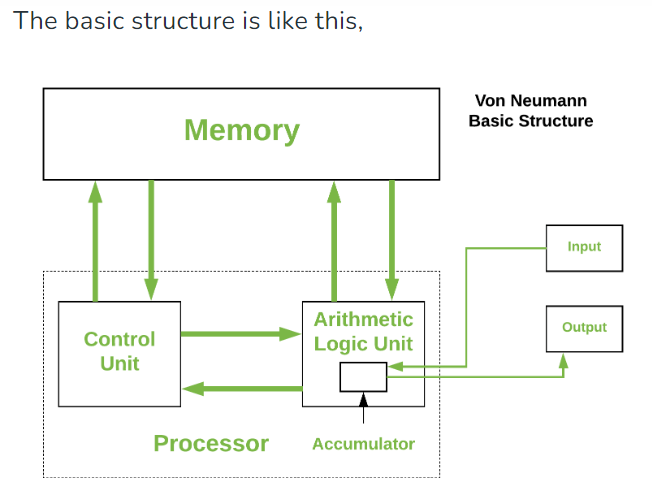
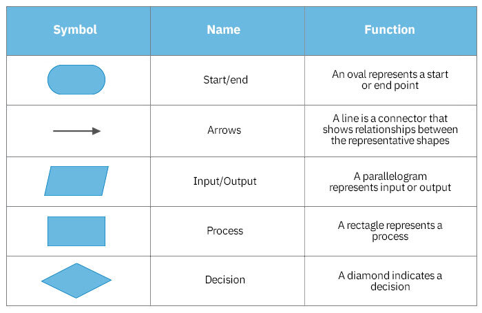
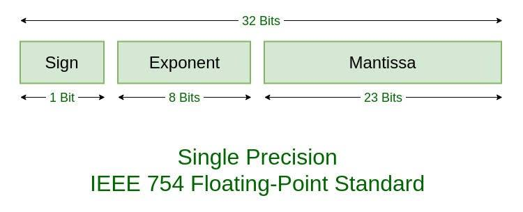

> [!abstract] Start here
> A syllabus-led guide for **80 marks**, based on your supplied blueprint, all 22 slide files, three existing notes, recursion PDF, and five handwritten pages. Learn the **CORE** material first, practise the **WRITE** programs without looking, and use **EXTRA** material only after that. The companion [[PSUC - Practice and Extra Reference]] preserves additional exercises and advanced topics from the sources.

## Navigation

- [[#1. Your 1½-day plan]]
- [[#2. Module 1 - Computer and C fundamentals]]
- [[#3. Module 2 - Decisions and loops]]
- [[#4. Module 3 - Arrays and strings]]
- [[#5. Module 4 - Functions, pointers and recursion]]
- [[#6. Module 5 - Structures and unions]]
- [[#7. Last-hour revision]]
- [[#8. Source map and corrections]]
- [[PSUC - Practice and Extra Reference|Practice questions, additional programs, and extension reference]]

## 1. Your 1½-day plan

### Blueprint and priorities

| Module | Blueprint content | Marks | Priority |
|---|---|---:|---|
| 1 | Architecture, languages, number systems, representations, C basics, macros, types, enum, storage classes, operators, conversion, precedence, I/O | 12–14 | CORE, especially storage classes and numerical questions |
| 2 | Conditions, switch, jumps, while, do-while, for | 16–20 | CORE + WRITE |
| 3 | 1D/2D arrays, strings, linear search, bubble sort | 6–10 | CORE + WRITE |
| 4 | Functions, value/reference passing, recursion, pointers, pointers with arrays | 24–28 | Highest allocation; practise writing and tracing |
| 5 | Structures, nested structures, arrays of structures, union | 10–12 | CORE + WRITE |

These are the blueprint's **ranges**, not five exact fixed allocations. Their endpoints need not separately total 80. Old notes saying “Unit 1 = 16 marks” or predicting 10 marks for strings do not override this table. Statements such as “100% coming” in class notes are emphasis, not a guarantee.

### A realistic schedule

Assumption: approximately **18 focused study hours across 36 elapsed hours**, with meals, breaks, and a full sleep. Shift the blocks to your actual start time. Use 50 minutes of work + 10 minutes off within longer blocks; the times below count focused work.

| When | Focused time | Task | Result you should produce |
|---|---:|---|---|
| Day 1, block 1 | 1 h | C types, I/O, operators, basic loops | Read a program and explain each line |
| Day 1, block 2 | 3 h | Functions, address passing, pointers and arrays | Write pointer swap and trace pointer expressions |
| Day 1, block 3 | 2 h | Recursion | Write factorial, Fibonacci, GCD and explain a call trace |
| Day 1, block 4 | 2.5 h | if/switch, loop patterns, digit problems | Write calculator, prime test, reverse number and pyramid |
| Day 1, block 5 | 1.5 h | 1D arrays and strings | Write search, bubble sort, string length and palindrome |
| Sleep | — | Aim for 7–8 hours | Preserve recall and concentration |
| Day 2, block 1 | 1.5 h | 2D arrays and remaining strings | Matrix multiplication/transpose and string functions |
| Day 2, block 2 | 1.5 h | Structures and unions | Write a student-record program and comparison table |
| Day 2, block 3 | 2 h | Remaining Module 1 | Conversions, IEEE example, storage classes, architecture |
| Day 2, block 4 | 3 h | Closed-book practice + last-hour sheet | Attempt the 80-mark practice set; fix your errors |
| **Total** | **18 h** | | |

> [!tip] How to learn a program quickly
> 1. Read its **input, output, and idea**.
> 2. Trace a small example by hand.
> 3. Hide the answer and write it from memory.
> 4. Test one normal case and one boundary case.
> 5. Explain why the loop ends or why recursion reaches its base case.
>
> Spend more time doing this than rereading. Reuse a pattern: digit problems use `% 10` and `/ 10`; strings stop at `'\0'`; arrays use `0` through `n-1`.

### Minimum checklist before the exam

- [ ] Pointer swap, pointer arithmetic, array/function relationship.
- [ ] Factorial and Fibonacci recursion; trace calls and returns.
- [ ] if-else ladder, switch fall-through, break versus continue.
- [ ] Digit sum/reverse, prime, factorial, Fibonacci, nested-loop patterns.
- [ ] Array extrema, linear search, bubble sort, matrix multiplication.
- [ ] String length, reverse/palindrome, library functions.
- [ ] Structures, nested structure, array of structures, union differences.
- [ ] Storage-class table and static-variable output.
- [ ] All number-system conversion directions; integer and float representation.
- [ ] Operators, precedence, casting and correct I/O formats.
- [ ] Von Neumann diagram and language/translators comparisons.

## 2. Module 1 - Computer and C fundamentals

### 2.1 Computer, program and Von Neumann architecture — CORE

A **computer** accepts input, processes data according to instructions, stores it, and produces output. **Data** are raw facts; information is data interpreted or processed for a purpose. **Hardware** is physical equipment. **Software** is programs and associated data. A **program** is a sequence of instructions for a task.

**Von Neumann architecture:** a stored-program computer in which **instructions and data share the same main memory**.



| Component | Exam-ready function |
|---|---|
| Input unit | Accepts data/instructions, e.g. keyboard |
| Memory | Stores both instructions and data |
| Control unit, CU | Fetches and decodes instructions; directs data movement and control |
| Arithmetic logic unit, ALU | Arithmetic, comparisons, logical and bit operations |
| Registers | Very fast small storage within the CPU |
| Output unit | Presents results, e.g. display/printer |
| Buses | Connect CPU, memory and I/O |

**CPU = CU + ALU + registers.** The diagram's processor region contains CU and ALU; include registers when labelling your own diagram.

- **PC, program counter:** address of the next instruction.
- **IR, instruction register:** instruction currently being processed.
- **Accumulator/general registers:** operands and intermediate results.
- **MAR:** address involved in a memory operation. **MDR:** data being transferred.
- **Status register:** flags such as zero, carry and overflow.

**Fetch–decode–execute–store cycle:**

1. Fetch the instruction at the address in PC into IR; update PC as appropriate.
2. CU decodes the operation and required operands.
3. CPU performs the operation, using ALU/memory/I/O as needed.
4. Store the result if required. Repeat. A branch may change PC.

**Buses:** data bus carries data/instructions; address bus selects locations; control bus carries read/write and other control/status signals.

**Advantages:** unified memory simplifies design, stored programs can be changed, and the computer can perform many tasks. **Limitation:** shared instruction/data transfer resources can restrict throughput: the **Von Neumann bottleneck**.

**Four-mark answer pattern:** definition + labelled diagram + roles of components + execution cycle/bottleneck. Do not merely list device names.

### 2.2 Memory and languages — CORE

Fastest access / smallest typical capacity to slower access / larger capacity:

`Registers → Cache → RAM → SSD/HDD`

| Storage | Key point |
|---|---|
| Registers | Inside CPU, hold immediate operands/results |
| Cache | Small fast memory on/near CPU, keeps frequently/recently used data and instructions |
| RAM | Main working memory, read/write, normally volatile |
| ROM | Non-volatile firmware storage; variants such as EEPROM can be reprogrammed |
| Secondary storage | Persistent large storage, e.g. SSD, HDD, optical discs, tape |

Bit = binary digit. In the usual 8-bit-byte systems, byte = 8 bits. A word is a machine's natural processing unit, commonly 16/32/64 bits. Clock rate is cycles per second in Hz; one cycle is not necessarily one completed instruction. Hardware capacities/speeds in old slides are examples, not fixed definitions. More hardware background is in the companion note.

| Feature | Machine language | Assembly language | High-level language |
|---|---|---|---|
| Form | Binary machine instructions | Mnemonics such as `MOV`, `ADD` | C, C++, Java, Python statements |
| CPU executes directly? | Yes | After assembly | After translation/execution machinery |
| Translator | None for machine instructions | Assembler | Compiler and/or interpreter |
| Portability | Architecture dependent | Architecture dependent | Source is generally more portable; may need changes/recompilation |
| Writing/debugging | Difficult | Requires hardware knowledge | Easier abstractions and maintenance |

Assembly example: `MOV AX, 5`, `MOV BX, 3`, `ADD AX, BX` leaves 8 in AX. Assembly offers direct hardware control and can be efficient, but is architecture dependent and harder to maintain. Compiled C may also generate highly efficient machine code; a language name alone does not determine execution speed.

| Translator | What it does | Typical example |
|---|---|---|
| Compiler | Translates source into target code before that code runs; target may be assembly, object code or bytecode | C compiler |
| Interpreter | Executes a program through an implementation at runtime; may use bytecode/JIT internally | Python implementation |
| Assembler | Translates assembly into machine/object code | NASM, GNU assembler |

The introductory comparison “whole program versus line by line” is a useful classroom model, but real implementations may combine compilation and interpretation. An assembler is not defined by “two phases” or “stops at first error.”

**Programming paradigms:** procedural programming organizes steps into procedures/functions (C); object-oriented programming organizes objects and methods (e.g. C++/Java); functional programming emphasizes function evaluation (e.g. Lisp); logic programming uses facts/rules (e.g. Prolog). Imperative code describes how to change state; declarative code describes the desired result. C is primarily imperative/procedural.

### 2.3 Algorithms and flowcharts — CORE overview

An **algorithm** is a finite, ordered, unambiguous procedure for solving a problem. Its properties are **input** (zero or more), **output** (at least one), **definiteness**, **finiteness**, and **effectiveness** (feasible individual steps).



Oval = start/end; parallelogram = input/output; rectangle = processing; diamond = decision; arrow = flow. Circle = on-page connector; pentagon is commonly an off-page connector; double-sided rectangle = predefined process/subroutine; cylinder = stored data/database; hexagon commonly means preparation, used in some loop conventions.

Class convention: one start and one stop, flow top-to-bottom/left-to-right, avoid crossing arrows, number on-page connectors and letter off-page connectors. These connector labels are a class convention, not a universal language rule.

**Example: factorial algorithm:** read non-negative `n`; set `fact=1`; for `i=1` to `n`, multiply `fact` by `i`; print `fact`; stop. For a flowchart, put the loop test `i<=n?` in a diamond with labelled yes/no branches. Examples for addition, maxima, tables, and login are in the companion note.

### 2.4 Number systems — CORE + numerical practice

| Base | Name | Valid digits |
|---:|---|---|
| 2 | Binary | 0,1 |
| 8 | Octal | 0–7 |
| 10 | Decimal | 0–9 |
| 16 | Hexadecimal | 0–9,A–F where A=10 … F=15 |

For base `b`, positional value is **Σ(digit × b^position)**. The units digit has position 0; fractional positions are -1, -2, … . Always write the base to avoid ambiguity.

| Conversion | Method | Worked example |
|---|---|---|
| Decimal → binary | Repeated division by 2; read remainders upward | 25: remainders 1,0,0,1,1 → `(11001)₂` |
| Decimal → octal | Repeated division by 8 | 125 → quotients 15,1,0; remainders 5,7,1 → `(175)₈` |
| Decimal → hex | Repeated division by 16 | 250 → quotient 15 remainder 10; then 0 remainder 15 → `(FA)₁₆` |
| Binary → decimal | Sum bit × power of 2 | `(101101)₂ = 32+8+4+1 = 45` |
| Octal → decimal | Sum digit × power of 8 | `(345)₈ = 3×64+4×8+5 = 229` |
| Hex → decimal | Sum digit × power of 16 | `(2A)₁₆ = 2×16+10 = 42` |
| Binary → octal | Group integer bits in 3s from right; pad left with 0 | `1101011 → 001 101 011 → (153)₈` |
| Binary → hex | Group integer bits in 4s from right | `11111010 → 1111 1010 → (FA)₁₆` |
| Octal → binary | Replace each digit with exactly 3 bits | `(345)₈ → 011 100 101` |
| Hex → binary | Replace each digit with exactly 4 bits | `(2A)₁₆ → 0010 1010` |
| Octal → hex | Convenient route through binary | `(345)₈ → 011100101 → 0000 1110 0101 → (E5)₁₆` |
| Hex → octal | Convenient route through binary | `(2A)₁₆ → 00101010 → 000 101 010 → (52)₈` |

There are other valid routes (e.g. through decimal); “no direct conversion” in the slides means use the convenient binary grouping method.

Memorize: `0=0000, 1=0001, 2=0010, 3=0011, 4=0100, 5=0101, 6=0110, 7=0111, 8=1000, 9=1001, A=1010, B=1011, C=1100, D=1101, E=1110, F=1111`.

**Fractions:** decimal fraction to binary uses repeated multiplication by 2, recording integer parts downward. `0.625×2=1.25`, `.25×2=.5`, `.5×2=1` gives `.101₂`. Conversely `.101₂=1/2+0/4+1/8=.625`. Group fractional binary bits outward from the radix point, padding on the **right**. Example `10.101₂=2.625₁₀`.

**Slide exercise answers:**

| Decimal | Binary | Octal | Hex |
|---:|---|---|---|
| 125 | 1111101 | 175 | 7D |
| 250 | 11111010 | 372 | FA |
| 182 | 10110110 | 266 | B6 |
| 237 | 11101101 | 355 | ED |
| 229 | 11100101 | 345 | E5 |
| 470 | 111010110 | 726 | 1D6 |
| 943 | 1110101111 | 1657 | 3AF |

Cover three columns and reconstruct them. In an answer, show division/grouping steps, not only the final value.

### 2.5 Integer and floating-point representation — CORE

For **n bits**:

- Unsigned range: `0` to `2ⁿ−1`.
- Signed **two's complement** range: `−2ⁿ⁻¹` to `2ⁿ⁻¹−1`.
- 8-bit two's complement: `−128 … 127`; 16-bit: `−32768 … 32767`.
- `int` need not be 16 bits; common modern systems use 32 bits. Use a question's stated width.

**Represent −5 in 8-bit two's complement:** `5=00000101`; invert → `11111010`; add 1 → `11111011`.

**Decode `11111011`:** signed weights give `−128+64+32+16+8+2+1=−5`. The other seven bits are **not simply the magnitude** for a negative two's-complement value.

For comparison, 8-bit sign-magnitude `−5` is `10000101`; one's complement is `11111010`; two's complement is `11111011`. Sign-magnitude and one's complement have two representations of zero. Two's complement has one.

**C range traps:** unsigned arithmetic wraps modulo `2ⁿ` for an n-bit unsigned type. Signed arithmetic overflow has undefined behavior; do not assume it always wraps. Plain `char` may be signed or unsigned. In the C11/C17 model used here, converting out-of-range 130 to an 8-bit signed character type is implementation-defined, not a portable promise of −126.

**Floating point:** approximates a real value using sign, significand and exponent. Many decimal fractions are not exactly representable in binary, so rounded arithmetic can make exact equality unreliable.



For a **normalized IEEE 754 binary32** number:

`value = (−1)^sign × (1.fraction)₂ × 2^(stored_exponent−127)`

- Single precision: 1 sign + 8 exponent + 23 stored fraction bits = 32 bits.
- Double precision: 1 + 11 + 52 = 64 bits, exponent bias 1023.
- Fraction is often called mantissa in class. The leading normalized `1` is implicit.

**Slide example, 19.125:**

1. `19.125₁₀ = 10011.001₂`.
2. Normalize: `1.0011001₂ × 2⁴`.
3. Sign = `0`; exponent = `4+127=131=10000011₂`.
4. Fraction = `00110010000000000000000`.
5. Final: `0 10000011 00110010000000000000000`.

Special exponent patterns represent zero/subnormals and infinity/NaN; the normalized formula above does not apply to all patterns. For this exam, prioritize the field sizes, bias, normalization and the worked example.

### 2.6 Structure of C and translation — CORE

Complete minimal program:

```c
#include <stdio.h>

int main(void)
{
    printf("Hello, World!\n");
    return 0;
}
```

- `#include <stdio.h>` makes standard I/O declarations available.
- `int main(void)` is a standard hosted-program entry point with no arguments.
- `{ ... }` forms a compound statement/block.
- A function call such as `printf(...)` followed by `;` is an expression statement.
- `return 0;` reports successful termination.
- C is case-sensitive. Use straight quotes in source code.
- `// comment` and `/* comment */` are comments; block comments do not nest.

**Translation:** `.c source → preprocessing → compilation → assembly → object code → linking → executable`. A loader later loads the executable for execution. A common toolchain combines these stages behind one command.

Preprocessing includes files, expands macros, and handles conditional directives. It does **not** load library functions into RAM. Headers usually provide declarations/types/macros; linked libraries provide compiled function implementations. `sqrt(100)` is a **call**, `double sqrt(double);` is a declaration, and a function body is its definition.

| Header | Main use |
|---|---|
| `<stdio.h>` | `printf`, `scanf`, `getchar`, `putchar`, `fgets`, `puts` |
| `<string.h>` | `strlen`, `strcpy`, `strcat`, `strcmp`, searching strings |
| `<math.h>` | `sqrt`, `pow`, `fabs` |
| `<ctype.h>` | Character tests and `toupper`/`tolower` |
| `<stdlib.h>` | Utilities, conversions, allocation |
| `<stddef.h>` | `NULL`, `size_t`, `ptrdiff_t` |

`#include <header.h>` normally searches configured system include paths. `#include "myheader.h"` normally checks the source/local location before other paths. Exact search rules belong to the implementation. User headers conventionally end in `.h`. `<conio.h>`, `getch()` and `clrscr()` are older implementation-specific facilities.

**Common directives:** `#include`, `#define`, `#undef`, `#if`, `#ifdef`, `#ifndef`, `#else`, `#elif`, `#endif`. Directives normally do not end in `;`. `include` is not a C language keyword.

### 2.7 Macros — CORE

```c
#define PI 3.14159
#define SQUARE(x) ((x) * (x))
#define MUL(a, b) ((a) * (b))
#define MAX(a, b) ((a) > (b) ? (a) : (b))
#define AREA(r) (PI * (r) * (r))
```

An **object-like macro** replaces a name with replacement text. A **function-like macro** substitutes parameters in replacement text. No space belongs between the macro name and `(` in its definition.

| Expression | Expansion/result |
|---|---|
| Bad definition `#define SQ(x) x*x`; `SQ(2+3)` | `2+3*2+3` = 11 |
| Correct `SQUARE(2+3)` | `((2+3)*(2+3))` = 25 |
| `MUL(3+2,4)` | 20 |
| `MAX(8,5)` | 8 |

Parenthesize each argument and the full expression. Even a parenthesized macro can repeat an argument: **do not use `SQUARE(i++)`**; its expansion modifies `i` twice without sequencing. Prefer an ordinary function when arguments have side effects.

**Macro versus function:** macros do textual substitution with no parameter type checking and may duplicate work/code. Functions have typed parameters, normal argument evaluation, and easier debugging. Macro expansion occurs before compilation; the resulting expression is not necessarily calculated during preprocessing. Modern compilers can inline functions, so macros are not automatically faster.

**Macro versus `const`:** `#define LIMIT 10` creates replacement text; `const int limit=10;` declares a typed, non-modifiable object. The macro name itself is not an allocated variable. `const` does not automatically mean compile-time integer constant in C.

### 2.8 Tokens, types, variables, constants and enum — CORE

A **token** is a smallest lexical unit. Learn the classroom categories: keyword, identifier, constant, string literal, operator, punctuation/separator. Preprocessor directives are handled during preprocessing, rather than being a seventh ordinary C token kind.

For `int total = a + 10;`, tokens are `int`, `total`, `=`, `a`, `+`, `10`, `;`.

**Identifiers:** letters/digits/underscore, start with a letter or underscore, case-sensitive, cannot be a keyword. Prefer starting user names with letters because some underscore names are reserved. Valid: `sum`, `marks2`, `student_name`. Invalid: `1sum`, `sum value`, `a+b`, `float`, `@value`.

The **32 classic C90 keywords** found in your slide:

```text
auto break case char const continue default do
double else enum extern float for goto if
int long register return short signed sizeof static
struct switch typedef union unsigned void volatile while
```

Later C standards add keywords; “32” describes the traditional syllabus list.

A **variable** is a named object storing a value. A **data type** specifies its value category and operations/storage requirements. Declaration states a name/type; initialization supplies its initial value; assignment changes an existing object's value.

```c
int age;                  // declaration and definition
float price = 12.5f;      // initialized definition
age = 18;                // assignment
const int DAYS = 7;       // a typed object that cannot be modified
```

| Type | Common size, not a universal guarantee | `printf` | `scanf` destination |
|---|---|---|---|
| `char` | 1 C byte | `%c` | `%c`, `char *` |
| `short` | 2 bytes | `%hd` | `%hd`, `short *` |
| `int` | 4 bytes | `%d` | `%d`, `int *` |
| `unsigned int` | 4 bytes | `%u` | `%u`, `unsigned int *` |
| `long` | 4 or 8 bytes | `%ld` | `%ld`, `long *` |
| `long long` | 8 bytes | `%lld` | `%lld`, `long long *` |
| `float` | 4 bytes | `%f` (promoted to double) | `%f`, `float *` |
| `double` | 8 bytes | `%f` or `%lf` | `%lf`, `double *` |
| `long double` | commonly 8/12/16 bytes, ABI dependent | `%Lf` | `%Lf`, `long double *` |
| `size_t` | system dependent | `%zu` | `%zu`, `size_t *` |
| pointer | system dependent | `%p`, pass `(void *)p` | Learn pointer output first |

`sizeof` returns size in C bytes; `sizeof(char)==1`. An ordinary string has no built-in `string` type in C: use a null-terminated `char` array. `void` means no value/return value; standard C does not define `sizeof(void)`.

Type modifiers include `signed`, `unsigned`, `short`, `long`, `long long`. Other categories include arrays/pointers/functions and user-defined structure/union/enum types.

**Constants:**

- Integer: `123` decimal, `0123` octal (=83 decimal), `0x123` hex (=291 decimal).
- `017 + 2` = `15+2` = **17 decimal**. Digits 8 and 9 cannot occur in octal literals.
- Suffixes: `12u`, `12L`, `12LL`, `12UL`, `12ULL` select unsigned/long variants.
- `0b1010` appears in slides; it is standard in C23 and an extension in older compilers. Use portable decimal/hex in C11/C17 exam programs.
- Floating: `3.14` has type `double`; `3.14f` is `float`; `3.14L` is `long double`; `6.022e23` is scientific notation.
- Character: `'A'` is an integer character constant (type `int` in C). String: `"A"` is an array of two chars, `A` and `'\0'`.
- On ASCII systems: `'0'=48`, `'5'=53`, `'A'=65`, `'a'=97`, `'\0'=0`. ASCII itself is a 7-bit code; 256 is the number of possible patterns in an 8-bit byte, not “256 ASCII characters.”

**Escapes:** `\n` newline, `\t` tab, `\r` carriage return, `\b` backspace, `\a` alert, `\\` backslash, `\"` double quote, `\'` single quote, `\0` null character. Print a literal percent with `%%` in a format string.

**Enumerated types:** symbolic integer constants.

```c
enum Day { SUN, MON, TUE, WED, THU, FRI, SAT };
enum Number { A = 5, B, C = 10, D, E };
// SUN=0, WED=3; A=5, B=6, C=10, D=11, E=12
```

An `enum Day today=WED;` variable can hold a day value; `if (today==WED)` tests it. Traffic signal example: `enum Traffic { RED, YELLOW, GREEN };`, with `GREEN=2`. Enumerators, macros and `const` objects are three distinct ways class notes introduce named constants.

### 2.9 Storage classes, scope and lifetime — CORE, memorize

**Scope:** region of source where a name is visible. **Lifetime/storage duration:** how long its object exists. **Linkage:** whether declarations identify the same entity across scopes/files.

| Class/use | Scope | Lifetime | Initialization if omitted | Exam point |
|---|---|---|---|---|
| Local `auto` or ordinary local | Block | Each active block invocation | Indeterminate | Initialize before reading |
| Local `register` | Block | Automatic | Indeterminate | Register hint; placement/speed not guaranteed; cannot apply `&` in C11/C17 |
| Local `static` | Block | Entire execution | Zero | Value retained between calls |
| File-scope `static` | File | Entire execution | Zero | Internal linkage; hidden from other translation units |
| File-scope object / suitable `extern` declaration | Where declared | Entire execution for the associated object | Zero for an uninitialized static-duration definition | External sharing through declarations |

`extern int count;` normally declares an object defined elsewhere; it does not create a new automatic local object or initialize it to zero. `int count;` at file scope can serve as a tentative definition. `extern int count=3;` is a definition.

Complete output-tracing example:

```c
#include <stdio.h>
void counter(void)
{
    int a = 0;
    static int b = 0;
    ++a;
    ++b;
    printf("a=%d b=%d\n", a, b);
}
int main(void)
{
    counter();
    counter();
    counter();
    return 0;
}
```

Output: `a=1 b=1`, then `a=1 b=2`, then `a=1 b=3`. Each call initializes a new `a`; `b` is initialized once and persists.

A local declaration can hide a global of the same name. **C has no C++ `::` scope-resolution operator.** A global is not automatically visible “without restriction”: declarations, scope and linkage still matter. Scope kinds from the slide: block, file, function (labels), function-prototype scope.

### 2.10 Operators, expressions and casting — CORE

An expression combines operands/operators to compute a value or perform a side effect. An expression statement adds `;`; a null statement is just `;`; a compound statement uses `{}`.

| Group | Operators and rules |
|---|---|
| Arithmetic | `+ - * / %`; `%` requires integer operands; division by zero is invalid |
| Relational/equality | `< <= > >= == !=` produce 0 or 1 |
| Logical | `&&`, `||`, `!` interpret zero as false, nonzero as true; produce 0 or 1 |
| Assignment | `= += -= *= /= %= &= ^= \|= <<= >>=` |
| Increment/decrement | `++ --`; operand must be a modifiable lvalue |
| Bitwise | `& \| ^ ~ << >>` operate on integer bits |
| Conditional | `condition ? value_if_true : value_if_false` |
| Other | `sizeof`, cast `(type)`, comma `,`, address `&`, dereference `*`, member `. ->` |

**Division:** `5/2=2`, `(double)5/2=2.5`; integer division truncates toward zero. `-7/3=-2`, `-7%3=-1`. `2^3` is XOR (=1), not exponentiation; use multiplication or `pow` for a power.

**Implicit conversion:** automatic conversion, e.g. `double x=5;`. **Explicit casting:** programmer writes conversion, e.g. `(double)sum/n`. `double x=5/2;` gives `2.0`; assignment cannot restore the discarded fraction. `(int)3.9=3` for a representable value. Small integer types usually undergo integer promotion in expressions; signed/unsigned mixtures deserve care.

**Precedence and associativity**, high to low:

| Level | Operators | Grouping |
|---:|---|---|
| 1 | postfix `() [] . -> x++ x--` | Left to right |
| 2 | unary `++x --x + - ! ~ * & sizeof`, cast | Right to left |
| 3 | `* / %` | Left to right |
| 4 | `+ -` | Left to right |
| 5 | `<< >>` | Left to right |
| 6 | `< <= > >=` | Left to right |
| 7 | `== !=` | Left to right |
| 8 | bitwise `&` | Left to right |
| 9 | bitwise `^` | Left to right |
| 10 | bitwise `\|` | Left to right |
| 11 | `&&` | Left to right |
| 12 | `\|\|` | Left to right |
| 13 | `?:` | Right to left |
| 14 | assignment family | Right to left |
| 15 | comma operator | Left to right |

Precedence/associativity determine **grouping**, not a general left-to-right evaluation order. Parentheses control grouping, but do not sequence arbitrary side effects.

Examples: `a+b*c` groups `a+(b*c)`; `20/5*2=8`; `a=b=c=5` assigns 5 to all three; `a/=b+c` means `a=a/(b+c)`.

**Prefix/postfix:** starting `m=5`, `y=++m` gives `m=6,y=6`; starting again at 5, `y=m++` gives `y=5,m=6`. With `a=1,b=1`, `c=a+++b` tokenizes as `a++ + b`, giving `c=2,a=2,b=1`. Write spaces for clarity. `++5` and `++(x+1)` violate the modifiable-operand requirement.

**Short circuit:** `x!=0 && 10/x>2` avoids division when `x==0`. `1 || ++x` skips `++x`; `0 && ++x` skips it too.

**Important traps:** `=` assigns, `==` compares. `5<=x<=10` groups `(5<=x)<=10` and is always true for ordinary integer `x`; use `x>=5 && x<=10`. `if(x==0);` has an empty body. `i++ + ++i` and `printf("%d %d",i++,i++)` have undefined behavior in this C model; there is no guaranteed numerical answer.

**Bitwise worked example:**

```text
12 = 00001100
25 = 00011001
&    00001000 = 8
|    00011101 = 29
^    00010101 = 21
```

For 0/1 input bits, AND gives 1 only for 1,1; OR gives 1 if either is 1; XOR gives 1 when the bits differ. `~` flips bits. On ordinary two's-complement `int`, `~35=-36`. The low 8 complemented bits of 35 are `11011100`, whose **unsigned 8-bit interpretation** is 220; that is a different interpretation from the full signed `int` expression.

For small unsigned values: `5u<<1=10`, `20u>>2=5`. Keep shift counts nonnegative and below the promoted type width. Use unsigned operands for bit manipulation; negative signed shifts and signed overflow have additional rules.

**Swap without a third variable**, body fragment for two **distinct unsigned variables** `a,b`:

```c
a ^= b;
b ^= a;
a ^= b;
```

If both names refer to the same object, XOR swapping destroys its value. Addition/subtraction swapping can overflow signed integers. A temporary variable is the clearest general swap.

### 2.11 Formatted input/output — CORE

Standard streams: `stdin` input, `stdout` ordinary output, `stderr` diagnostics. These are streams and can be redirected; they are not permanently tied to keyboard/screen.

```c
int age;
float marks;
char grade;
/* Body fragment: require all three inputs before using them. */
if (scanf("%d %f %c", &age, &marks, &grade) == 3)
    printf("Age=%d Marks=%.2f Grade=%c\n", age, marks, grade);
```

`scanf` needs addresses so it can store values. For an array string, `name` already converts to a pointer to its first char: `scanf("%19s",name)` for `char name[20]`. Its return value counts successful assignments. `printf` returns characters written (or a negative value on error).

Integer output: `%d`/`%i` prints signed decimal, `%u` unsigned decimal, `%o` unsigned octal, `%x`/`%X` unsigned hexadecimal in lower/uppercase. Example: `printf("%u %o %x",42u,42u,42u)` prints `42 52 2a`. Do not confuse the output meaning of `%i` with its base-detecting input behavior.

**`printf` syntax:** `%[flags][width][.precision][length]specifier`.

| Example | Meaning/result |
|---|---|
| `printf("[%6d]",42);` | `[    42]` |
| `printf("[%-6d]",42);` | `[42    ]` |
| `printf("%05d",42);` | `00042` |
| `printf("%+d",42);` | `+42` |
| `printf("[%9.3f]",123.456789);` | `[  123.457]` |
| `printf("[%*.*f]",7,2,98.736);` | `[  98.74]` |
| `printf("%.4d",42);` | `0042`, at least 4 integer digits |
| `printf("%.3s","Computer");` | `Com`, at most 3 string characters |
| `printf("%#x",42u);` | `0x2a` |
| `printf("%%");` | `%` |

Width is a **minimum**, so wider values are not truncated. `-` left-aligns, `+` forces a sign, space reserves a sign position, `0` requests zero padding, `#` requests an alternate form.

`%f` is fixed-point, `%e/%E` exponential, `%g/%G` chooses fixed or exponential based on exponent/precision and normally removes trailing zeros. Default precision is 6 digits after the decimal for `%f/%e`, 6 significant digits for `%g`. `%f` **also rounds** when printing to a given precision. `%g` examples from the lecture: `0.0000875 → 8.75e-05`, `8750000.0 → 8.75e+06`, `87.50 → 87.5`.

**`scanf` details:**

| Form | Behavior |
|---|---|
| `%d` versus `%i` | Decimal input versus base detection using prefixes (`010` octal, `0x10` hex) |
| `%2d` | Maximum field width 2 input characters; unread input remains |
| `%*d` | Read and discard an integer; no destination argument |
| `%d-%d-%d` | Literal dashes must match the input |
| `%d%*c%d%*c%d` | Discard one arbitrary separator between integers |
| `%c` | Reads a character including whitespace; no automatic skipping |
| `" %c"` | Leading format whitespace skips input whitespace before the character |
| `%19s` | Reads a word, maximum 19 chars + null in a 20-char array |
| `%99[^\n]` | Reads up to newline, maximum 99 chars + null in a 100-char array |
| `%[abc]` | Accepts only characters in the scanset |

`%s` input stops at whitespace; `%s` output stops at `'\0'`. A scanset does not automatically skip leading whitespace. `scanf(" %99[^\n]",s)` skips leading whitespace too, which may be unwanted if leading spaces matter. If a conversion fails, do not use the destination as though input succeeded. Avoid a trailing newline in a `scanf` format because it can keep waiting for a non-whitespace character.

> [!check] Module 1 retrieval
> Explain PC versus IR, compiler versus assembler, macro versus function, signed versus unsigned range, scope versus lifetime, `float` versus `double` input formats, and why `(double)a/b` differs from `(double)(a/b)`. Convert `(726)₈` to hex and decode the 19.125 floating-point fields without looking.

## 3. Module 2 - Decisions and loops

### 3.1 Selection statements — CORE

Control can be **sequential** (in order), **selection** (choose a branch), or **iteration** (repeat). A condition is false when zero, true when nonzero. It need not return exactly 1, and scalar expressions, including floating values/pointers, can serve as conditions.

Syntax patterns, shown as fragments:

```c
if (condition) {
    /* executed only when true */
}

if (condition) {
    /* true branch */
} else {
    /* false branch */
}

if (condition1) {
    /* first matching branch */
} else if (condition2) {
    /* second choice */
} else {
    /* fallback */
}
```

An `else-if` ladder executes the **first true branch only**. Independent `if` statements can execute several bodies. Braces can be omitted for a single statement, but using them avoids mistakes.

**Dangling else:** an `else` belongs to the nearest unmatched `if` unless braces change the grouping. With `n=3`, this fragment prints nothing:

```c
if (n > 5)
    if (n < 10)
        puts("1111");
    else
        puts("2222");
```

**Common decision recipes**, body fragments with the variables already declared/input:

```c
/* Even/odd, also works for negative integers */
printf("%s\n", n % 2 == 0 ? "Even" : "Odd");

/* Largest of three, handles equal maxima */
int largest = a;
if (b > largest) largest = b;
if (c > largest) largest = c;

/* Smallest: use < in the same pattern. */

/* Sign: negative, zero or positive */
int sign = n < 0 ? -1 : (n == 0 ? 0 : 1);

/* Leap year: century years need divisibility by 400 */
int leap = year % 400 == 0 || (year % 4 == 0 && year % 100 != 0);
```

Leap-year tests: 2000 yes, 1900 no, 2024 yes, 2025 no. For an absolute-value exercise use `if(n<0) n=-n;` with an input whose positive magnitude fits; the minimum signed integer is an edge case.

**Character classification:** use one ladder, otherwise a letter may also reach an unrelated `else`:

```c
/* Body fragment, ASCII-compatible ranges assumed. */
if (ch >= 'a' && ch <= 'z') puts("Lowercase");
else if (ch >= 'A' && ch <= 'Z') puts("Uppercase");
else if (ch >= '0' && ch <= '9') puts("Digit");
else puts("Other character");
```

**Grade ladder** from the slides, for valid marks 0–100: `>=80 → A`, `>=60 → B`, `>=50 → C`, `>=40 → D`, otherwise F. Check ranges in descending order and reject values outside 0–100 first.

### 3.2 Switch and jump statements — CORE + WRITE

`switch` selects an entry point using an integer/enum/character-valued expression. Each `case` is a unique integer constant expression. `default` is optional and can appear anywhere. Floats, strings and ordinary variable case labels are invalid. In this C model, a `const int` object is not generally an integer constant expression for a case label; macros/enumerators can be.

Execution jumps to the matching case (or default if none), then continues until `break`, return, or the end. **Case labels do not themselves stop execution.** Statements before the first label are bypassed when entering a switch.

Complete calculator — WRITE:

```c
#include <stdio.h>
int main(void)
{
    double a, b;
    char op;
    if (scanf("%lf %c %lf", &a, &op, &b) != 3) return 1;
    switch (op) {
        case '+': printf("%.2f\n", a + b); break;
        case '-': printf("%.2f\n", a - b); break;
        case '*': printf("%.2f\n", a * b); break;
        case '/':
            if (b == 0.0) puts("Division by zero");
            else printf("%.2f\n", a / b);
            break;
        default: puts("Unknown operator");
    }
    return 0;
}
```

Example `8 / 2` → `4.00`; `8 / 0` prints the error. For modulo, use integer operands and reject zero divisor.

**Fall-through trace:** with code `case 110: print HRD; case 115: print IVS; case 125: print E&R; case 135: print CCD;`, input 115 prints `IVS E&R CCD`. If default precedes case 1 and case 2, input 2 still jumps directly to case 2. With no matching case, default may fall through to later cases if there is no break.

**Grouped cases**, body fragment:

```c
switch (ch) {
    case 'a': case 'e': case 'i': case 'o': case 'u':
    case 'A': case 'E': case 'I': case 'O': case 'U':
        puts("Vowel");
        break;
    default: puts("Not a vowel");
}
```

For grade ranges use `switch(marks/10)` after validation, grouping 10,9,8 for A. The slide's exact cases 100,90,80 alone do not cover every mark in 80–100. `case 80 ... 89:` is a GNU extension, not standard C.

| Statement | Effect |
|---|---|
| `break` | Exits the nearest enclosing loop or switch, not an arbitrary block |
| `continue` | Skips the rest of the nearest loop iteration; no special switch-only meaning |
| `return` | Ends the current function; a non-void function can return one value |
| `goto label;` | Jumps to a label in the same function |

There is no C keyword named `jump`. `goto` fragment: `if(error) goto cleanup; ... cleanup: puts("Done");`. It can help shared cleanup; for ordinary counting use structured loops.

### 3.3 Loop mechanics — CORE

| Loop | Syntax outline | Condition check | Minimum body executions |
|---|---|---|---:|
| for | `for(init; condition; update) {body}` | Before body | 0 |
| while | `while(condition) {body}` | Before body | 0 |
| do-while | `do {body} while(condition);` | After body | 1 |

`for`: initialize once → test → body → update → test again. All three expressions can be omitted; omitted condition behaves as true: `for(;;)`. Multiple init/update expressions can use comma: `for(i=0,j=9;i<j;i++,j--)`.

In a **for** loop, `continue` proceeds to the **update**, then retests. In **while**, it proceeds to the condition. In **do-while**, it proceeds to the test at the bottom. This difference can cause infinite loops if an update is skipped in a while body.

Fragment tracing 1–5, skip 3, stop before printing 5:

```c
for (int i = 1; i <= 5; ++i) {
    if (i == 3) continue;
    if (i == 5) break;
    printf("%d ", i);
}
/* Prints: 1 2 4 */
```

`for(i=0;i<n;i++);` has an empty body. `do-while` requires its final semicolon. A nested-loop `break` exits only the nearest loop. `while(n<100)` starting at 1 sums 1–99, **4950**; use `n<=100` for 1–100, **5050**.

### 3.4 Number-program patterns — WRITE

The next block contains **reusable function definitions**, not a full program. Put them above `main`, or declare prototypes first. Unless stated otherwise, inputs are nonnegative and results must fit the return type. These small helpers express the same loop logic you can place directly in `main` when the question requests that style.

```c
int digit_sum(unsigned int n)
{
    int sum = 0;
    do {
        sum += (int)(n % 10);
        n /= 10;
    } while (n != 0);
    return sum;
}

unsigned int reverse_number(unsigned int n)
{
    unsigned int rev = 0;
    do {
        rev = rev * 10 + n % 10;
        n /= 10;
    } while (n != 0);
    return rev;
}

unsigned long long factorial_iter(unsigned int n)
{
    unsigned long long fact = 1;
    for (unsigned int i = 2; i <= n; ++i) fact *= i;
    return fact;
}

int is_prime(int n)
{
    if (n < 2) return 0;
    for (int d = 2; d <= n / d; ++d)
        if (n % d == 0) return 0;
    return 1;
}
```

| Program | Trace/example | Boundary |
|---|---|---|
| Digit sum | 472: extract 2,7,4 → 13 | 0 → 0 |
| Reverse | 120: rev 0→0→2→21 | Leading zeros disappear; avoid unsigned result overflow |
| Numeric palindrome | Compare original nonnegative input with its reverse | 121 yes, 120 no, 0 yes |
| Factorial | Multiply 1×2×…×n | 0! = 1; restrict n≤20 for the shown 64-bit-or-wider unsigned type |
| Prime | Reject a discovered divisor; return true only after the loop | 0,1 negative values are not prime; 2 is prime |

`d<=n/d` avoids the possible overflow of `d*d<=n`. Do not print “prime” inside every unsuccessful divisor test. For reversing, sufficiently large values can wrap unsigned arithmetic; use small exam inputs or a wider checked accumulator.

**Fibonacci series**, complete program printing **n terms**, starting `0 1`:

```c
#include <stdio.h>
int main(void)
{
    int n;
    unsigned long long a = 0, b = 1;
    if (scanf("%d", &n) != 1 || n < 0 || n > 40) return 1;
    for (int i = 0; i < n; ++i) {
        printf("%llu ", a);
        unsigned long long next = a + b;
        a = b;
        b = next;
    }
    putchar('\n');
    return 0;
}
```

Input 7 → `0 1 1 2 3 5 8`. Distinguish **number of terms** from **nth term with F(0)=0**.

Other loop recipes:

- Count digits: `count=0; do {count++; n/=10;} while(n);` gives 1 for zero.
- Natural sum: initialize 0, add `i=1…n`; or `n*(n+1)/2` with adequate type.
- Multiplication table: for `i=1…10`, print `number*i`. Tables 10–20 require an outer table loop.
- Skip a zero denominator: before division, `if(denominator==0) continue;` in a loop reading multiple cases.
- Sum selected natural numbers: add only when the question's divisibility condition holds.
- Armstrong: count k digits, sum each digit raised to k using integer multiplication, compare with original. For 153: `1³+5³+3³=153`. More practice appears in the companion note.

### 3.5 Nested loops and patterns — WRITE

Think **rows first**. For row `i=1…n`, a right triangle has `i` stars; a centered pyramid has `n-i` leading spaces and `2*i-1` stars.

Complete centered pyramid:

```c
#include <stdio.h>
int main(void)
{
    int n;
    if (scanf("%d", &n) != 1 || n < 1 || n > 30) return 1;
    for (int i = 1; i <= n; ++i) {
        for (int s = 0; s < n - i; ++s) putchar(' ');
        for (int j = 0; j < 2 * i - 1; ++j) putchar('*');
        putchar('\n');
    }
    return 0;
}
```

For n=4:

```text
   *
  ***
 *****
*******
```

Variations: right triangle uses `j=1…i` and no spaces; inverted triangle uses `n-i+1` stars; number triangle prints `j` in place of `*`; Floyd's triangle maintains a separate counter incremented across rows. For each variation, calculate the row lengths before writing loops.

> [!check] Module 2 retrieval
> Predict an unmatched `else`, a switch with no breaks, and a loop containing both continue and break. Write prime, digit reversal, calculator and pyramid without looking. Explain why 1900 is not a leap year and why a do-while body runs once even when its test is initially false.

## 4. Module 3 - Arrays and strings

### 4.1 One-dimensional arrays — CORE

An array stores a fixed number of **same-type elements in contiguous storage**. `int a[5]` has elements `a[0]…a[4]`. C does not automatically check index bounds; accessing outside the array causes undefined behavior.

```c
int a[5] = {3, 58, 89, 42, 1};
int b[] = {10, 20, 30};             // size inferred as 3
int c[5] = {90, 85};               // 90,85,0,0,0
int zeros[5] = {0};                // all zero
int d[] = {[2] = 19, [9] = 2};     // C99: size 10, others zero
```

An uninitialized **automatic** array has indeterminate contents, not all zeros. Whole arrays cannot be assigned with `a=b` after declaration.

Body fragments:

```c
for (int i = 0; i < n; ++i) scanf("%d", &a[i]);
for (int i = 0; i < n; ++i) printf("%d ", a[i]);
size_t count = sizeof a / sizeof a[0]; /* only when a is an actual array here */
```

If `a` is a function parameter, it has adjusted pointer type; that `sizeof` calculation cannot recover the caller's element count. Pass the length or use another agreed convention.

**Core lab patterns**, function definitions with `n>=1` where an element is accessed:

```c
int array_sum(const int a[], int n)
{
    int sum = 0;
    for (int i = 0; i < n; ++i) sum += a[i];
    return sum;
}

void extrema(const int a[], int n, int *smallest, int *largest)
{
    *smallest = *largest = a[0];
    for (int i = 1; i < n; ++i) {
        if (a[i] < *smallest) *smallest = a[i];
        if (a[i] > *largest) *largest = a[i];
    }
}

void reverse_array(int a[], int n)
{
    for (int left = 0, right = n - 1; left < right; ++left, --right) {
        int temp = a[left];
        a[left] = a[right];
        a[right] = temp;
    }
}
```

**Reverse with an auxiliary array**, as requested by the slide's lab list: `for(i=0;i<n;i++) b[i]=a[n-1-i];`. Print `b`; copy it back only if the question requires changing `a`.

**Print subarray:** validate `0<=left<=right<n`, then loop `i=left…right` inclusive. State whether the question's indices are zero-based or whether it gives one-based positions. Do not use the earlier note's `i<9` when the array has only five elements.

### 4.2 Linear search and sorting — CORE + WRITE

**Linear search:** compare the key with successive elements. Works on unsorted arrays. Returns the first matching index or −1. At most n comparisons, O(n) time, O(1) extra storage.

```c
int linear_search(const int a[], int n, int key)
{
    for (int i = 0; i < n; ++i)
        if (a[i] == key) return i;
    return -1;
}
```

For `[8,4,9,4]`, key 4 → index 1 / position 2; key 7 → −1. If every occurrence is requested, print all matching indices instead of returning at the first match.

**Bubble sort:** compare adjacent elements and swap out-of-order pairs. After each ascending pass, the largest value in the remaining unsorted part is in its final position at the right.

```c
void bubble_sort(int a[], int n)
{
    for (int pass = 0; pass < n - 1; ++pass) {
        int swapped = 0;
        for (int j = 0; j < n - 1 - pass; ++j) {
            if (a[j] > a[j + 1]) {
                int temp = a[j];
                a[j] = a[j + 1];
                a[j + 1] = temp;
                swapped = 1;
            }
        }
        if (!swapped) break;
    }
}
```

Trace `[5,1,4,2,8]`: pass 1 → `[1,4,2,5,8]`; pass 2 → `[1,2,4,5,8]`; next pass has no swaps, so stop. Worst/average O(n²); with this early-exit version, best O(n); O(1) extra space. Swapping only for `>` preserves the relative order of equal elements, so this version is stable. Descending sort changes `>` to `<`.

**Selection sort**, also present in your array slides, repeatedly selects the smallest remaining element:

```c
void selection_sort(int a[], int n)
{
    for (int i = 0; i < n - 1; ++i) {
        int min_index = i;
        for (int j = i + 1; j < n; ++j)
            if (a[j] < a[min_index]) min_index = j;
        int temp = a[i];
        a[i] = a[min_index];
        a[min_index] = temp;
    }
}
```

Trace `[64,25,12,22,11]`: `[11,25,12,22,64]` → `[11,12,25,22,64]` → `[11,12,22,25,64]`. O(n²) comparisons in best/worst cases; O(1) storage; the ordinary swap version is not stable. **Bubble compares neighbors; selection finds a minimum.** Prioritize bubble sort because it is explicitly named in the blueprint.

### 4.3 Two-dimensional arrays — CORE + WRITE

`int a[2][3]` means 2 rows × 3 columns. Valid `i=0…1`, `j=0…2`. It is an array of row arrays, stored in **row-major order**:

```text
{{1,2,3},{4,5,6}} → memory order 1,2,3,4,5,6
```

For `C` columns, conceptual address of `a[i][j]` is `base + (i*C+j)*sizeof(int)`. With assumed base 1000, 3 columns, 4-byte int, `a[1][2]` is at `1000+(1*3+2)*4=1020`.

Input/print pattern, body fragment:

```c
for (int i = 0; i < rows; ++i) {
    for (int j = 0; j < cols; ++j) {
        scanf("%d", &a[i][j]);
    }
}
```

Row processing: keep row fixed and vary column. Column processing: keep column fixed and vary row. For a row sum, initialize sum **inside the outer row loop**. For a column sum, place columns in the outer loop and initialize there.

| Matrix task | Formula/condition |
|---|---|
| Addition/subtraction | Same dimensions; `c[i][j]=a[i][j] ± b[i][j]` |
| Transpose | `t[j][i]=a[i][j]`; rows/columns interchange |
| Main diagonal | Square matrix, `i==j` |
| Secondary diagonal | Square matrix, `i+j==n-1` |
| Trace | Sum `a[i][i]` |
| Symmetric matrix | Square and `a[i][j]==a[j][i]` for all pairs |
| Multiplication | A is r×c, B is c×k, result is r×k |

**Multiplication is not elementwise multiplication.** `result[i][j]=Σ a[i][k]*b[k][j]` across the shared dimension. Initialize each result element to zero before accumulating.

Complete 2×3 by 3×2 multiplication — WRITE:

```c
#include <stdio.h>
int main(void)
{
    int a[2][3] = {{1,2,3}, {4,5,6}};
    int b[3][2] = {{7,8}, {9,10}, {11,12}};
    int c[2][2] = {{0}};
    for (int i = 0; i < 2; ++i)
        for (int j = 0; j < 2; ++j)
            for (int k = 0; k < 3; ++k)
                c[i][j] += a[i][k] * b[k][j];
    for (int i = 0; i < 2; ++i) {
        for (int j = 0; j < 2; ++j) printf("%d ", c[i][j]);
        putchar('\n');
    }
    return 0;
}
```

Output rows: `58 64`, `139 154`. Replace fixed dimensions with validated bounded inputs if a question requests runtime dimensions. A variable-length array such as `int a[r][c]` uses automatic storage; it is **not** heap allocation. This guide uses fixed maximums where portability helps.

**Magic square**, mentioned in your notes: all row sums, column sums, and both diagonal sums must match. A **normal** n×n magic square additionally uses each integer 1…n² exactly once; its magic sum is `n(n²+1)/2`. For 3×3, `8 1 6 / 3 5 7 / 4 9 2` gives 15. Checking sums alone is not enough to prove a *normal* magic square. A checker and odd-order generation algorithm appear in the companion note.

### 4.4 Strings and safe input — CORE

A C string is a `char` sequence terminated by **`'\0'`**, not by the digit `'0'` and not by a newline.

```c
char name[20] = "MUJ";      // M U J \0 then remaining zero bytes
char word[] = "ABCD";      // 5 chars including terminator
char a[15] = "ABCD";       // sizeof a=15, strlen(a)=4
char raw[4] = {'A','B','C','D'}; // character array, NOT a string
```

Capacity must cover content **plus one terminator**. `sizeof` measures the whole array's bytes in its own scope; `strlen` counts characters before the first null. `strlen` returns `size_t`, printed with `%zu`.

Complete line input template:

```c
#include <stdio.h>
#include <string.h>
int main(void)
{
    char s[100];
    if (fgets(s, sizeof s, stdin) == NULL) return 1;
    s[strcspn(s, "\n")] = '\0';
    printf("Text: %s\nLength: %zu\n", s, strlen(s));
    return 0;
}
```

`fgets` reads at most capacity−1 chars and terminates the string on success. It retains a newline when it fits; the next line removes it. A longer input line is read in pieces. `scanf("%99s",s)` reads one bounded word. `scanf("%99[^\n]",s)` reads a nonempty line up to newline without skipping it first. Always check success.

**Avoid `gets()`**: it cannot limit input and was removed from C11. After numeric `scanf`, a leftover newline can cause a following `fgets` to read an empty line. Prefer consistent line input or explicitly consume the rest of that line; one `getchar()` is not a universal cleanup method. Do not use `fflush(stdin)` as standard C input cleanup.

### 4.5 String library functions — CORE, memorize these

Use **`#include <string.h>`**, not `<str.h>`. The six functions explicitly listed in your notes are `strlen`, `strcpy`, `strcat`, `strcmp`, `strchr`, `strstr`. Also know `strrchr` for the handwritten last-occurrence task.

| Function | Purpose | Result/example | Critical rule |
|---|---|---|---|
| `strlen(s)` | String length | `strlen("ABCD")=4` | Excludes null; result `size_t` |
| `strcpy(dest,src)` | Copy including terminator | Copies src into dest | Destination must fit; no overlapping arrays |
| `strcat(dest,src)` | Append to existing dest string | `"ab"` + `"cd"` → `"abcd"` | Capacity ≥ old length + source length + 1; no overlap |
| `strcmp(a,b)` | Lexicographic comparison | 0 equal, <0 a before b, >0 a after b | Do not expect exactly −1/+1 |
| `strchr(s,ch)` | First occurrence of character | Pointer to match or `NULL` | Check pointer before dereferencing |
| `strstr(s,sub)` | First occurrence of substring | Pointer to start or `NULL` | Searches for `sub` inside `s` |
| `strrchr(s,ch)` | Last occurrence of character | Pointer to match or `NULL` | Useful for last-occurrence question |

`strcmp` compares the first unequal characters as unsigned character values; on ASCII systems that corresponds to ASCII ordering. `strcmp(a,b)==0` or `!strcmp(a,b)` means equal. `a==b` compares pointers in ordinary string expressions, not their contents.

**Destination first:** `strcpy(b,a)` copies **a into b**. `strcat(a,b)` modifies **a**, appending b; it does not mean valid C assignment `a=a+b`.

Library demonstration, complete:

```c
#include <stdio.h>
#include <string.h>
int main(void)
{
    char a[30] = "Hello";
    char b[30];
    strcpy(b, a);
    strcat(a, " C");
    printf("%s %s %zu\n", a, b, strlen(a));
    printf("Equal: %d\n", strcmp(a, b) == 0);
    const char *p = strstr(a, "C");
    if (p != NULL) printf("Found at index %td\n", p - a);
    return 0;
}
```

Output: `Hello C Hello 7`, `Equal: 0`, `Found at index 6`. Pointer subtraction's result is `ptrdiff_t`, printed with `%td`.

`strrev`, `strupr`, `strlwr` appear in class notes but are **not ISO C library functions**. Learn what they do; for portable answers, write loops or use `toupper`/`tolower` from `<ctype.h>` per character. Pass `toupper((unsigned char)s[i])` to avoid invalid negative character values.

### 4.6 Manual string programs — WRITE

These are function definitions. Add `<stddef.h>` for `size_t` and `<ctype.h>` for `toupper`; include `<string.h>` only if using library alternatives. Each input must be a valid terminated string.

```c
size_t string_length(const char s[])
{
    size_t i = 0;
    while (s[i] != '\0') ++i;
    return i;
}

void reverse_string(char s[])
{
    size_t n = string_length(s);
    for (size_t i = 0; i < n / 2; ++i) {
        char temp = s[i];
        s[i] = s[n - 1 - i];
        s[n - 1 - i] = temp;
    }
}

int string_palindrome(const char s[])
{
    size_t n = string_length(s);
    for (size_t i = 0; i < n / 2; ++i)
        if (s[i] != s[n - 1 - i]) return 0;
    return 1;
}

int count_spaces(const char s[])
{
    int count = 0;
    for (size_t i = 0; s[i] != '\0'; ++i)
        if (s[i] == ' ') ++count;
    return count;
}

void uppercase(char s[])
{
    for (size_t i = 0; s[i] != '\0'; ++i)
        s[i] = (char)toupper((unsigned char)s[i]);
}

int last_occurrence(const char s[], char ch)
{
    int last = -1;
    for (int i = 0; s[i] != '\0'; ++i)
        if (s[i] == ch) last = i;
    return last;
}
```

Examples: `string_length("ABCD")=4`; reversal `ABCDE→EDCBA`; `madam` palindrome, `Madam` not in this case-sensitive version; `"a b  c"` has 3 literal spaces; last `'a'` in `banana` has index 5. Empty string length is 0 and it is a palindrome under this definition.

The handwritten “spaces” task also mentions newline; count `s[i]==' ' || s[i]=='\n'` if asked for those two categories. If asked for *all whitespace*, use `isspace((unsigned char)s[i])`, which also includes tabs etc. After the input template removes a newline, that newline cannot be counted in the stored string.

**Why reverse/palindrome stop at n/2:** each iteration processes a pair. Going to the full length undoes a reversal. Compare the first character with the **last content character `n-1`**, not `s[n]` (the terminator). The handwritten length program should print the counter, not `a[i]` at the terminating null.

Manual copy/concatenation/comparison and substring algorithms appear in the companion note. Passing a string to a function follows the pointer/array rules in Module 4.

> [!check] Module 3 retrieval
> Write bubble sort and show two passes. Explain why partial initialization gives zeros but an uninitialized local array does not. Write transpose and multiplication index patterns, distinguish capacity/length, list the six string functions, and write a string palindrome loop.

## 5. Module 4 - Functions, pointers and recursion

> [!important] Highest allocation: 24–28 marks
> Make this your strongest module. You should be able to explain parameter passing, write pointer swap, trace pointer movement within an array, and write/trace recursive functions. Arrays and strings also reuse these ideas.

### 5.1 Functions and terminology — CORE

A **function** is a named unit of work that may accept parameters and return a result. Functions support decomposition, reuse, testing and readability. **Library functions** come from a library; **user-defined functions** are written by the programmer.

Complete example:

```c
#include <stdio.h>
int add(int x, int y);              // declaration/prototype

int main(void)
{
    int result = add(5, 7);         // call, actual arguments 5 and 7
    printf("%d\n", result);
    return 0;
}

int add(int x, int y)               // definition, formal parameters x and y
{
    return x + y;
}
```

Output 12. **Prototype** states return type/name/parameter types. **Definition** supplies the body. **Call** transfers control and supplies arguments. Parameter names in a prototype are optional, e.g. `int add(int,int);`.

| Category | Example prototype |
|---|---|
| No arguments, no returned value | `void greet(void);` |
| Arguments, no returned value | `void display(int n);` |
| No arguments, returns a value | `int read_number(void);` |
| Arguments and returns a value | `int max2(int a,int b);` |

Use `(void)` to explicitly say no parameters in the C11/C17 model. A `void` function can use `return;`; it cannot return an ordinary value. A non-void function uses `return expression;` on paths where its value will be used. Several return statements are allowed, but only one is executed on a particular path. A function returns **one value**, which may itself be a structure; pointers can provide several output results.

C allows calling one function from another, but standard C does **not** allow defining a named function inside another function. Local variables are visible only in their scope. Recursive calls have separate ordinary automatic variables and parameters. A returned pointer must not point to a local automatic object that has ceased to exist.

### 5.2 Call by value versus call by address — CORE + WRITE

**C passes all arguments by value.** A normal integer argument copies the integer. A pointer argument copies an address; dereferencing the copied pointer can modify the caller's object. The blueprint's phrase **call by reference** refers to this commonly taught **call by address / reference-like behavior through pointers**. C has no C++ reference parameters such as `int &x`.

| Item | Value parameters | Address passed through pointers |
|---|---|---|
| Prototype | `void swap(int a,int b);` | `void swap(int *a,int *b);` |
| Call | `swap(x,y);` | `swap(&x,&y);` |
| Local parameter stores | Copy of number | Copy of address |
| Modify caller's x/y? | Assignments to a/b affect only copies | Assignments through `*a`/`*b` modify caller's objects |
| Good for | Read-only scalar input | Updating objects, arrays, multiple outputs |

Complete comparison program — WRITE:

```c
#include <stdio.h>
void swap_value(int a, int b)
{
    int temp = a;
    a = b;
    b = temp;
}
void swap_address(int *a, int *b)
{
    int temp = *a;
    *a = *b;
    *b = temp;
}
int main(void)
{
    int x = 5, y = 7;
    swap_value(x, y);
    printf("%d %d\n", x, y);
    swap_address(&x, &y);
    printf("%d %d\n", x, y);
    return 0;
}
```

Output `5 7`, then `7 5`. In address swap, `a` points to x and `b` to y; `temp=*a` saves 5, `*a=*b` writes 7 into x, and `*b=temp` writes 5 into y. Merely swapping local pointer variables inside the function would not swap the integers.

You can produce two outputs with `void minmax(...,int *min,int *max)`, as in Module 3's extrema. Global variables are another way to share state, but returning values or passing pointers generally makes dependencies clearer.

### 5.3 Pointer basics and types — CORE

A **pointer** stores an address used to refer to an object/function, or a special null value. Pointer type determines what can be accessed through it and how pointer arithmetic advances.

```c
int a = 10;
int *p = &a;
/* p stores a's address; *p accesses a's value. */
*p = 25;             // a becomes 25
int **pp = &p;       // pointer to pointer
**pp = 30;           // a becomes 30
```

| Expression | Meaning |
|---|---|
| `a` | Value of integer a |
| `&a` | Address of a, type `int *` |
| `p` | Pointer value, here address of a |
| `*p` | Integer object/value reached through p |
| `&p` | Address of the pointer variable, type `int **` |

`int *p, q;` declares **only p as a pointer**; q is an int. Use `int *p,*q;` for two pointers. `*` means declaration/dereference or multiplication depending on context; `&` means address-of or bitwise AND depending on context.

Complete pointer I/O example:

```c
#include <stdio.h>
int main(void)
{
    int a = 10;
    int *p = &a;
    printf("Value=%d Pointed value=%d\n", a, *p);
    printf("Address=%p Pointer=%p\n", (void *)&a, (void *)p);
    if (scanf("%d", p) != 1) return 1;
    printf("Updated=%d\n", a);
    return 0;
}
```

Addresses vary between runs. `scanf("%d",p)` works because p points to a real int; an uninitialized pointer is not an input buffer. Use `%p` with a `(void *)` argument to print an object pointer, not `%d` or a guessed integer width.

| Pointer term | Meaning / rule |
|---|---|
| Null pointer | `int *p=NULL;` points to no object; may compare/check it, cannot dereference |
| Wild pointer | Informal name for an uninitialized/invalid pointer; do not use |
| Dangling pointer | Refers to storage whose lifetime ended, e.g. a returned local address or freed allocation |
| Void pointer | `void *` can hold an object address; convert to a suitable typed pointer before dereferencing |
| Pointer to pointer | `int **pp` points to an `int *`; can update that pointer through `*pp` |

`NULL` is available from standard headers such as `<stddef.h>`/`<stdio.h>`. The slide's `int *p='\0';` uses zero in a confusing form; write `NULL`. A null pointer is not a valid address for an integer even though zero is used to express its initialization.

Void pointer fragment:

```c
int x = 10;
float y = 3.5f;
void *vp = &x;
printf("%d\n", *(int *)vp);
vp = &y;
printf("%.1f\n", *(float *)vp);
```

Match the cast to the actual pointed-to object type. C allows conversion between `void *` and object pointers without an explicit cast; the cast above makes dereference type visible. Standard C does not support dereferencing `void *` or arithmetic on it because `void` has no object size.

**EXTRA pointer const:** `const int *p` lets p move but forbids changing the int through p; `int *const p=&x` fixes p but permits changing x through it; `const int *const p=&x` fixes both through that name.

### 5.4 Pointer arithmetic and arrays — CORE + WRITE

```c
int a[4] = {10, 20, 30, 40};
int *p = a;                 // same element address as &a[0]
int *q = a + 2;             // points to a[2]
```

Assume 4-byte int and illustrative base address 1000:

```text
index       0       1       2       3       one-past
address   1000    1004    1008    1012      1016
value       10      20      30      40      no element
            p               q
```

`p+1` moves by **one element**, not one byte. `q-p=2` is an element count, not 8 bytes. Pointer subtraction has type `ptrdiff_t` (`<stddef.h>`) and print format `%td`.

| Operation | Rule |
|---|---|
| `p+n`, `p-n`, `p++`, `p--` | Stay within the same array or exactly one-past it |
| `q-p` | Defined for pointers in the same array, including one-past; result counts elements |
| `p<q` | Use ordered comparisons for positions in the same array |
| `p==q`, `p==NULL` | Equality comparisons are useful without dereference |
| `p+q`, `p*q`, `p/q`, unary `-p`, bit shifting a pointer | Invalid pointer arithmetic |
| `a+4` | May form the one-past pointer; may not dereference it |
| `a+5` | Outside permitted range; forming it already violates pointer-arithmetic rules |

Casting an invalid address calculation to a pointer does not make it safe. The source slide's `r=arr+5` for a 4-element array must not be described as a valid arithmetic result. Do not copy that demonstration as working code.

**Equivalent element notation:** `a[i] == *(a+i)` in value. `&a[i] == a+i`. An array expression normally converts to a pointer to its first element, but an array object **is not itself a pointer variable**.

| Array versus pointer | `int a[4]` | `int *p=a` |
|---|---|---|
| Object | Four ints | One pointer |
| Can increment/reassign the name? | No `a++` or `a=p` | Yes, within validity rules |
| `sizeof` in this scope | 4×sizeof(int) | sizeof(pointer) |
| `&name` type | `int (*)[4]`, pointer to whole array | `int **` |

**Expression tracing**, reset `p=a` before each row unless stated:

| Expression | Meaning/result |
|---|---|
| `*p++` | `*(p++)`: yields 10, then p points to a[1] |
| `(*p)++` | Yields 10, then a[0] becomes 11; p stays |
| `*++p` | Advance p, then access a[1], yields 20 |
| `++*p` | Increment a[0], yields 11; p stays |

Do not combine several changes to the same object in an unsequenced expression. Use separate statements when tracing.

### 5.5 Passing arrays and strings to functions — CORE

In parameter declarations, `int a[]` adjusts to `int *a`. Passing the pointer gives access to the caller's elements. **The length is not automatically passed**; supply it, use a fixed agreed bound, or for strings use the null terminator.

```c
int sum_pointer(const int *a, int n)
{
    int sum = 0;
    for (int i = 0; i < n; ++i) sum += *(a + i);
    return sum;
}

void set_first(char s[])
{
    if (s[0] != '\0') s[0] = 'X';
}
```

Calls: `sum_pointer(values,n)` and `set_first(name)`. Changing `s[0]` changes the caller's array. Reassigning local `s` would not change the caller's pointer variable. Use a `const char *` parameter when the function should only read a string.

`char text[]="MUJ";` is a modifiable array. `const char *text="MUJ";` points to a string literal; do not modify a string literal. A declaration such as `char *p="MUJ";` does not make that literal safely writable.

**2D function parameter:** the compiler must know the row width to move to the next row.

```c
int sum_matrix(int rows, const int a[][3])
{
    int sum = 0;
    for (int i = 0; i < rows; ++i)
        for (int j = 0; j < 3; ++j) sum += a[i][j];
    return sum;
}
```

For `int a[2][3]`, `a+1` points to the second **row**, advancing by 3 ints; `a[0]+1` advances by one int. A compatible pointer is `int (*p)[3]=a;`, not `int **p=a;`. `a[i][j]` equals `*(*(a+i)+j)`.

### 5.6 Recursion and tracing — CORE

**Recursion:** a function calls itself, directly or through other functions, to solve smaller instances of a problem. Every successful design needs:

1. **Base case** giving a result without a further recursive call.
2. **Recursive case** reducing the problem toward the base case.

Calls keep separate active parameters/automatic locals, conceptually on the call stack. When a base case returns, suspended calls continue in reverse order. Missing/unreachable base cases can cause stack exhaustion; a base case alone is insufficient if the input never moves toward it.

Complete recursive factorial — WRITE:

```c
#include <stdio.h>
unsigned long long factorial(unsigned int n)
{
    if (n <= 1) return 1;
    return n * factorial(n - 1);
}
int main(void)
{
    int n;
    if (scanf("%d", &n) != 1 || n < 0 || n > 20) return 1;
    printf("%llu\n", factorial((unsigned int)n));
    return 0;
}
```

Input 5 → 120. **Trace factorial(4):**

```text
call f(4) waits for 4*f(3)
call f(3) waits for 3*f(2)
call f(2) waits for 2*f(1)
f(1) returns 1
f(2) returns 2*1 = 2
f(3) returns 3*2 = 6
f(4) returns 4*6 = 24
```

**Output before versus after the recursive call** changes order. Function definitions:

```c
void print_up(int n)
{
    if (n <= 0) return;
    print_up(n - 1);
    printf("%d ", n);
}
void print_down(int n)
{
    if (n <= 0) return;
    printf("%d ", n);
    print_down(n - 1);
}
```

For n=3, `print_up` prints `1 2 3`, `print_down` prints `3 2 1`. A function that prints n **both before and after** the recursive call prints `3 2 1 1 2 3` if the base case is `n<=0`.

### 5.7 Essential recursive programs — WRITE

The following are function definitions to combine with a suitable `main`. Inputs and results must respect the stated domains and integer limits.

```c
int sum_n(int n)                   // n>=0, sum must fit int
{
    if (n == 0) return 0;
    return n + sum_n(n - 1);
}

long long fibonacci(int n)         // n>=0; use n<=40 for practice
{
    if (n <= 1) return n;
    return fibonacci(n - 1) + fibonacci(n - 2);
}

int sum_digits(unsigned int n)
{
    if (n == 0) return 0;
    return (int)(n % 10) + sum_digits(n / 10);
}

long long power(int a, unsigned int n) // nonnegative exponent; result must fit
{
    if (n == 0) return 1;
    return a * power(a, n - 1);
}

int gcd(int a, int b)              // a,b>=0 and not both zero
{
    if (b == 0) return a;
    return gcd(b, a % b);
}
```

| Program | Base case | Smaller problem | Example |
|---|---|---|---|
| Sum natural numbers | `sum_n(0)=0` | `n+sum_n(n-1)` | 5 → 15 |
| Fibonacci | `F(0)=0,F(1)=1` | `F(n-1)+F(n-2)` | F(6)=8 |
| Digit sum | 0 → 0 | last digit + sum of remaining digits | 472 → 13 |
| Power | exponent 0 → 1 | a×power(a,n−1) | 2⁵=32; this algorithm defines 0⁰ as 1 |
| GCD | b=0 → a | gcd(b,a%b) | 18,12 → 6 |

To print **n Fibonacci terms**, loop `i=0…n-1` and print `fibonacci(i)`. The naïve recursive Fibonacci repeats subproblems and is exponentially slow; its maximum active recursion depth is O(n). Factorial uses O(n) calls and O(n) stack depth; its iterative version uses O(1) auxiliary storage. GCD uses Euclid's reduction: `gcd(18,12)→gcd(12,6)→gcd(6,0)→6`.

**LCM** for nonnegative a,b: if either is zero return zero, otherwise `(a/gcd(a,b))*b` using a sufficiently wide type. Dividing first reduces intermediate overflow risk.

**Tower of Hanoi** from the recursion PDF — understand and practise after the essentials:

```c
void hanoi(int n, char source, char auxiliary, char destination)
{
    if (n <= 0) return;
    hanoi(n - 1, source, destination, auxiliary);
    printf("Move disk %d from %c to %c\n", n, source, destination);
    hanoi(n - 1, auxiliary, source, destination);
}
```

Call `hanoi(3,'A','B','C')`. Move n−1 disks to auxiliary, move largest to destination, move n−1 from auxiliary to destination. Rules: one disk at a time, never put a larger disk on a smaller disk. `T(n)=2T(n-1)+1=2ⁿ−1` moves, so 3 disks need 7 and 4 disks need 15. For 2 disks: A→B, A→C, B→C.

### 5.8 Recursion versus iteration — CORE

| Recursion | Iteration |
|---|---|
| Calls functions on smaller subproblems | Repeats a loop body |
| Ends at base case | Ends when loop condition fails/break executes |
| Active calls use stack frames | Simple counting loops usually use constant extra stack space |
| Natural for recursive structures/divide-and-conquer | Often straightforward for counting/accumulation |
| May repeat subproblems or exhaust stack | May become infinite if update/test is wrong |

Recursion is not automatically faster or shorter. Choose the clearest algorithm. Direct recursion calls itself; indirect recursion uses a cycle of calls through other functions. Tail recursion has no pending work after the recursive return, but C does not guarantee tail-call optimization.

**Coverage of the PDF's longer practice list:** the companion note gives recursive digit count, number reverse/palindrome, prime check, decimal-to-binary printing, array sum/max, binary search, string reverse/palindrome, multiplication, plus concise algorithms for merge sort, quicksort, permutations, subsets, N-Queens and rat-in-a-maze. The last group is extension material from a practice list, not explicitly named in the module-wise blueprint. Do it after the core, not before pointer swap and Fibonacci.

> [!check] Module 4 retrieval
> Explain `p`, `*p`, `&p`, `int *p,q`, `a[i]`, `a+1`, `&a`, `*p++`, and why `sizeof` cannot recover a parameter-array length. Write pointer swap, recursive factorial/Fibonacci/GCD, and trace printing before/after a recursive call. State the input domain and base case before each recursive program.

## 6. Module 5 - Structures and unions

### 6.1 Structure syntax and access — CORE

A **structure** groups related members, possibly of **different types**, under one aggregate type. An array groups same-type elements; a structure can combine name, roll number, and marks.

```c
struct Student {
    char name[30];
    int roll;
    float marks;
};                         // semicolon required

struct Student s = {"Arpit", 7, 85.5f};
struct Student *p = &s;
```

The `struct Student {...};` definition describes a type. It does not allocate a Student object by itself. `struct Student s;` creates an object. `struct` is the keyword, `Student` is the tag, and name/roll/marks are members.

**Access:** `s.marks` uses dot on an object; `p->marks` uses arrow on a pointer. `p->marks` equals `(*p).marks`; parentheses matter. `*p.marks` groups incorrectly for that intention.

Input/output fragments, with `<stdio.h>` and `<string.h>` available:

```c
scanf("%d", &s.roll);
scanf("%f", &s.marks);
scanf("%29s", s.name);          // one-word name
printf("%s %d %.2f\n", s.name, s.roll, s.marks);
strcpy(s.name, "Arpit Sharma"); // cannot assign to s.name with =
```

Use `fgets` for names containing spaces, with the input rules from Module 3. Structures of compatible type **can** be assigned: `s2=s1;` copies all members, including array members. There is no built-in general `s1==s2` comparison in C; compare relevant members explicitly.

**`typedef`** gives an alias for an existing type:

```c
typedef struct Student Student;
Student other = {"Mira", 8, 90.0f};
```

The alias lets you write `Student` instead of `struct Student`; it does not create an object or magically change layout.

### 6.2 Nested structures and arrays of structures — WRITE

A nested structure contains another structure as a member. An array of structures stores multiple records. Use `students[i].dob.year` to access a nested member.

Complete student-record program combines nested structures, array of structures, input/output, averaging, and finding the topper. This is a prepared exam pattern; the original numbered structure lab sheet was not among the supplied files.

```c
#include <stdio.h>
#define MAX_STUDENTS 50

struct Date {
    int day, month, year;
};
struct Student {
    int roll;
    char name[30];
    float marks;
    struct Date dob;
};

void add_bonus(struct Student *s, float bonus)
{
    s->marks += bonus;
}

int main(void)
{
    struct Student students[MAX_STUDENTS];
    int n, topper = 0;
    double total = 0.0;
    if (scanf("%d", &n) != 1 || n < 1 || n > MAX_STUDENTS) return 1;
    for (int i = 0; i < n; ++i) {
        if (scanf("%d %29s %f %d %d %d",
                  &students[i].roll, students[i].name, &students[i].marks,
                  &students[i].dob.day, &students[i].dob.month,
                  &students[i].dob.year) != 6) return 1;
        total += students[i].marks;
        if (students[i].marks > students[topper].marks) topper = i;
    }
    for (int i = 0; i < n; ++i) {
        printf("%d %s %.2f DOB:%02d/%02d/%04d\n",
               students[i].roll, students[i].name, students[i].marks,
               students[i].dob.day, students[i].dob.month,
               students[i].dob.year);
    }
    printf("Average=%.2f\n", total / n);
    printf("Topper=%s\n", students[topper].name);
    add_bonus(&students[0], 2.0f);
    printf("First student's revised marks=%.2f\n", students[0].marks);
    return 0;
}
```

Sample input:

```text
2
1 Mira 90 1 2 2007
2 Aman 80 3 4 2007
```

Average 85.00; topper Mira; revised first marks 92.00. This simplified input assumes valid marks/dates and one-word names. For tied highest marks it reports the first. In an exam, adjust the fields and validation to the question.

**Structure with functions:** `void show(struct Student s)` receives a copy; assigning s's fields changes only the copy. `void update(struct Student *s)` can change the caller via `s->member`. A structure may also be returned by value. `const struct Student *s` is suitable for reading through a pointer without modification.

Other transferable record questions: employee salary/increment; books with price/author; complex addition using `{real,imag}`; student subjects stored as a member array with total/average. A structure can contain an array; an array can contain structures; nested records combine both.

### 6.3 Union and structure comparison — CORE

A **union** groups possible members in **overlapping storage**. It is useful when a record needs one of several alternative representations at a time.

```c
union Contact {
    char email[40];
    char phone[16];
};
```

Phone numbers are better stored as text for leading zeros and `+`; a small `int` is not a universal phone-number type.

| Point | Structure | Union |
|---|---|---|
| Keyword | `struct` | `union` |
| Member storage | Separate member regions | Members overlap |
| Values | All initialized member values can coexist | Design for one stored alternative at a time |
| Size | Enough for all members and padding | Enough for largest member plus possible alignment/padding |
| Updating one member | Other ordinary members retain values | Overwrites shared bytes affecting other interpretations |
| Typical purpose | Record of simultaneous fields | Alternative representations, often with a tag |
| Access syntax | Dot/arrow | Dot/arrow |

**Padding matters:** `sizeof(struct)` need not equal the sum of member sizes; `sizeof(union)` need not equal exactly the largest member size. Use `sizeof` or follow explicit “ignore padding” assumptions in a numerical question.

If char=1, int=4 and **padding ignored**, `struct {char c; int n;}` has size 5, while a union of those members needs size 4. With common 4-byte alignment the struct is often 8 and union 4. Do not present 8 as universal.

The “active member” is the last stored alternative in the ordinary teaching model. Reading a different union member does not recover its old independent value. The C rules involve representation reinterpretation and may involve invalid/trap representations; “always prints a random garbage number” is not a guaranteed result. For exam programs, read the member indicated by a separate tag.

Complete tagged-union example:

```c
#include <stdio.h>
#include <string.h>
enum ContactType { EMAIL, PHONE };
union Contact {
    char email[40];
    char phone[16];
};
struct Person {
    enum ContactType kind;
    union Contact contact;
};
int main(void)
{
    struct Person p;
    p.kind = EMAIL;
    strcpy(p.contact.email, "student@example.com");
    if (p.kind == EMAIL) puts(p.contact.email);
    else puts(p.contact.phone);
    p.kind = PHONE;
    strcpy(p.contact.phone, "+91-1234567890");
    if (p.kind == PHONE) puts(p.contact.phone);
    return 0;
}
```

The tag is a programmer-maintained field; the union does not automatically remember an enum tag for you. Here the phone write replaces shared storage previously used by the email.

> [!check] Module 5 retrieval
> Write a structure definition, create/initialize an object, access it with dot/arrow, then extend it to a nested date and array of students. Explain structure assignment, structure versus array, `typedef`, padding, and six structure/union differences.

## 7. Last-hour revision

### 7.1 Must-recall formulas and distinctions

| Prompt | Immediate answer |
|---|---|
| Signed n-bit two's complement range | `−2^(n−1)` … `2^(n−1)−1` |
| Unsigned n-bit range | `0` … `2^n−1` |
| Octal/binary grouping | 3 bits per octal digit |
| Hex/binary grouping | 4 bits per hex digit |
| Float single precision | 1 sign, 8 exponent, 23 fraction, bias 127 |
| Factorial base | `0!=1`, also `1!=1` |
| Fibonacci base | `F(0)=0`, `F(1)=1` |
| Hanoi moves | `2^n−1` |
| Matrix multiply | `C[i][j] += A[i][k]*B[k][j]` |
| Array last index | `n−1` |
| String last content index | `strlen(s)−1`, for nonempty string |
| String end | `'\0'` |
| Pointer increment | One pointed-to element |
| Array parameter length | Not automatically available; pass it/convention |
| Static local | Block scope, entire-run lifetime, zero default, retains value |
| `scanf` floating input | `%f` for float address, `%lf` for double address |
| `printf` floating output | `%f` for float/double; `%Lf` for long double |
| Structure pointer member | `p->x == (*p).x` |
| Equal strings | `strcmp(a,b)==0` |

### 7.2 Twenty output/concept checks

Cover the answer column first. Treat each snippet independently with its stated initial values.

| # | Question | Answer |
|---:|---|---|
| 1 | `017+2` printed decimal | 17 |
| 2 | `5/2` and `(double)5/2` | 2 and 2.5 |
| 3 | `m=5; y=m++;` final y,m | 5,6 |
| 4 | `m=5; y=++m;` final y,m | 6,6 |
| 5 | `a=1,b=1; c=a+++b;` final c,a,b | 2,2,1 |
| 6 | `12&25`, `12\|25`, `12^25` | 8,29,21 |
| 7 | `5u<<1`, `20u>>2` | 10,5 |
| 8 | `x=0; 0 && ++x;` final x | 0 |
| 9 | `x=2; 5<=x<=10` | 1, because `(5<=2)<=10` |
| 10 | `if(x==0); puts("Hi");` | Hi prints regardless of x |
| 11 | `char a[15]="ABCD";` sizeof/strlen | 15/4 |
| 12 | `strcmp("abc","abc")` | 0 |
| 13 | Does `strcpy(b,a)` change a? | It copies a into b |
| 14 | `int a[]={10,20,30}; int *p=a; ++p; *p` | 20 |
| 15 | Same array, `(a+2)-a` | 2 |
| 16 | `int *p,q;` which is pointer? | Only p |
| 17 | `swap_value(x,y)` for x=5,y=7 | Caller stays 5,7 |
| 18 | `factorial(4)`, `fibonacci(6)`, `gcd(18,12)` | 24,8,6 |
| 19 | Static initialized 0, increment each of 3 calls | 1,2,3 |
| 20 | Predict `i++ + ++i` | Undefined behavior; no guaranteed output |

### 7.3 Exam answer construction

- **Theory:** define the term, give syntax/diagram if relevant, explain behavior, add a concrete example. Differences are easiest as a table with genuinely distinct rows.
- **Program:** identify inputs/outputs, write declarations and initialization, give the algorithm/code, then a small sample output. Match “using recursion”, “without library function”, “with auxiliary array”, etc. exactly.
- **Trace:** make columns for loop/call state, condition, changed variables, and printed output. For recursion separate the descent from the returns.
- **Numerical:** show base, intermediate groups/divisions, bit width and assumptions. Label final base/type.
- **Final check:** semicolons, braces, `==`, array limits, null terminator, addresses in `scanf`, initialized accumulators, denominator checks, recursion base/reduction, dot versus arrow.

### 7.4 Final closed-book program list

- [ ] Pointer swap + value swap explanation.
- [ ] Recursive factorial and Fibonacci + one trace.
- [ ] Recursive GCD, sum of digits, power.
- [ ] Calculator using switch, including division by zero.
- [ ] Prime, reverse number/palindrome, Fibonacci series.
- [ ] Pyramid, plus one triangle variation.
- [ ] Linear search, bubble sort, min/max.
- [ ] Matrix transpose and multiplication.
- [ ] Manual string length, reverse and palindrome; six library functions.
- [ ] Student records using nested structure and array of structures.
- [ ] Tagged union or structure-versus-union example.

## 8. Source map and corrections

### 8.1 What controls the scope

The **PSUC ETE module-wise 80-mark blueprint** controls module organization and marks. The broader opening syllabus mentions standard library functions and elementary data structures, but the detailed table has five modules. Accordingly, standard library use appears throughout this guide, and a short extension on basic data structures/file I/O is in the companion. Linked lists are explicitly described as later DSA material in your notes, so they are not part of the core 18-hour plan.

Harvard architecture and some assembly features are marked “not in exam” in your existing notes. The main guide prioritizes the blueprint's Von Neumann and language introductions; a brief Harvard comparison is retained in the companion so the supplied content is still represented.

### 8.2 Coverage by supplied source

Slide numbers refer to the supplied deck order, including title slides. Repetition across decks is consolidated; typos and incorrect examples are corrected rather than copied.

| Source | Where its material is covered |
|---|---|
| `PSUC_ETE_Module_Wise_Blueprint_80_Marks.pdf` | Plan, five module headings, priorities and scope |
| `Lectures.md` | Architecture, language comparisons, all conversion directions and class emphasis |
| `Summary of Lectures.md` | Computer/C fundamentals, macros, types, I/O, operators and decisions; corrected where needed |
| `Lectures - C.md` | C basics through union; class-emphasized programs, 2D arrays, strings, functions, storage classes |
| `Lecture 1PSUC.pptx` | §§2.1–2.3 and companion hardware/language overview |
| `Lecture 2.pptx` | §2.2 and companion hardware background; old capacity/speed numbers treated as examples |
| `Lecture 3.pptx` | Languages, translators, architecture, registers and C translation |
| `Lecture 3.1.pptx` | CPU components, stored programs, architecture; Harvard in companion |
| `Lecture 3.2.pptx` | Algorithms, properties and basic exercises |
| `Lecture 3_Questions.pptx` | Four-mark architecture, program/cycle, language differences, assembly pros/cons |
| `Lecture 4 Decimal_to_All_Conversions_Class_Notes.pptx` | All 12 conversion directions, examples and all eight exercise inputs |
| `Lecture 4-C_Macros_and_Function_Like_Macros_in_C.pptx` | C skeleton, object/function macros, expansion traps, circle area |
| `Lecture 4-Detailed_C_Programming_Viva_QA_PPT.pptx` | Headers, include search, main, ISO, compilation and preprocessor viva points |
| `Lecture 7_flow chart.pptx` | Algorithm/flowchart section; symbols image and companion practice |
| `Lecture 7_Tokens.pptx` | Tokens, classic keywords, identifiers, enum, constants and data types |
| `Lecture 8_ constant values.pptx` | Integer/float representation, 19.125 example, constants, ASCII, macro versus const |
| `Lecture 9 _ Variables.pptx` | Variables, sizes/modifiers, suffixes, scanf format features |
| `lecture 10 _ formatted io.ppt` | Streams, conversions, flags, width/precision, exponential/general formats, scansets, suppression |
| `Lecture 10_opr.pptx` | All operator groups, precedence, prefix/postfix, bitwise examples, ternary |
| `Lecture 11_if else.pptx` | Control types, if/else, even/odd, max, leap year, character/range traps |
| `Lecture 12_if-else.pptx` | Nesting, dangling else, ladder, grades, sign, calculator; quadratic and eligibility practice in companion |
| `Lecture 13_switch.pptx` | Switch restrictions, fall-through, grouped vowel cases, calculator and tracing |
| `lecture 14_for.pptx` | All three loops, tables, digit sum/reverse, natural sum, factorial, Fibonacci, prime and continue |
| `lecture 14_Storage classes in c.pptx` | Scope/lifetime, auto/register/static/extern, retention tracing |
| `lecture 15_pointer.pptx` | Pointer declaration, I/O, void/null, arithmetic, invalid operations and corrected boundaries |
| `lecture 16_Array.pptx` | Array input/init, every listed lab pattern, selection sort and bubble sort with traces |
| `lecture 17_Recursion_in_C_Class_Notes.pdf` | Eight sample-program topics, tracing, advantages/limits, iteration comparison; all 24 practice topics mapped in companion |
| Handwritten image 1, `10.01.14 PM` | String functions, sizeof versus strlen, manual length correction |
| Handwritten image 2, `10.01.27 PM` | Space count, copy direction and manual reversal |
| Handwritten image 3, `10.02.04 PM` | Palindrome, comparison, substring, case conversion and last occurrence |
| Handwritten image 4, `10.02.28 PM` | Concatenation, string parameters, structure and union differences |
| Handwritten image 5, `10.02.57 PM` | Union storage, last stored alternative and separate tag |

The original numbered Lab 4/Lab 7/structure sheets referred to in your notes were not supplied. This guide covers every visible lab **description** and supplies related practice; it cannot identify unseen question numbers.

### 8.3 Corrections worth remembering

| Source shorthand/error | What to learn |
|---|---|
| Preprocessing “uploads libraries into RAM” | It handles source transformations; linking/loading are separate |
| Header “contains all function code” | Headers usually declare interfaces; libraries provide implementations |
| `include` as keyword; `sqrt(100)` as declaration | Directive name; function call |
| All int/char sizes and wraparound fixed | Width and signed-char behavior depend on implementation; signed overflow has no guaranteed result |
| Negative two's-complement lower bits are magnitude | Use negative sign-bit weight / invert-add-one |
| `%s` output ends at space | It ends at the null terminator; `%s` input stops at whitespace |
| `%f` does not round | It rounds for the requested displayed precision |
| Any scanset failure stores empty string | A failed conversion need not write a successful result; check return value |
| `<str.h>`, `gets`, `strrev/strupr/strlwr` | Use `<string.h>`; safe bounded input; portable loops for nonstandard functions |
| “Call by reference” built into C | Pointer arguments provide address-based modification; arguments are passed by value |
| `int a[r][c]` means heap/dynamic allocation | A VLA is an automatic array, not malloc |
| All array lengths can be found with sizeof | Not after adjustment to a pointer parameter |
| Pointer addition beyond one-past is valid until used | Even forming such an out-of-range result violates the rule |
| `break` exits any block | It exits the nearest loop or switch |
| `::global` in C | C++ syntax, not C |
| Union size exactly largest, structure exactly sum | Alignment/padding can increase size |
| Inactive union member has predictable “garbage” | Do not rely on that interpretation or a particular output |

For the technical corrections, the reference baseline is C11/C17-style portable C. Selected rule checks: [WG14 C11 draft N1570](https://www.open-std.org/jtc1/sc22/wg14/www/docs/n1570.pdf), especially §§6.5, 6.5.3.4, 6.5.6, 6.7.2.1, 6.7.6.3, 7.21 and 7.24. This reference is for checking rules, not an extra reading assignment for your remaining study time.

**Image provenance:** Von Neumann diagram: `Lecture 1PSUC`, slide 16; flowchart symbols: `Lecture 7_flow chart`, slide 4; single-precision fields: `Lecture 8_ constant values`, slide 7. Images are copied from your supplied slides into the adjacent `assets` folder. Keep the two Markdown files and `assets` together when importing into Obsidian.
